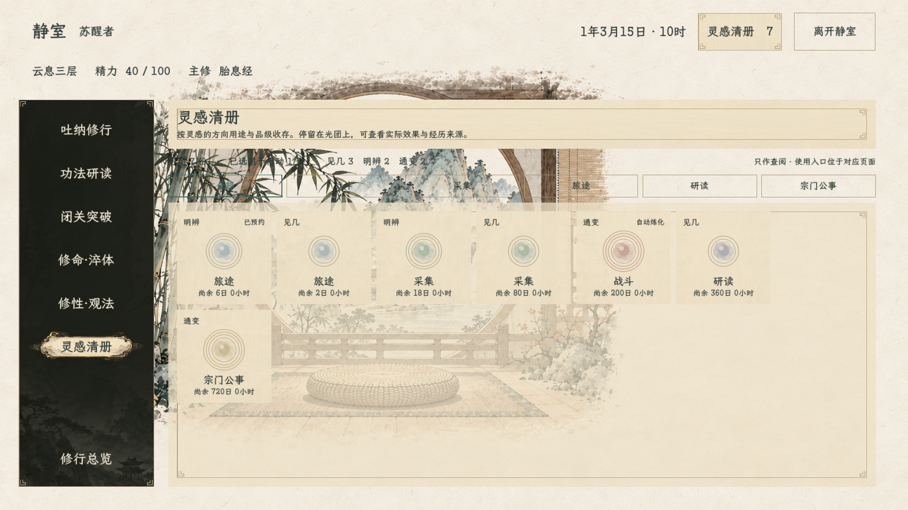
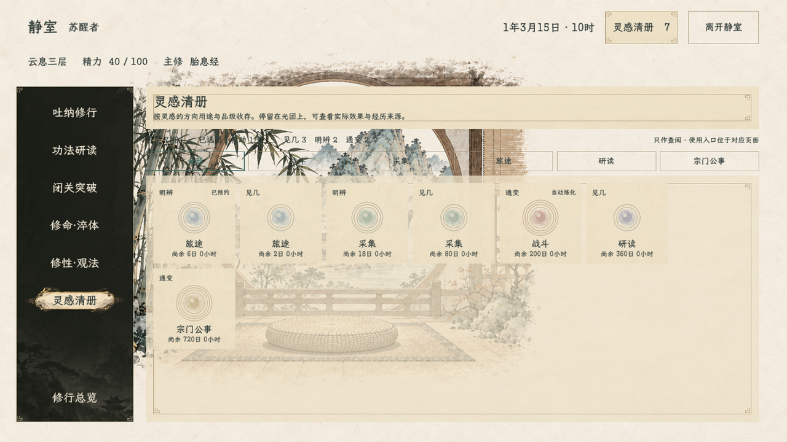
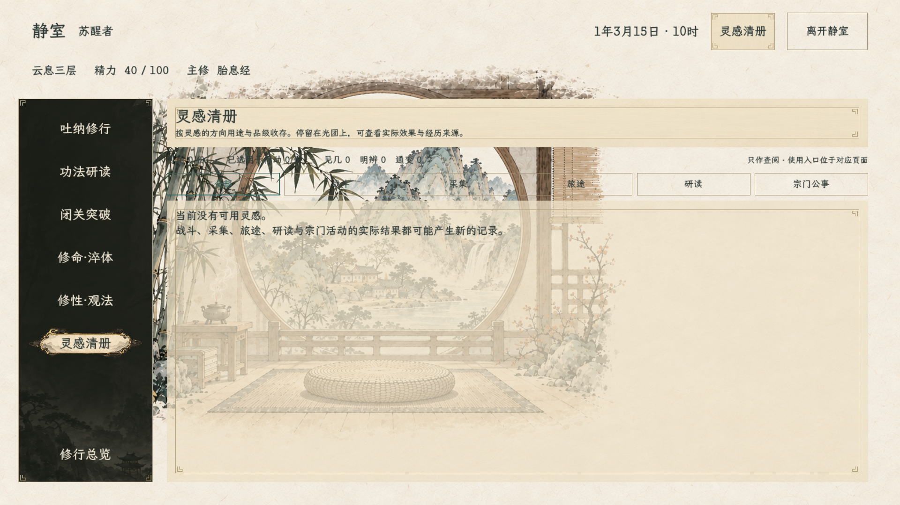
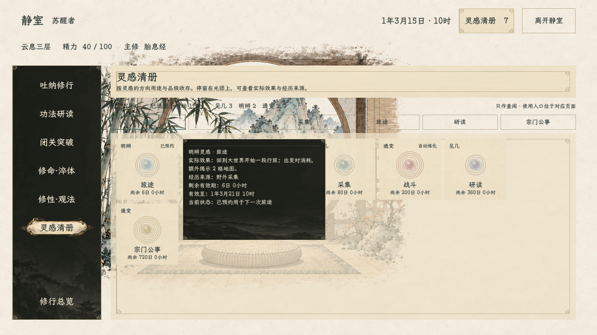
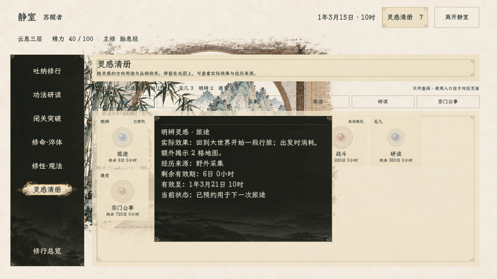

# 灵感清册与抽象光团（2026-10-20）

> 2026-10-24：灵感系统已暂时撤下，本文仅保留历史界面与素材。正式游戏不显示清册入口或活动灵感选择框；以[云息闭环主案](../../plans/人物与修炼/云息期无剧情自由修行与玉虚宗门闭环_20261013.md)的最新裁定为准。

灵感清册沿用静室现有纸墨界面。页面只陈列灵感记录，不在此执行预约、炼化或其他消耗操作；玩家在对应的行动页面使用灵感。

## 展示结构

- 页面主体为可筛选、可滚动的灵感格子，移除记录列表与右侧详情栏。按已预约优先、剩余有效期由近到远排列。
- 格子正面只显示品级、现行用途、剩余有效期，以及已预约／吐纳预留状态；悬停提示再展开实际效果、经历来源、有效期与当前状态。
- 顶部按现行运行时用途筛选：战斗、采集、旅途、研读、宗门公事。来源经历是独立信息，不充当用途分类。
- 当前代码仍使用 `use_domain_id` 表达可强化行动，品级仍为见几、明辨、通变。策划案中尚未接入运行时的方向分类不映射到本页，也不创建新的记录字段或效果。

## 光团规范

光团是静态、抽象的墨色雾团，不包含山水、器物、人物或具体经历画面。五种现行用途以低饱和色和轻微的雾团轮廓差异辨认；品级以一至三重浅色光晕呈现，并在格子上保留“见几／明辨／通变”文字，缩小时仍可读。

颜色沿用静室纸墨中的柔和中间调：战斗为淡赭红，采集为灰玉绿，旅途为青灰蓝，研读为灰紫，宗门公事为旧金。光团不闪烁、不循环动画，不以色相作为唯一识别方式。

## 预览

预览由原生静室场景渲染；临时样例角色只用于展示五种用途、三档品级、到期排序和当前状态，不进入正式存档。

