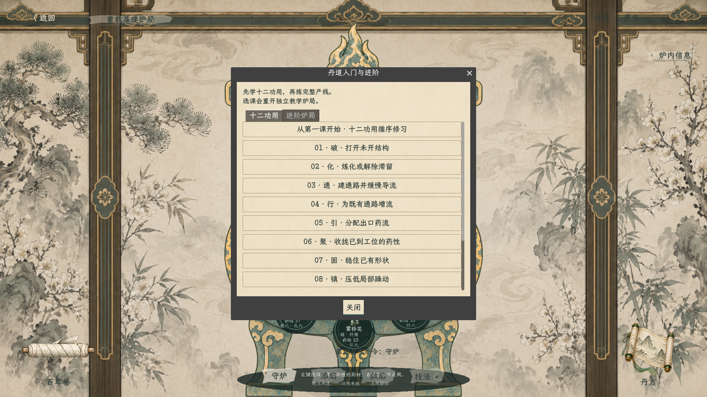
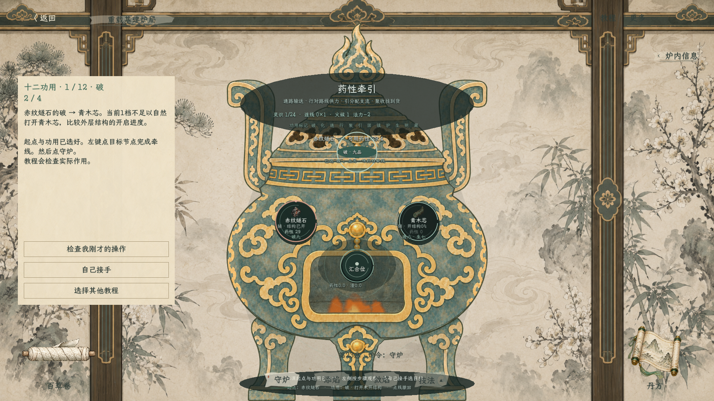
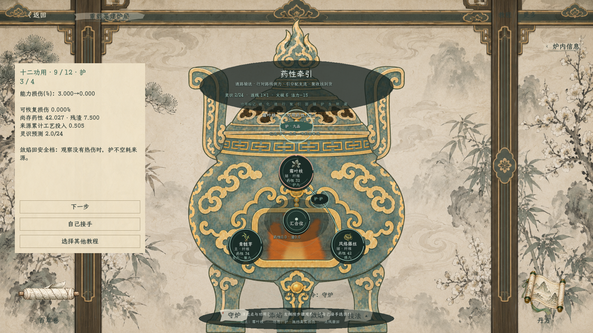
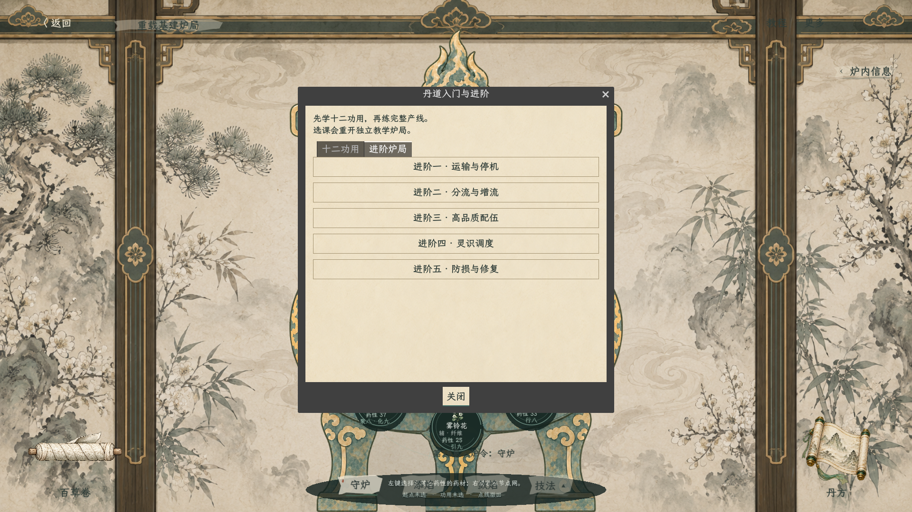
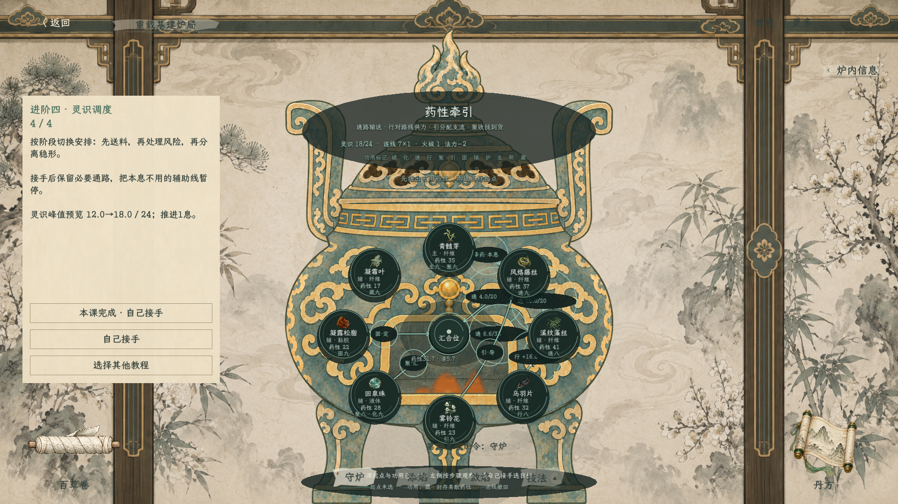

# 炼丹十二功用入门与五课进阶（2026-10-18）

> 最新入口已调整：[第0息第一炉与简化牵线](炼丹第一炉教程与简化牵线_20261018.md)。当前选课页为第一炉／十二功用；旧五课进阶暂不作为玩家入口，文中旧截图和入口描述仅作历史记录。

状态：已接入炼丹测试页右上角“教程”，替代原三课选课页。入口分为“十二功用”和“进阶炉局”两个页签。构建通过，46项模型检查、29项场景／教程检查通过；十二项均有真实作用对照和后续步骤。

规则依据：[逻辑主案](../plans/炼丹系统逻辑主案_20261017.md)、[通行引分工](../plans/炼丹通行引节点网分工修订_20261018.md)、[高品质配伍](../plans/炼丹高品质配伍与基建炉局_20261018.md)。课程展示已实现的作用，不增加材料功用、角色能力或新的资源。

## 一、玩家怎样使用

> 本节已由[十二功用独立实操教程](../plans/炼丹十二功用独立实操教程_20261018.md)覆盖：当前十二课默认从亲手点药材开始，不自动选择起点与功用；行／引／通分别核对指定路线、分支偏向和实际到货。明、藏课后续不再要求分离／隐藏牵药。以下步骤和截图为旧版。

1. 点击右上角“教程”，选择从第一课开始，也可滚动列表单独选一项。
2. 每项四步：看作用来源与目标，运行无功用对照，施用并核对效果，再观察后续边界。
3. 对照会明确重开相同初始教学炉况，避免先后药量差异被误认为功用效果；这是教学选项，不是普通炼丹的回滚手段。
4. 第二步之后可选“按指引亲自试”：起点与功用已选好，玩家左键点目标完成牵线，再下炉令。行选择一段已建通路；引还需要点引线菜单设置不同出口权重；护课按提示添焰，其余按提示守炉。
5. 教程检查真实结算、作用目标和来源投入，检测成功才进入效果页。只签线、未推进，或无真实缺口时，不会被当作施用成功。
6. 也可继续“下一步”看自动对照。“自己接手”保留当前炉况并隐藏教学卡，允许自由修改；选另一课会新开教学炉局。
7. 完成后可直接进入下一项；十二项修毕可选择进阶。选课页“已修”只记录当前会话的课程进度，不授予正式角色书籍技巧、不改变材料能力。

## 二、十二功用的具体安排

按加工到成丹的顺序授课；仍使用原十二项词典，不是新增一套功用。

|课次|功用与真实来源|练习对象与作用|后续要掌握的边界|
|---|---|---|---|
|1|破 · 赤纹燧石|低火下打开青木芯的紧实结构，对照开启进度|开结构不等于已炼出药性|
|2|化 · 月露菌汁|处理凝露松脂的原料，观察药性产生；再解除滞留|解滞不重复取得率；化不代替破|
|3|通 · 风络藤丝|签到汇合位，先建结构，下一息观察缓流|无行也能导流，建成不重复付建设药性|
|4|行 · 乌羽片|对藤丝至藻丝的实际通路供力，比较本息流量|暂停行后通仍缓流；供力不绕过容量限制|
|5|引 · 雾铃花|对藤丝分流节点设置3∶1，再以相同初始炉况对照1∶3|权重受来源、工作量、出口容量与空间约束|
|6|聚 · 回泉珠|收拢已经实际到达中心的药性|不能从远端吸药，不自动生成复杂丹胚|
|7|固 · 凝露松脂|提升已有中心药团的结构稳定|不纠正错配；新流入药性会稀释原有稳定|
|8|镇 · 泥脉石团|压低阴阳药性实际接触后出现的中心躁动|不减少线位与本息操作负担，不修复热伤|
|9|护 · 霜叶枝|添焰到6档前保护最高安全5档的藤丝|事前挡伤，敛焰回安全火候后不空耗保护来源|
|10|生 · 青髓芽|修复先前一次真实过热造成的藤丝能力损伤|不恢复已转渣、逸散或已消耗的质量|
|11|明 · 清音玉片|提高青髓芽药团的显露进度，再配合实际分离|查看已知信息免费；明不等于自动排渣|
|12|藏 · 凝霜叶|比较青髓芽的封存覆盖与实际逸散，再尝试牵药|覆盖部分不能直接流出，已逸散部分不可追回|

各项炉况均由真实材料投料、火候加工与操作准备：镇的躁动来自阴阳真实接触，生的损伤来自实际超安全档位；不直接填损伤、躁动或可用药性。藏课使用实际已有材料的自由药性逸散，不虚构气体材料。

教学卡显示对照指标、当前药性／残渣、封存或结构状态、来源累计工艺投入与灵识预览。图上选择对应起点和功用，沿用左键互动、右键收网；不制作功用图标。

## 三、五课进阶

|课程|要解决的问题|实际练习|
|---|---|---|
|运输与停机|如何看懂供料、通路和到货|两味炉局：基础运输→暂停积料→恢复|
|分流与增流|为什么加速上游还会堵|五味双支路：先看无行缓流，再启用行／引，反向调整权重，观察中继出口瓶颈|
|高品质配伍|多味药怎样真正进入一颗丹|八味炉局：多来源输送、聚合、混匀、分离排渣、固稳形与逐颗评级|
|灵识调度|如何把并行负担压回可控范围|八味炉局：暂停行／引，再停止两项辅药重复送料，随后恢复供力；显示峰值实际变化|
|防损与修复|护与生何时使用，损失能否追回|先过热受伤，再敛焰并生修复；随后重开相同初态，比较事前护住这次热伤|

## 四、实现与验证边界

- 入门十二项均通过无功用与实际施用的指标对照，且完成第三步后续操作；通单独验证新建下一息才运输。
- 保留原13项场景／三课检查，新增十二项入门、两项新进阶，以及两项手动操作检测，共29项；46项模型检查继续通过。
- 手动破课验证签线后经实际守炉触发课程推进；手动引课还验证出口权重不同且真实执行后才推进。
- 已捕获全部十二项作用画面、两页选课、两项新进阶和手动练习画面；正式说明保留代表截图。截图为游戏实际渲染。
- 教学状态不接正式库存、角色历法或课程存档；完整五行制化、复杂丹种仍按当前未完成边界，不以课程存在代表这些机制已完成。
