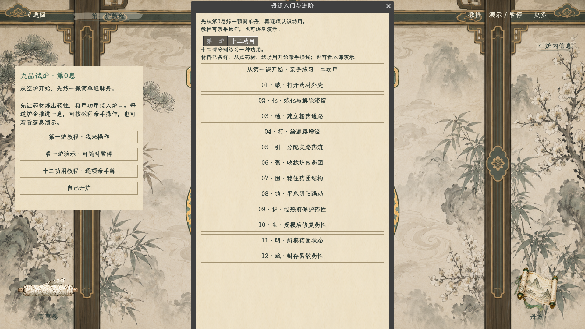
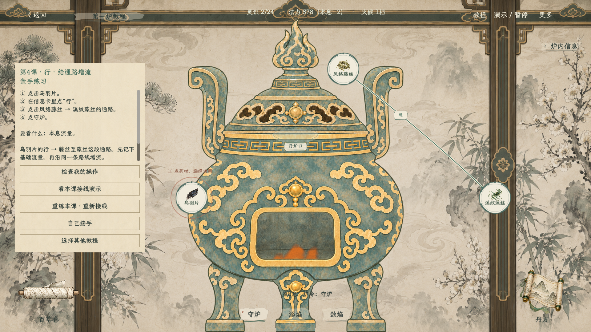
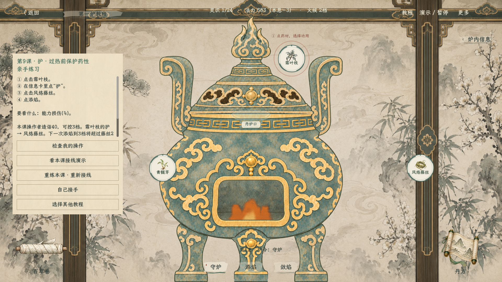
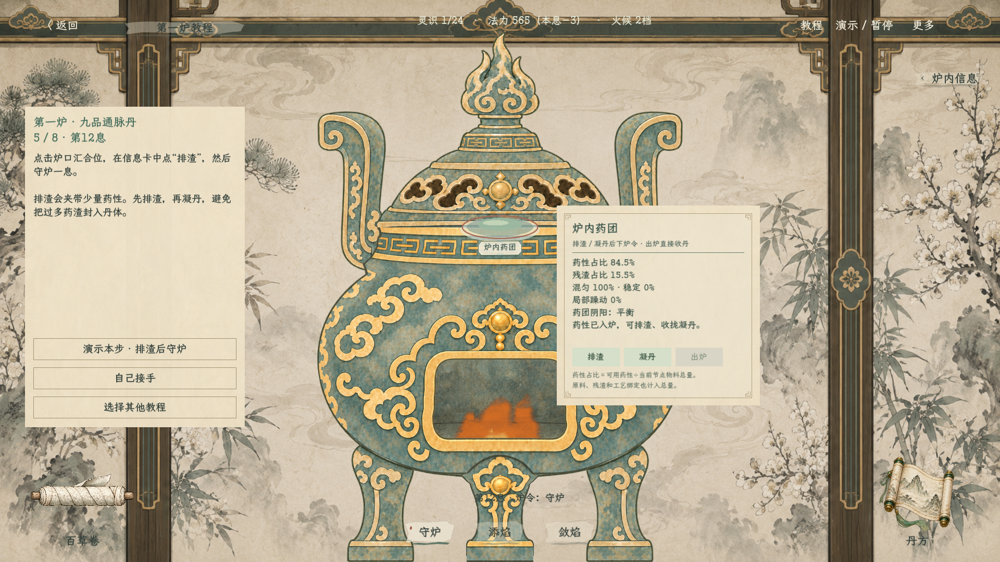
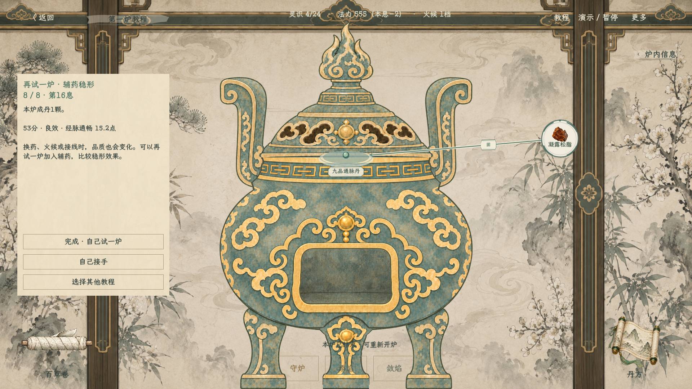

# 炼丹十二功用实操与炉口药团（2026-10-18）

规则见[十二功用独立实操教程](../plans/百工技艺/炼丹/炼丹十二功用独立实操教程_20261018.md)，覆盖旧自动选起点和八角汇合徽章。

侧卡首先显示具体点击步骤和观察目标，内容可滚动；提供检查操作、演示、重练、接手和选课。节点仍只显示图标与名称，临时朱色圈提示当前操作对象，行指向通路。欢迎卡及右上教程页均有入口。

炉口为空时淡椭圆口沿，有药性时为青灰药团和轻雾，凝丹后显示丹丸；不使用金色节点素材。入线终点落在椭圆边缘，名称在下方。详情点击才显示，实色浅纸底保证文字清晰。使用现有绘制接口及素材，不制作功用图标。截图来自游戏实际渲染。

