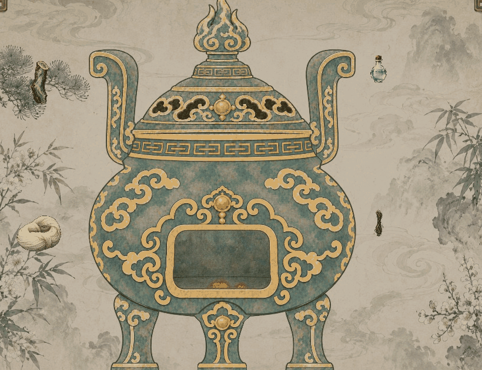

# 炼丹演出节奏优化

2026-11-06，已接入现行炼丹界面。规则依据[炼丹完整结算与正式接入](../../plans/百工技艺/炼丹/炼丹完整结算与正式接入_20261023.md)及其散丹鉴看、通用领取修订；本轮只调整呈现。

## 最新修订：药材柔和融入

用户反馈材料吸入略僵硬，本次只修改投料融入。药材先轻抬，再沿缓起的弧线牵入，靠近炉口时有小幅回旋；各味有轻微时差。末段保留部分体积，从轮廓边缘逐渐化开为原素材颜色的淡墨细雾与少量碎屑，尾迹继续汇入开口并消散。轨迹首尾平滑，取消突然起步以及末段主要靠整体缩到小点的做法。

动图仅展示本次融入段，从1280×720实机中裁出炉前区域，不放大，约20帧／秒；循环首尾增加短暂停留。可对照[轻抬与牵入](材料轻抬.png)、[轮廓化开](材料化开.png)。其他流程仍使用下方现用细长瓶及隐藏界面版本。

`AlchemyIngredientFlow`只控制飞行、局部形变、轮廓柔化与淡墨绘制；颜色直接采样当前药材图，不产生新资源或状态。位图保持原样，无额外发光。所有材质节点随飞行副本一并清理，跳过仍直达同一已提交结果的领取。

编译0警告0错误；10种流程156项通过，新增药材化开中途跳过，并将炉火跳过检查改为等待实际投料结束；原生与8帧／秒完整流程各18项通过。已查看实机投料、中段牵入及最后化开画面，无运行或着色器错误；仍有既有技能UID回退提示。日志和高频原始帧在`tmp/alchemy-animation-20261106/revision3/`。

## 当前修订：现用细长瓶与演出隐藏界面

本次按用户反馈更换开口瓶和瓶塞的呈现来源：全部从当前1×2格细长瓷瓶`textures/items/inventory_density_20261029/pill_container_empty_porcelain.png`直接分层取样。瓶身保留原像素与比例，木塞沿原位置落回，开口、封口和行囊外观一致；不再切到旧圆肚开口瓶或旧瓷塞。标定写在容器定义中，蓝色颈带和品质刻点也按现用瓶颈位置校准。没有生成或覆盖现有物品位图。

成功开炉后，暂时隐藏周围投料、用度、顶部资源、教程与配方入口；只保留丹炉、投料／成品、跳过及确认按钮。完整与简洁模式都收起周围界面，待领取结束后仅恢复原来可见的控件，原来关闭的弹层保持关闭。预检失败不会隐藏界面。

本次9种流程139项通过，包含实际隐藏与恢复、当前瓶图引用、各阶段跳过、真实扣料及领取；原生与8帧／秒完整流程各18项通过。运行没有新增错误，仍有既有技能UID回退提示。

## 实际效果

动图取自本机 Godot 图形窗口的完整流程，使用隔离人物与真实材料：青木清露方、丹道造诣18、灵识24。原始画面1280×720；动图缩至960×540并调色压缩，游戏内动画连续运行。鉴看和领取的停留由验收驱动自动确认。

| 画面 | 调整 |
| --- | --- |
| [投料入炉](投料入炉.png) | 飞行副本沿用原药位图像尺寸，先靠近炉口，再做收缩旋入；收敛绕行幅度、转动与末段淡出。淡墨旋流增加浓淡和边缘渐隐，复用绘制缓冲。 |
| [炉内炼化](炉内炼化.png) | 直接驱动既有炉身内火焰，升火、维持、收火连续衔接；移除从未显示的额外火焰层。 |
| [散丹鉴看](散丹鉴看.png) | 丹药以中心为轴从炉口小幅升出，沿曲线减速落定；暗场平滑过渡，修正首帧全尺寸闪现。按主案恢复每颗飞行0.95秒、间隔1.05秒。 |
| [并行装瓶](并行装瓶.png) | 各瓶先轻移淡入，再同时收纳对应丹效的丹药；保留标定瓶口、最后18%淡出与丹效分组。 |
| [瓶塞封口](瓶塞封口.png) | 各瓶塞同时加速落下、轻微转正，随后切换正式闭瓶外观。 |

普通炉火和旋流继续使用透明混合；本轮没有新增全屏发光、大字提示或判定。评分、产量、投料、精力、游戏耗时和领取事务沿用原逻辑。简洁模式直接进入评分排序后的鉴看；各阶段跳过直接进入通用领取。

## 验收

- 编译0警告、0错误。
- `tools/AlchemyAnimationSmoke.tscn`使用隔离人物实际扣料和领取。完整流程、投料／炉火／出丹／鉴看／装瓶／封口六阶段跳过、简洁展示与预检拒绝，共9种场景、139项检查通过。
- 检查内容包括一次扣料、精力与历法、逐颗评分及简洁排序、飞行副本与补间清理、领取前不入包、领取后各档数量和界面恢复。
- 原生图形窗口完整流程18项通过，已查看投料、炼化、散丹、装瓶和封口画面。额外限制8帧／秒的完整流程18项通过。
- 抓帧时复现了旧等待逻辑使用现实时间、低帧率下提前进入下一步的问题；现改为与补间一致的帧计时，消除阶段抢跑。
- 运行仍有既有`卸力.tres`脚本UID回退警告；本轮没有运行错误或着色器错误。未重跑炼丹数值全量回归，未读写玩家旅程。

第一轮130项记录与[旧瓶动图](炼丹动画预览.gif)仅作历史；现用瓶、隐藏界面及139项记录为上一轮版本，日志在`tmp/alchemy-animation-20261106/revision2/`。本次材料柔和融入、156项及最新画面以上方“最新修订”为准。
