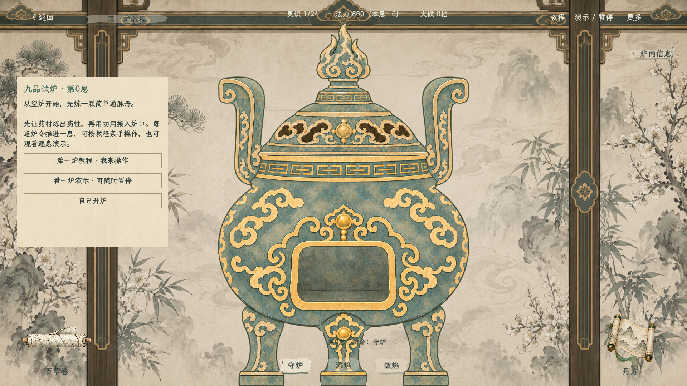
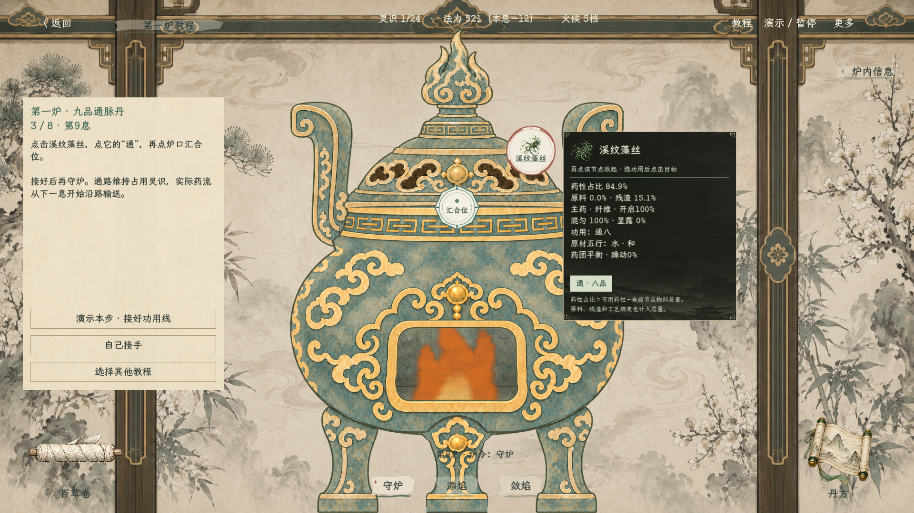
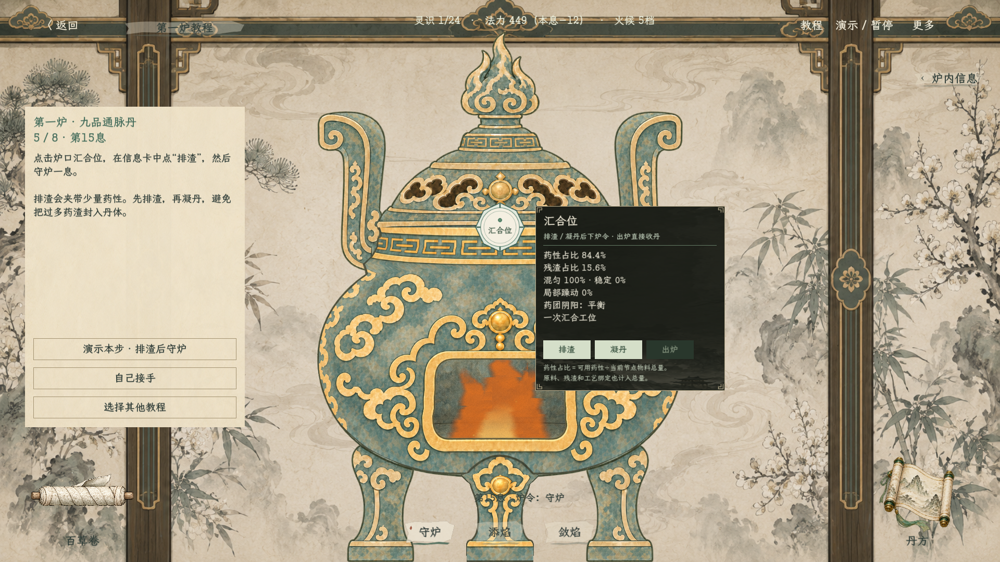
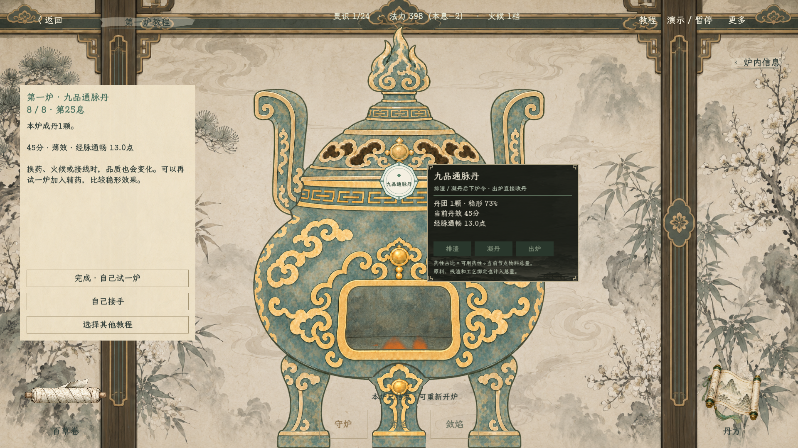
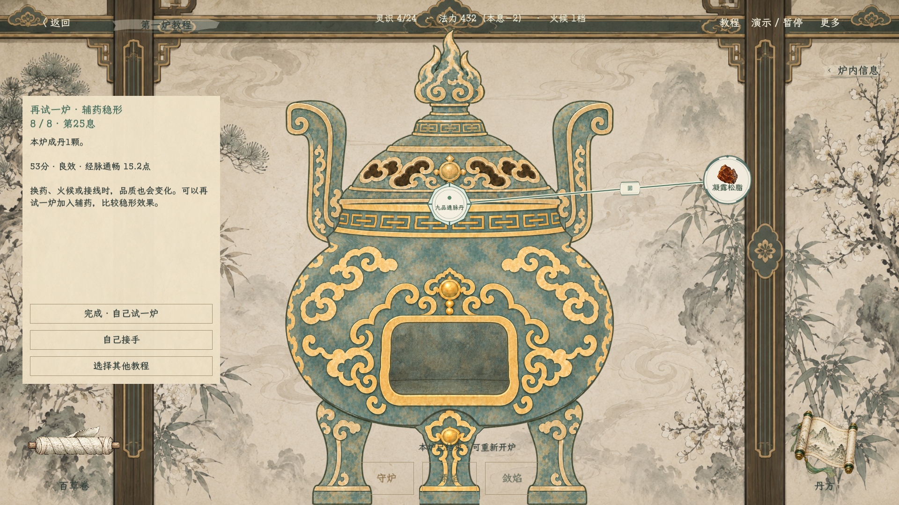

# 炼丹第一炉教程与简化牵线（2026-10-18）

当前入口改为第0息空炉。左侧欢迎卡直接进入教程、演示或自由开炉；顶部也可打开教程和演示／暂停，不再自动载入预加工15息炉局。

> 火候分档已后续修订：造诣36最高2档，材料窗口同步调整，两课当前为19息／16息成丹。本文截图保留修订前视觉记录，截图中的火候、息数和法力不作为现行数值；现行值见下方基础炉务规则。

## 如何开始

1. “第一炉教程”从溪纹藻丝简炼通脉丹开始，可按文字亲手投药、控火和接线，也可点“演示本步”观察同一操作。
2. “看一炉演示”逐息执行同一流程；再点“演示／暂停”停在当前炉况，可自行接手。
3. 普通画面不再提供技法菜单、快捷技法或书籍学习入口。基础排渣、凝丹、出炉放在炉口点击信息卡里。
4. 接线为点击药材、选择功用、点击目标；选中后有鼠标虚线预览，接成后随炉令按需工作。点线只保留用途、状态、停用／恢复和拆除，不再打开数值表。
5. 单味课实测45分；加入松脂的稳形课实测53分。两课都由实际材料与基础炉务结算，品质不是教程固定奖励。

规则与真实演算见[九品基础炉务与第一炉教程](../plans/炼丹九品基础炉务与第一炉教程_20261018.md)。构建、55项模型与53项场景／交互检查通过。

