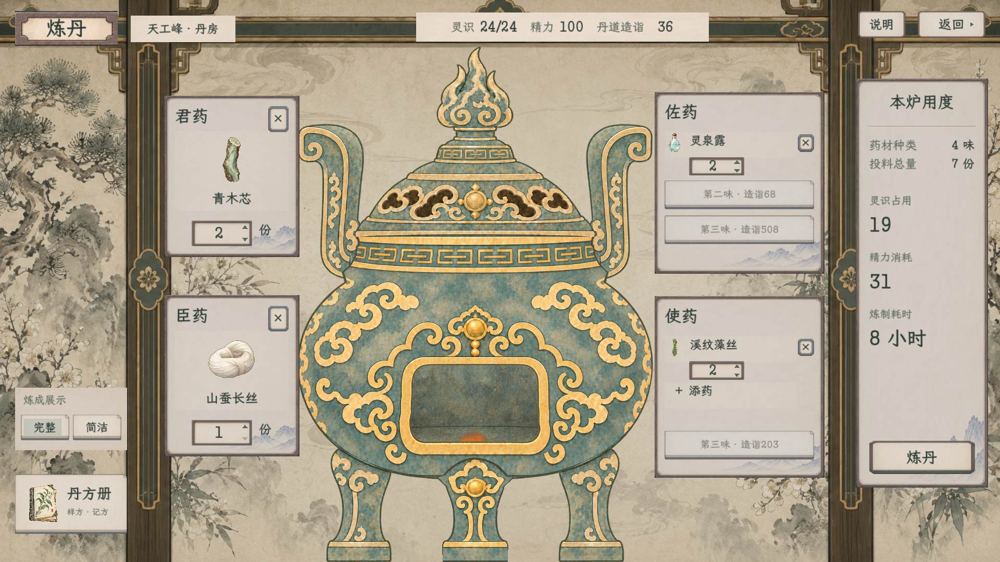

# 炼丹纸墨木石：正式接入

2026-11-09：按用户新反馈，分割线统一为普通细直线，撤去中央花纹。已刷新本目录两档原生画面并完成复验，记录见[本次修订](直线分割修订_20261109.json)。

2026-11-08，已按用户批准接入原生游戏。入口：玉虚仙宗·天工峰·丹房。原网页继续独立保留，不承载游戏数据。

[接入范围](../../plans/界面与美术/炼丹纸墨木石原生接入_20261108.md) · [原已确认样稿](../炼丹纸墨木石样稿_20261108/README.md) · [生产素材来源](../../../textures/ui/crafting_paper_20261108/sources.json)

| 原生画面 | 1920×1080 | 1280×720 |
| --- | --- | --- |
| 常用配伍 | [完整图](alchemy_paper_main_1920.png) | [完整图](alchemy_paper_main_1280.png) |
| 拣药 | [完整图](alchemy_paper_picker_1920.png) | [完整图](alchemy_paper_picker_1280.png) |
| 丹方册 | [完整图](alchemy_paper_notebook_1920.png) | [完整图](alchemy_paper_notebook_1280.png) |
| 佐使各三味 | [完整图](alchemy_paper_full_eight_1920.png) | [完整图](alchemy_paper_full_eight_1280.png) |

图片来自真正的Godot控件和Viewport，使用隔离人物检查，没有用网页画面代替。48味材料、25份内置样方和原我的丹方保存保留；真实投料、精力、历法、炉火演出和领取流程继续原链路。第三味开放后药签326高，不压缩字号与操作。

编译0警告0错误；两档原生UI共268项通过，另有真实事务集成48项、记方10项、完整／简洁演出各18项通过。记录与日志保存在本目录；既有《卸力》UID回退警告保留，无新运行错误。所有测试使用独立APPDATA与内存人物，未读写玩家旅程。
