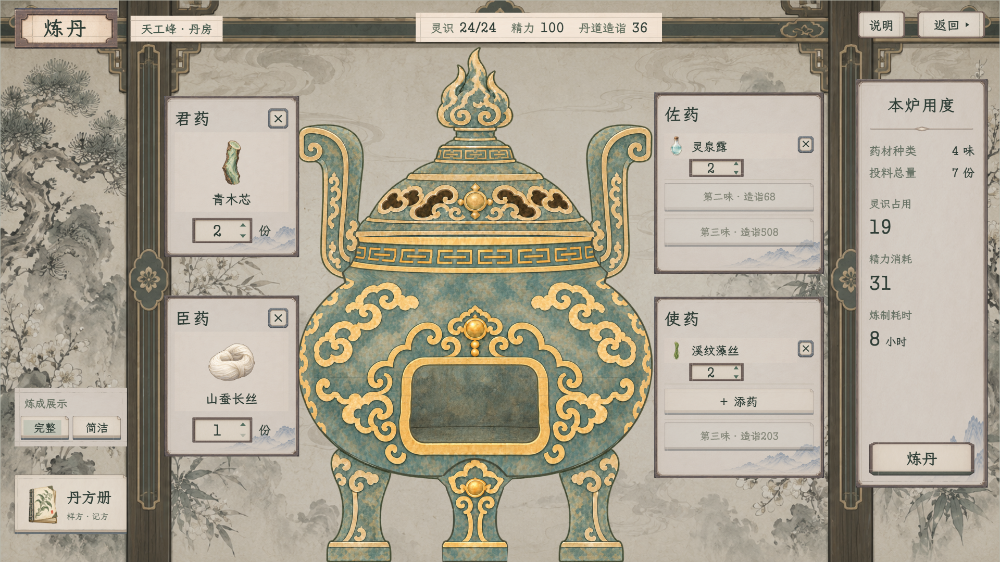

# 炼丹 · 围炉配伍样稿

最新状态：用户已批准并完成原生接入，见[正式游戏图集与验收](../炼丹纸墨木石实装_20261108/README.md)。本目录网页仍是隔离样稿；下文“未接入”属于该网页首版交付记录。

2026-11-08，当前待用户验收，**未接入游戏**。见闻当前版本先保留，本轮先做炼丹操作页的公共控件统一，炼器等本页验收后再继续。

[打开可操作样稿](index.html) · [本轮范围](../../plans/界面与美术/炼丹纸墨木石样稿_20261108.md) · [浏览器验收](验收记录.json) · [素材来源](素材来源.json) · [真实材料与样方夹具](示例数据.json)

本地入口：[查看与操作](http://127.0.0.1:8876/docs/美术规范/炼丹纸墨木石样稿_20261108/index.html)。

保留原丹房、原丹炉和君臣佐使四组围炉布局。药签与右侧用度换成低亮度纸面与细木压边，按钮依用途分型；右上角沿用“返回 ▸”。顶部状态切换是样稿查看工具，不属于游戏画面。

佐使各三味已实填核对：开放第三味后，药签由304增高到326，保留字体和按钮大小，第三行留足内边距；移除／补回药材时保持三行高度。顶部“扩展药位”可直接查看这一状态，只是布局夹具，不是新增丹方。见[两组局部](炼丹_佐使满配_局部.png)、[1920完整图](炼丹_佐使满配_完整图_1920.png)、[1280完整图](炼丹_佐使各三味_1280.png)和[20项专项核对](佐使满配验收.json)。

| 画面 | 1920×1080 | 1280×720 |
| --- | --- | --- |
| 常用配伍 | [完整图](炼丹_配伍_1920.png) | [完整图](炼丹_配伍_1280.png) |
| 扩展药位 | [完整图](炼丹_扩展药位_1920.png) | [完整图](炼丹_扩展药位_1280.png) |
| 拣药与筛选 | [完整图](炼丹_拣药_1920.png) | [完整图](炼丹_拣药_1280.png) |
| 丹方册 | [完整图](炼丹_丹方册_1920.png) | [完整图](炼丹_丹方册_1280.png) |
| 空炉 | [完整图](炼丹_空炉_1920.png) | [完整图](炼丹_空炉_1280.png) |

[本炉用度阅读层](炼丹_本炉用度_1280.png)

可换药、移除、增减整数份数，按五行／阴阳／功用及本位有效筛选；同材不能重复占位。丹方册提供三份现行样方，载入只填配伍；我的丹方可题名、覆盖或删除，仅在本页内存演示，刷新即复位。

默认青木清露方读取现行材料数据，4味7份，灵识19、精力31、8小时；灵识按整炉取整，未沿用旧截图。造诣36、灵识24／24、精力100来自当前独立试演常量，不代表玩家状态。未知库存不编造，炼前不预报成品、颗数、品质或丹效。

丹炉直接引用v13前后素材，按原88个三角和脚底锚点显示静态外观，不改变PNG。此页未移植真实火焰与演出；完整／简洁只切换选择状态。“炼丹”仅展开用度供验收，不扣料、不消耗精力、不推进时间、不生成丹药或调用领取。

全部图片是实际浏览器画面。没有调用人物库存、旅程存档或浏览器持久存储，没有修改当前游戏、原炼器／炼丹页、共享PNG或已确认样稿。

本轮1920×1080与1280×720共49项检查通过，12张完整截图已保存；23份图像／字体素材与夹具来源均已核对。覆盖药位、份数、资源不足、筛选空状态、同材禁选、丹方载入／记方／删除确认、返回、未知资料和刷新复位；控制台与资源加载无异常。具体结果见验收记录。
