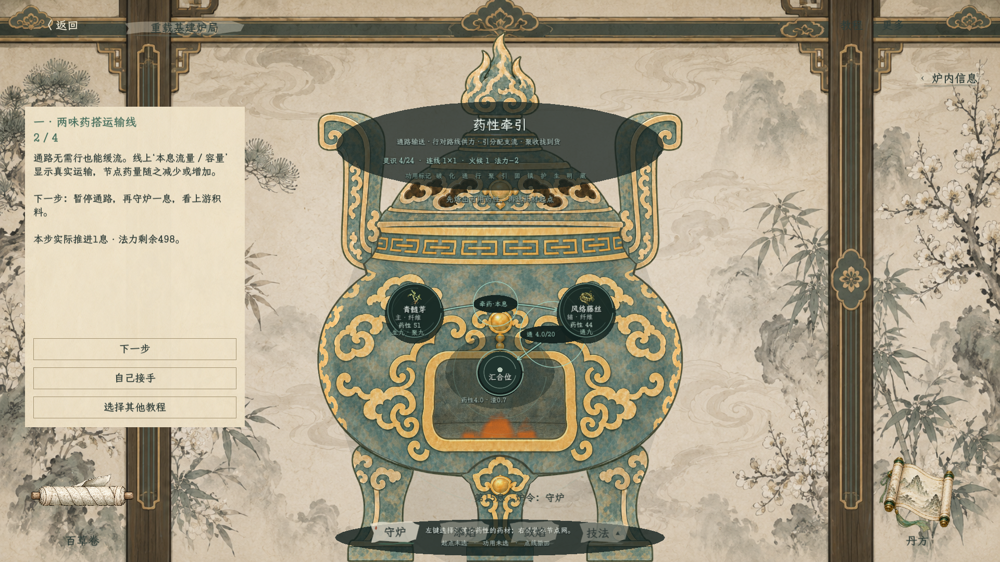
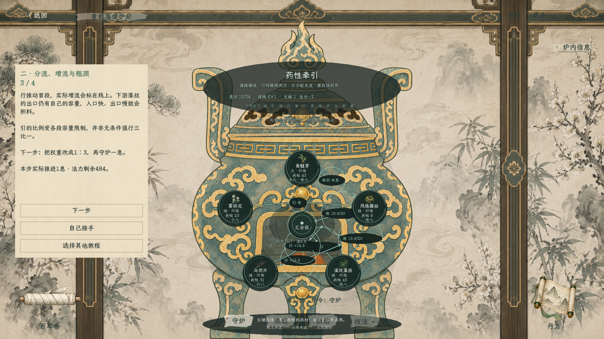
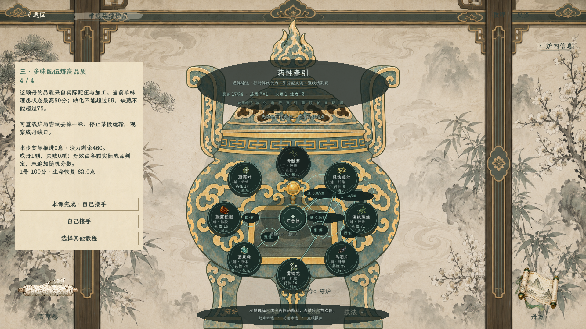

# 炼丹节点网三课教程（2026-10-18）

> 后续已扩展为[十二功用入门与五课进阶](炼丹十二功用入门与五课进阶_20261018.md)。本文保留前三课说明和早期截图；当前选课页及最新验证以新记录为准。

已接入炼丹测试页右上角“教程”。每课独立载入实际准备的炉局，左侧显示四步教学卡；“下一步”按说明实际执行炉令、停流、启用供力或调整分支。“自己接手”保留当前炉况。选课会重开教学炉局，不修改正式行囊或存档。

## 第一课：两味药搭运输线

青髓芽提供主药，风络藤丝提供通。

1. 看清“主药→基本牵药→藤丝→通路→汇合位”。牵药是安排的灵识操作，不代表主药拥有通。
2. 下一步守炉一息，观察通路基础缓流及药量变化。
3. 下一步暂停通路并守炉，观察上游继续到料、下游停止收货。
4. 下一步恢复通路并守炉，再接手自己控制。

## 第二课：分流、增流与瓶颈

五味药：青髓芽、风络藤丝、溪纹藻丝、乌羽片、雾铃花。藤丝分成直汇与中继两支；同一行来源分别向两段通路供力，各自付实际投入与灵识负担。

1. 初始暂停行和引，先守炉观察基础流量。
2. 下一步启用行与引，以3∶1出口权重推进，比较供力后的流量。
3. 下一步反向调整为1∶3并推进；实际流量仍受来源、容量、空间与引的覆盖工作量限制。
4. 接手后点引线修改权重、点行线暂停供力，比较中继积料与出口能力。

## 第三课：多味配伍炼高品质

八味完整炉局沿用[高品质配伍与基建炉局](../plans/百工技艺/炼丹/炼丹高品质配伍与基建炉局_20261018.md)。

1. 查看各来源的岗位：主药生、回泉珠化、凝霜叶藏，松脂在中心施固；通、行、引负责组织流转，聚收拢已到达药性。
2. 下一步连续守炉三息，观察多来源实际流入。
3. 下一步继续运行至主药到量，再混匀、分离排渣并开始分丹；画面保留实际加工后的状态。
4. 下一步在成品条件达标后出炉。出炉不额外推进一息，因此该步可能显示推进0息。

## 验证范围

构建通过；46项模型检查与13项场景／教程检查通过。新增覆盖第一课运输、暂停与恢复，第二课实际增流及反向权重安排，第三课逐步完成真实高品质成丹。八味标准演示为29息、100分、剩余法力460；替换材料或接手改变操作后，结果按实际炉况重新计算。

上述三张为实际游戏画面截图，未用概念图代替。完整五行制化、复杂丹种及正式角色资源仍沿用现行未完成边界。
