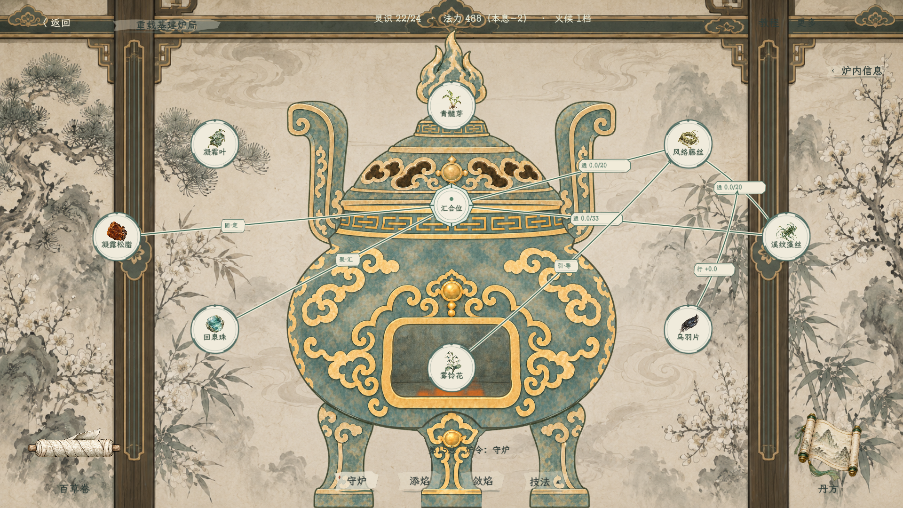
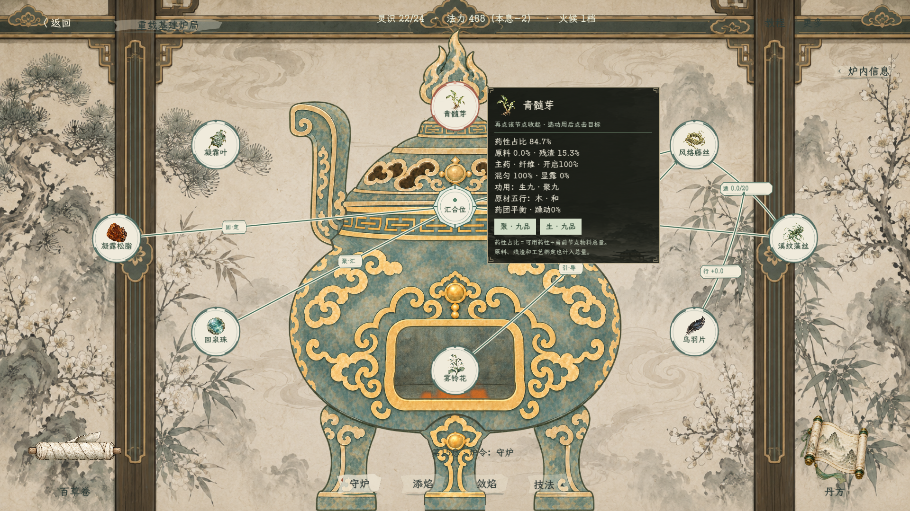

# 炼丹节点自由布局与浅纸连线（2026-10-18）

> 当前入口与操作进一步简化：[第0息第一炉教程](炼丹第一炉教程与简化牵线_20261018.md)。撤去技法与书籍入口，基础炉务位于炉口点击卡；签成的功用线默认按需工作，线路弹窗不再提供数值配置。

## 最新用户裁定（覆盖此前右侧常驻说明与悬停显示）

> 炉口外观后续已修订：[药雾、药团与丹丸](炼丹十二功用实操与炉口药团_20261018.md)。移除八角汇合徽章，改用贴合炉口的椭圆药雾和状态图形；点击卡使用实色浅纸底，保留仅点击显示和炉口锚定。

- 撤掉“药性牵引”标题、常驻十二功用总览、常驻起点／功用选择和操作说明。顶部仅显示灵识、法力、本息耗法力、整数火候；其余信息按点击查看。
- 保留正常丹炉外观和动态火焰。汇合点锁定在丹炉口，按炉图当前尺寸计算口沿锚点，不能拖离炉口。节点网展开／收起时从这一锚点伸展／回收，药材拖动后的布局重开时仍从炉口展开。
- 节点网控件占视口宽97%、高80%，药材可在这一大范围内重新摆放，不再被旧窄图框限制。教程仅为左侧步骤卡保留空间，不新增右侧文字栏。
- 不加整块暗框背景。药材节点内只显示图标与名称；汇合节点只显示工位图形与名称。
- 悬停不显示信息卡。点击节点显示节点旁的纸墨信息卡，再点该节点收起。信息卡内查看药性、加工状态、五行阴阳，并点击材料实际具备的功用按钮，再点击目标节点／已有通路牵线。全部十二功用不再作为常驻总览。
- 只有信息卡内的按钮接收相应点击；其余卡片部分不阻挡下方节点操作。右键收网时卡片一并关闭。
- 药材拖动超过6屏幕像素才视为移动，不误触签线、不推进息数、不占额外灵识。同炉刷新、炉令结算、关闭重开保留布局；“更多→整理节点布局”重排。

## 连线语义补正

节点网上的线只表达材料原表中的十二功用，功用名取实际签线记录。原型曾把基本“牵药”安排画成“牵药·本息”伪线，这不是第十三种功用，现已删除该图面表示。正式规则仍允许的基础搬运只在本息操作清单／炉记查看和撤回，不把它改名为“通”，也不授予没有通功用的材料建路能力。

## 药性百分比

“药性占比 XX.X%”＝当前节点可用药性量÷节点现存物料总量。分母包括未炼原料、自由药性、残渣与工艺绑定；空节点为0%。原料／残渣同样按现存总量显示占比。该数字描述药团组成，不代表丹药品质或累计炼化进度；内部来源账与数量结算不改。开启、混匀、显露、稳定等进度也明确显示百分号。

## 耗尽退场

用户确认“彻底耗尽才消失；未炼完或仍在进料的节点保留”。对应实现与五行阴阳边界见[规则记录](../plans/百工技艺/炼丹/炼丹节点退场与五行阴阳接入边界_20261018.md)。汇合位始终保留在炉口。

## 节点与线素材

`textures/ui/alchemy_nodes_20261018/`：`material_node.svg`（浅纸墨青）、`selected_node.svg`（陶朱选中）、`confluence_node.svg`（汇合八角）、`line_label.svg`（功用／流量底签）。透明外围的矢量素材随画面缩放；不制作功用图标。线有深墨青线、浅纸衬边和箭头，选中为陶朱。未开启结构在药材节点外侧显示，随实际开启进度消退。

## 验证

构建0错误、0警告；51项模型检查和47项场景／交互检查通过。覆盖炉口锚定、全幅范围、仅点击卡片、卡内功用签线、布局保持、真实加工及运输后节点消失、空料中继保留、空环不误保留、耗尽释放灵识及来源账守恒。八味炉局仍真实成丹100分。

已查看本机实际渲染的炉局及点击信息卡。图形运行器退出仍有此前存在的纹理回收告警，本轮未改渲染器。

