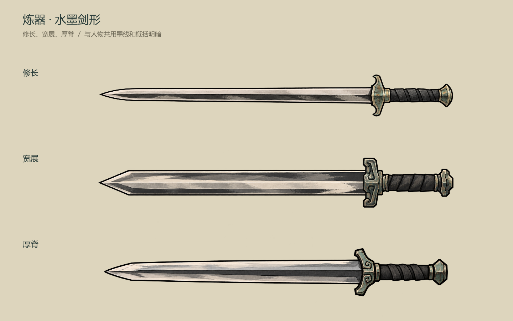
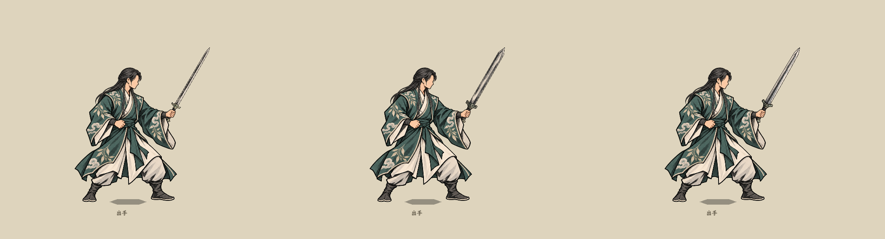

# 炼器剑图标重绘

2026-10-23。按当前[材料与过程量驱动炼器主案](../../plans/百工技艺/炼器/材料与过程量驱动炼器设计_20261022.md)查看器形来源后重画三种剑形。采用人物现行简化水墨风格：黑色轮廓、概括刃面与墨灰阴影、象牙白亮边，护手保留低饱和青铜与青绿。减少细碎金属纹理与装饰，不加常驻泛光。

## 图标与持剑实录

[深色背景对照](sword_icons_dark.png)；[阔剑镜像实录](mirrored_broad.png)。全部素材由内置图像生成工具生成，再进行透明背景清理编辑；原始输出为2048×768 RGBA。浅深背景实录使用Godot正常透明混合显示。

## 素材与定位

| 外观 | 透明素材 | 握点UV | 剑尖UV |
| --- | --- | --- | --- |
| 修长 | [slender_sword.png](../../../textures/ui/forged_swords_20261023_v1/slender_sword.png) | (0.874, 0.512) | (0.024, 0.505) |
| 宽展 | [broad_sword.png](../../../textures/ui/forged_swords_20261023_v1/broad_sword.png) | (0.866, 0.521) | (0.023, 0.522) |
| 厚脊 | [spined_sword.png](../../../textures/ui/forged_swords_20261023_v1/spined_sword.png) | (0.854, 0.551) | (0.037, 0.549) |

剑尖向左、握柄向右，使用时围绕真实握点旋转。原图画布不裁边，人物握姿与地面锚点沿用[持剑待机接口](../可换剑图持剑待机_20261022/README.md)，不重新绘制人物。各剑握点到剑尖统一显示为780人物原图单位。

完整[生成提示词与参考图记录](../../../textures/ui/forged_swords_20261023_v1/generation_prompts.json)。风格参考为男修碧岚云叶袍持剑待机图。

## 接入范围

- 当前炼器成器、器物册、悬停及详情共用的`ForgedArtifactPresentation.IconPath`改用此批剑图。
- 水墨特效实验室 → **动作·持剑待机**的三种剑图同步替换；下拉框仍显示细剑／阔剑／脊剑。
- 沿用既有外观选择：形态文字含“厚脊”优先选厚脊图，其次“宽展”，其余选修长图。不增加预选器形、配方、属性或品阶判定，不修改炼器结算。
- 历史旧炼器场景及其旧图保留；本轮未接入正式装备自动换图，也未新增持剑攻击姿势。

已编译，并用实际游戏预览录制三剑、镜像和浅深背景对照。本轮未新增或运行自动化测试；美术观感待用户评审。
