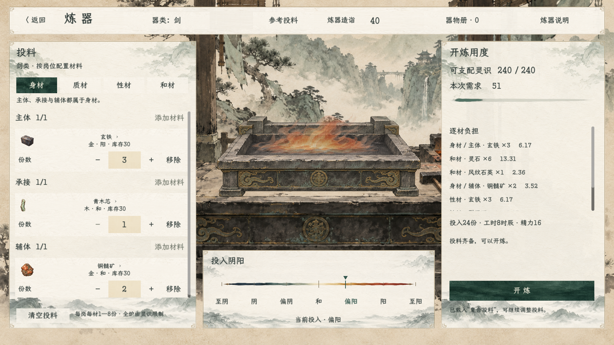

# 炼器原界面与炉火演出

> 本日后续：用户明确反馈旧白／乳白底晃眼、控件难分，现已按[底色分层](../炼器底色分层_20261108/README.md)调整当前炼器页的背景。字体、纹理和布局继续沿用原版；下文像素差0及四文件哈希保持为原样复用阶段的历史验收，不代表新颜色仍要与旧白底相同。

2026-11-08。用户明确要求风格也沿用原来。此前浏览器预览重新排版并使用替代字体，没有做到原样复用；本轮改为直接实例化游戏内`ProcessForgingScene`，顶部、两侧与阴阳区都使用原控件。旧网页样稿只保留历史，不作为原界面风格依据。

[完整原生演出](原界面炉火演出.gif) · [材料入炉](03_材料入炉.png) · [凝形](04_凝形成器.png) · [定器](05_定器.png) · [返回原界面](06_返回原界面.png)

## 原样复用阶段的范围

直接调用原来的投料、开炼用度和阴阳构建，不重新定义字体、字级、按钮、纸面、九宫格边距或边角线。沿用原`LXGWZhenKaiSlabGB-Regular.ttf`、`QuietRoomStyle`、`ForgingInkStyle`及1672×941设计画布的等比缩放。`ProcessForgingScene.Workspace.cs`和两份样式代码、字体原文件的SHA256均保持。

新增演出层只占中央，使用上轮空炉、炉沿遮挡及连续炉火材质；保留每秒12次关键姿态过渡和随渲染帧更新的流动。开炼时隐藏原页面，收火显示真实模型算出的器物，再恢复同一页面。当前没有选火、来源或品阶入口。

当前为[独立原生预览场景](../../../tscn/scene/ForgingOriginalStylePreview.tscn)。预览拒绝绑定人物，只调用现有模型读取结果，不调用人物开炼或独立会话提交；材料、器物册、尝试次数、工时和精力记账保持。正式人物的开炼事务尚未接入该演出。

## 原样一致性验收

同一原生页面先关闭中央演出层采集[原版基准](01_原界面基准.png)，再打开演出层及播放后返回，逐像素比较以下区域。

| 区域 | 加入炉火后最大RGBA差 | 演出后返回最大RGBA差 |
| --- | --- | --- |
| 顶部 | 0 | 0 |
| 左侧投料 | 0 | 0 |
| 右侧开炼用度 | 0 | 0 |
| 投入阴阳 | 0 | 0 |

[完整像素检查](像素一致性检查.json)。PNG采集为2560×1440，未压缩改变颜色；动图只作1280×720录屏导出，字体与颜色的精确对照以PNG及像素报告为准。

编译0警告、0错误；[原生演出6项检查](原生预览验证.log)通过，覆盖隐藏原页面、跳过、返回、自然完成以及材料／器物／记账不变。[原有炼器工作区15项回归](原工作区回归.log)通过，正常页面仍使用原控件和开炼规则。运行中保留原有《卸力》UID路径回退提示，无新增脚本或着色器错误。
