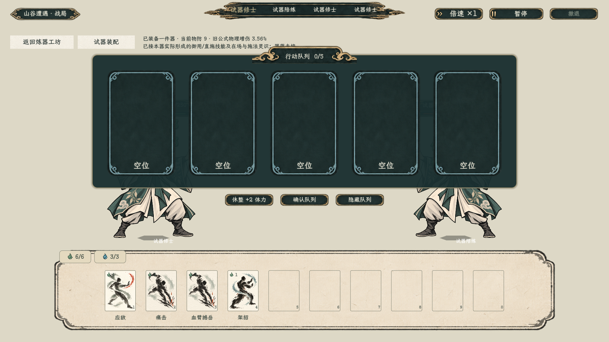

# 炼器对练入口

操作：进入炼器试炼，投入材料开炼，或打开器物册已有成器；详情上方点击“装备试用 · 进入对练”。战斗中点“试器装配”，装备/卸下或选化法目标后，点击重开应用；点“返回炼器工坊”恢复原成器详情。

当前可测基础物防、旧公式物伤加成和单技能化法。未启用普通攻击借本体锋锐；御用、临时灵识、器蕴和条件词条尚未接通。没有正式存档写入。

[接入方案及测试参数](../../plans/炼器装备对练接入_20261023.md)。[运行日志](运行.log)记录端到端断言结果与资源告警，不将其称为无错误通过。

