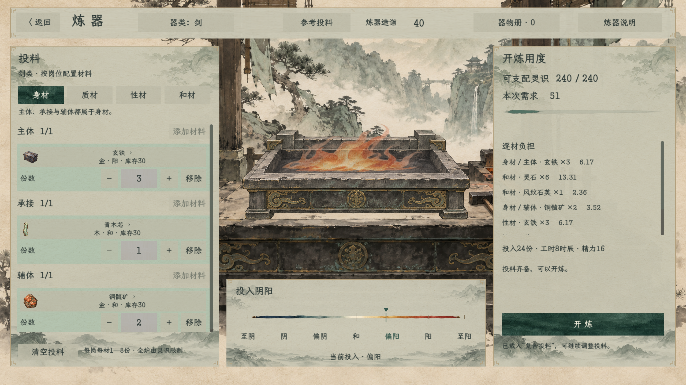

# 炼器底色分层

2026-11-08。按用户反馈降低大片白／乳白纸底的亮度，并区分主面板、材料块、数量框与普通按钮。沿用原游戏控件、字体、素材和布局。[当前规则与范围](../../plans/百工技艺/炼器/炼器界面底色分层与低亮度调整_20261108.md)。

本日后续按用户要求收减常驻说明：删除“每岗每材1—8份 · 全炉由灵识限制”、重复的剑类／岗位解释、默认配料／载入提示及“投料齐备”文案，材料列表增高80设计单位。限制由数量框悬停与“炼器说明”承载，真实缺项、资源不足和结算通知保留。[当前普通炼器页](03_文案精简.png) · [15项回归通过](文案精简回归.log)。编译仍为0警告0错误。

[调整前](01_调整前.png) · [底色与字形取样](底色与字形检查.json)

主面板采用灰米色，材料条目采用灰青色，数量框是灰棕色，普通按钮压为灰褐；选中页签和开炼按钮仍使用原深绿色。纸纹、山纹、角线和控件尺寸保持。只改背景StyleBox，不给整个控件染色，原物品图和文字保持本色。

原生2560×1440截图的固定背景点取样：

| 部位 | 调整前RGB | 调整后RGB | 该点线性亮度下降 |
| --- | --- | --- | --- |
| 主面板 | 244,240,228 | 201,198,177 | 35.8% |
| 材料块 | 247,242,234 | 178,193,173 | 43.3% |
| 数量框 | 240,228,203 | 182,180,174 | 41.7% |
| 普通按钮 | 247,243,234 | 187,188,169 | 45.0% |

数值描述取样点，不等于整页平均亮度或所有显示器上的体感。对应背景点与主要墨色的对比为5.60～6.74；标题三个取样区共637个实心墨色像素均在原位置保持。原字体文件及`QuietRoomStyle.cs`哈希一致。

编译0警告0错误；[原工作区15项](原工作区回归.log)与[原生演出6项](原生演出检查.log)均通过，覆盖选材筛选、数量、灵识限制、跳过、返回及资源记账不变。本轮运行无脚本／着色器错误；出现既有《卸力》UID回退和外观部件缺失提示，与本页底色无关。

底色已经用于当前炼器页面；炉火仍是独立只读预览，没有接人物实际开炼事务。其他系统的公共纸色未随之修改。
