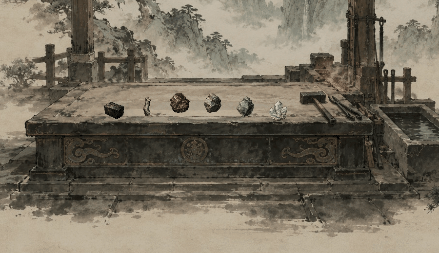
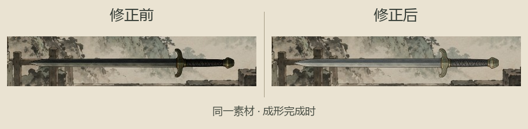

# 炼器演出样片

2026-11-06，独立可回放样片；尚未接正式开炼。完整设计、时段和事务边界见[炼器演出设计](../../plans/百工技艺/炼器/炼器演出设计与样片_20261106.md)。

最新修订：成器颜色被重复乘色压暗，现已修正。成形材质在片元阶段重复将纹理乘入已有纹理色，导致金属灰与透明边缘同时变深；改为只乘顶点传来的节点着色。原位图、器形、结算数据和演出时段保持。冷却完成后，保留现用物品图的金属本色。

三种剑形均进行了原图／成形材质的真实GPU对照，正常显示和半透明染色各一组，共6组；有效像素RGBA最大差均为0。8帧／秒的跳过、重播及自然完成7项仍通过。最新采集在`tmp/forging-animation-20261106/revision3/`，检查日志为`color.log`、`native.log`及`playback.log`。

当前修订：材料先轻抬、缓起牵入，在器坯不同位置逐渐化开。坯影采用多层灰褐薄洗，并连续延展；真实器形从中段向两端凝出，和坯影交叠收敛。末段缓缓抬起、转正。材料颜色取自现用素材，保留金属炼合的观感。

材料聚拢 → 炼合成坯影 → 实际器形渐显 → 收敛冷却 → 抬起定器。背景使用当前水墨工坊；成品使用既有模型算出的现用行囊图，样片本次为修长薄脊剑、法器。显示的器形、名称与器阶没有人为指定。

| 分镜 | 画面 |
| --- | --- |
| 投料 | [六种实际样方材料在台面聚拢](01_投料.png) |
| 炼合 | [坯影、局部暖色和少量碎点](02_炼合.png) |
| 显形 | [沿器身方向逐步显出](03_显形.png) |
| 收敛 | [退回金属本色](04_收敛.png) |
| 定器 | [抬起、稳定后显示真实名称与器阶](05_定器.png) |

原生窗口1280×720，当前动图裁取案台附近900×520区域，不放大，约20帧／秒并调色压缩；颜色对照以GPU检查及PNG为准。可在`tscn/scene/ForgingAnimationPreview.tscn`运行、重播和跳过；没有人物绑定，不扣材料、发器物或写旅程。尚未给正式炼器加入动画，也未扩展失败判定。[首版全景](炼器演出样片.gif)与[本色修正前](炼器材料柔和融入.gif)仅保留作历史。

编译0警告0错误，原生完整采集与8帧／秒回放正常。材料化开、器形凝出两时点的实际跳过与重播、自然完成及同一实例检查共7项通过；炼丹完整流程18项回归通过。最新运行无绘制或着色器错误，现有《卸力》资源UID回退提示保持。日志和原始帧在`tmp/forging-animation-20261106/revision2/`，以`native-final.log`、`playback-final.log`为准。
