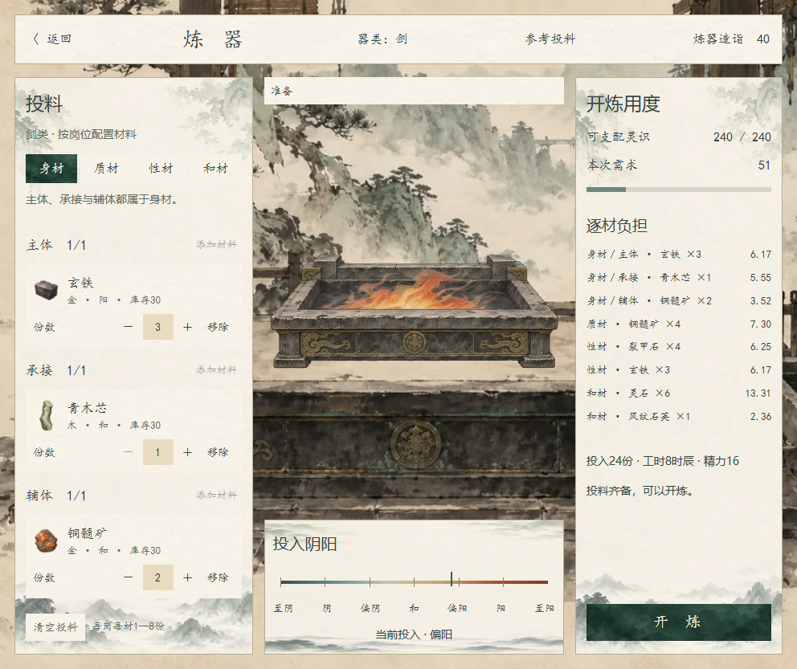
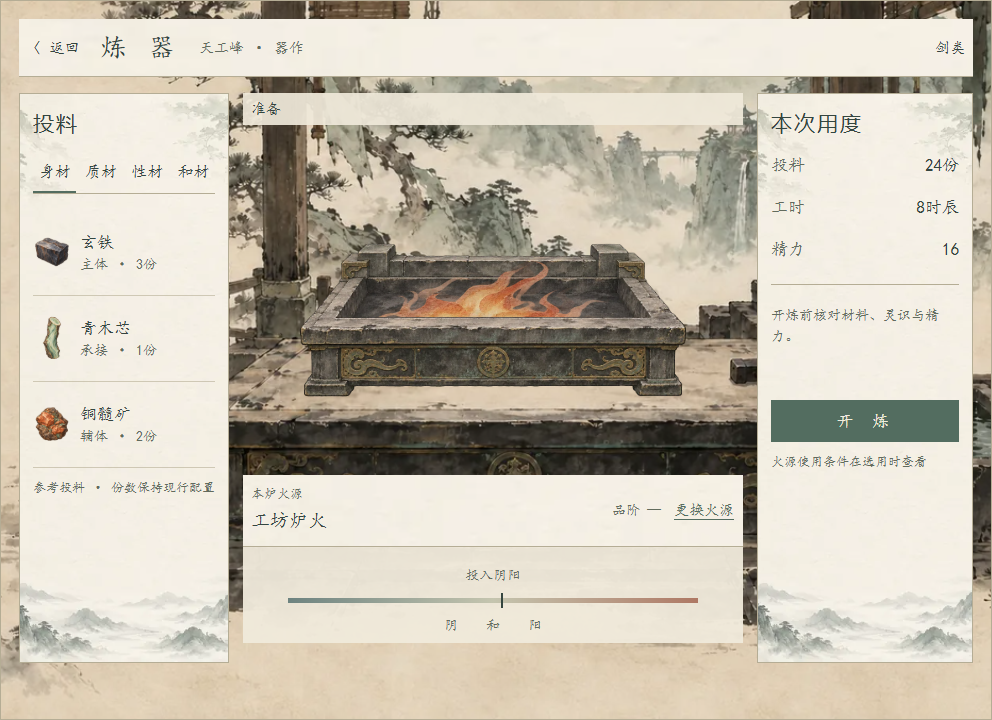

# 炼器火源分层素材

> 2026-11-08最新：用户指出风格也应完全沿用原版，现已改用[真正的原生控件及像素对照](../炼器原界面与炉火演出_20261108/README.md)。本页素材继续使用，但下方网页重排不是原样复用的依据。

## 上一轮网页预览：原功能与流畅炉火（风格已由原生复用覆盖）

用户最新要求保留原来的两侧UI，当前没有其他火，暂不处理火源类型。新版预览恢复原炼器的投料岗位、份数操作、灵识及逐材负担、用度和七档阴阳轴；移除选火、来源、品阶和两种布局比较。当前只用这一套暖色火，不增加新的火种或规则。

[演出中收起两侧](07_连续炉火演出.png) · [窄窗](08_原UI窄窗.png)

四张原始关键姿态仍保留；基础循环资源由6调为12帧／秒，新流动材质在姿态之间连续插值并让焰舌持续摆动，根部固定。浏览器逐帧绘制，实测约60帧／秒，连续采样48次均有不同画面；这不表示重新生成了48张原画。两帧先预乘alpha再插值，避免黑边和双图叠加时的明暗跳动。

10项浏览器检查通过，覆盖原样方灵识51、24份／8时辰／16精力、份数编辑、岗位标题、类型入口移除、火焰逐帧变化、演出收起与返回恢复。无脚本运行错误；采样检查产生一条Canvas像素读回性能提示，仅来自检查代码。新增原生流动材质供后续场景使用，尚未接入或验收正式Godot演出。

1024、736、320宽窗口检查通过，实际内容992、704、288，无横向溢出或按钮越界。原生流动着色器另在隔离Godot小场景实际渲染：OpenGL Compatibility加载3个uniform、导出384×256透明火焰且退出码0，无着色器错误。[原生材质画面](09_原生流动材质.png) · [运行记录](原生流动材质验证.log)。该检查验证材质，不代表正式炼器场景已接入。

## 首轮素材生成

2026-11-07。按用户“生成素材，和原有的一样精致”的要求，以现有`textures/ui/forging_20261021/ink_workshop.png`为参照，使用内置image_gen生成。保留原工坊的水墨、细石材、旧铜与克制暖火；不为火源新增品阶名、数值或消耗。

## 素材清单

| 素材 | 原图 | 用途 |
| --- | --- | --- |
| [透明空炉](../../../textures/ui/forging_fire_20261107/hearth_empty_v1.png) | 1536×1024，RGBA | 完整炉体，空膛，无固定火色 |
| [暖色火焰四帧](../../../textures/ui/forging_fire_20261107/flame_amber_loop_2x2_v1.png) | 1536×1024，RGBA | 2×2序列，每帧768×512；同一种火的四个姿态 |
| [无火工坊底图](../../../textures/ui/forging_fire_20261107/workshop_unlit_v1.png) | 1672×941，RGB | 去掉右后方固定橙火，保留工坊和案台 |
| [炉沿前景资源](../../../textures/ui/forging_fire_20261107/hearth_foreground_v1.tres) | 引用空炉原图 | 取原图`(0,540,1536,484)`，用于遮挡火根与进入炉内的材料 |
| [火焰循环资源](../../../textures/ui/forging_fire_20261107/flame_amber_loop_v1.tres) | 引用四帧原图 | 按左上、右上、左下、右下顺序读取，现为12帧／秒 |
| [连续流动材质](../../../textures/ui/forging_fire_20261107/flame_amber_flow_v2.tres) | [流动着色器](../../../shaders/forging_flame_flow.gdshader) | 完整图集上连续取样，12次姿态过渡／秒；motion_enabled可关闭动态 |

PNG原图完整保留生成的透明通道，未改画、抠色或覆盖旧素材。[完整提示词与生成来源](生成记录.json)。

## 叠放与状态

从后向前为：无火工坊、空炉、火焰及炼合材料、炉沿前景。前景资源在空炉原图左上角基础上向下偏移540原像素，再与炉体使用相同比例；不能把裁片放回原点。火焰用普通透明混合，避免整张图叠加发亮。成器抬出后保持真实物品图颜色。

连续流动材质用于承载完整2×2图集的TextureRect／Sprite2D，UV须为0—1；不与已经裁切帧图集的AnimatedSprite2D叠用。它直接读取独立的flame_atlas并只乘一次顶点着色，防止再次将图像颜色重复相乘。

四帧均为同一种暖色火，不代表四个等级，也不暗示自带火种高于工坊炉火。火源体系仍按[界面提案](../../plans/百工技艺/炼器/炼器火源与界面扩展方案_20261107.md)留待定案。

## 首轮叠放预览与检查（历史）

[投料与火焰](02_素材叠放投料.png) · [炼合凝形](03_素材叠放凝形.png) · [收火成器](04_素材叠放成器.png) · [窄窗素材预览](05_素材窄窗.png)

三张PNG尺寸、格式及透明通道已检查；两张透明图alpha范围为0～254。浏览器草案已使用本批图，确认图像解码、炉沿遮挡、自然收火、成器本色及返回投料正常，未出现黑底或透明边缘光圈。预览中的缩略图另作压缩，项目PNG保持原始分辨率。

换图后另检查320宽窗口（内容288）：无横向溢出，关键按钮和炉体均在边界内，图片和文字可见；浏览器无运行错误，脚本语法检查通过。宽窗口中炉体相对案台固定，收起面板或进入成器时不再随布局抬离台面。

上述画面是浏览器内的分层预览，不是Godot实机。原正式炼器、既有独立演出样片、人物持有和存档均未切换；本批资源尚待正式场景接入。
