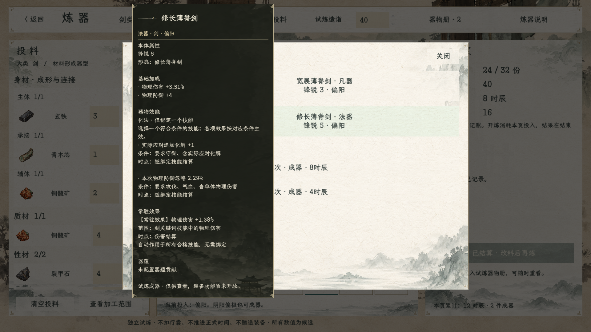
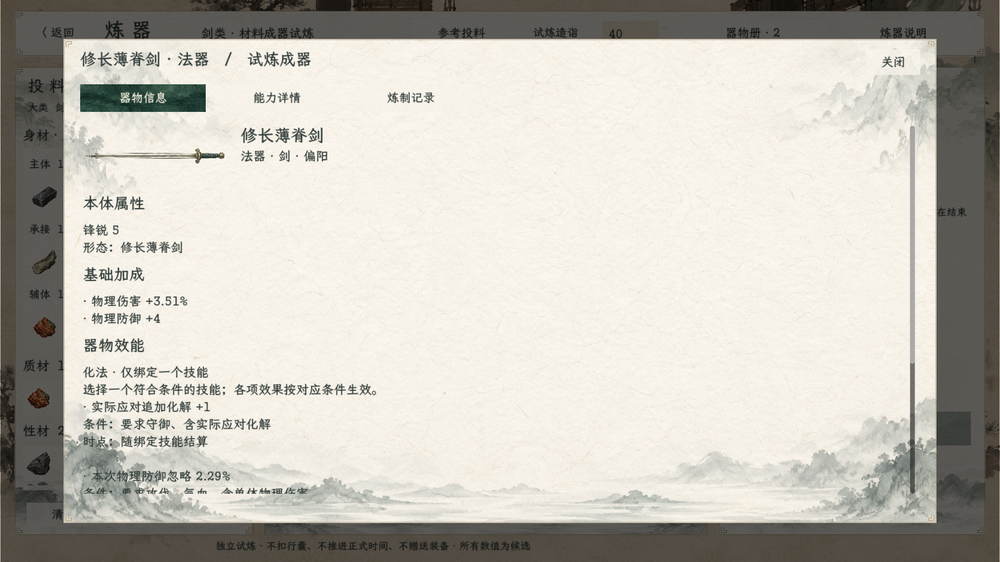

# 炼器物品展示验收

2026-10-22。现行范围见[实施说明](../../plans/炼器成器物品展示实施_20261022.md)。入口仍为首页试演或百工法宝页的炼器工坊，投料成器后查看详情，也可打开“器物册”悬停条目。

器物册与成器详情使用已有水墨剑图。统一信息栏展示实际实例的数据，其他能力同时说明生效范围、时点和绑定条件，避免把剑关键词收益误读为全部伤害加成。长信息沿用共用物品详情卡的滚动规则。

最新文案：锋锐仅显示数值；“其他能力”标题改为“器物效能”。化法集中展示为单一区块，标明“仅绑定一个技能”，每项保留自身条件，不再反复提示选择技能。详情页、能力页与悬停同步。

## 验证结果

- .NET 编译成功，0警告、0错误。
- 炼器场景自动验收1473项通过：原公式、四套投料、库存及快照检查保持通过；新增凡器/法器图标、实例名称/品阶/锋锐、悬停显示和切换、关闭清理、详情一致、无装备/对练按钮及反复查看不二次扣料检查。
- 已查看运行截图；成器页、器物册和共享信息栏均有实际图标，齐边宣纸与原水墨背景保持一致。
- 独立开发试器回归41项通过，确认撤下工坊入口没有破坏保留的测试后端；其退出日志仍有既有纹理/ObjectDB资源回收提示，未将此记为零警告。炼器物品展示场景本轮日志无该退出提示。
- 正式器物槽、装备入口、行囊写入和存档未接入。本次未改战斗卡、炼制公式、平衡参数或新增材料。尚未进行人工鼠标试玩。

完整场景结果见[运行记录](运行记录.md)和[运行日志](运行验收.log)。此前单器战斗后端保留独立开发测试，不作为当前炼器物品展示的操作入口。
