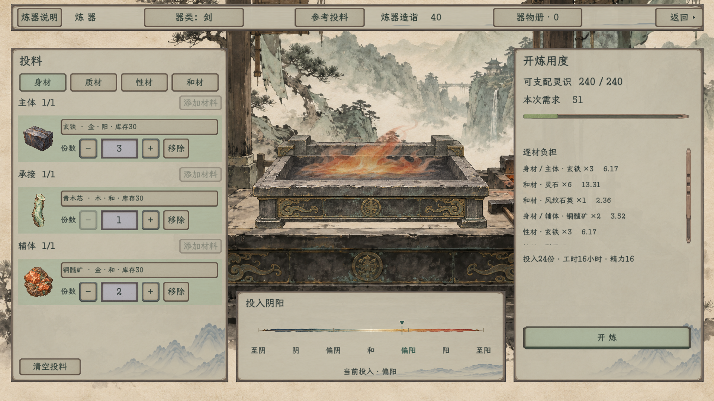

# 炼器纸墨木石独立样稿

2026-11-09：按用户新反馈，分割线统一为普通细直线，撤去中央花纹。已刷新本目录两档原生画面并完成复验，记录见[本次修订](直线分割修订_20261109.json)。

2026-11-08。[当前主案](../../plans/界面与美术/炼器纸墨木石样稿_20261108.md)。已按用户最新反馈修订材料卡和按钮：左侧大图标跨两行，右侧一行资料，份数紧接在右侧下行；顶栏、添加、移除、清空与分类普通操作统一同一种纸面。选中对整张原纸轻染色，去掉中央方形深底；按下时整纸略沉、下移1单位，文字保持深墨。尚未替换游戏内炼器。

顶栏标题、造诣标签、数值及全部按钮统一22字号、46行高、同一位置垂直居中；横条收为1624×62，内部上下各8单位，返回仍固定全局右上(1534,18)。不再保留原先34／19／23混排或返回高出一截。

## 完整图

| 页面 | 1920×1080 | 1280×720 |
| --- | --- | --- |
| 身材／整体 | [查看](炼器_主界面_1920.png) | [查看](炼器_主界面_1280.png) |
| 质材 | [查看](炼器_质材_1920.png) | [查看](炼器_质材_1280.png) |
| 性材 | [查看](炼器_性材_1920.png) | [查看](炼器_性材_1280.png) |
| 和材 | [查看](炼器_和材_1920.png) | [查看](炼器_和材_1280.png) |
| 原生选材窗 | [查看](炼器_选材_1920.png) | [查看](炼器_选材_1280.png) |
| 器物册 | [查看](炼器_器物册_1920.png) | [查看](炼器_器物册_1280.png) |
| 说明 | [查看](炼器_说明_1920.png) | [查看](炼器_说明_1280.png) |
| 只读炉火定器 | [查看](炼器_炉火定器_1920.png) | [查看](炼器_炉火定器_1280.png) |
| 按钮悬停 | [查看](炼器_按钮悬停_1920.png) | [查看](炼器_按钮悬停_1280.png) |
| 按钮按下 | [查看](炼器_按钮按下_1920.png) | [查看](炼器_按钮按下_1280.png) |

## 操作与边界

独立场景：[ForgingPaperPreview.tscn](../../../tscn/scene/ForgingPaperPreview.tscn)。包装只作用于这个实例，复用实际 ProcessForgingScene 和原只读炉火接口；原工坊、炉台、字体、各区尺寸、灰米／灰青／灰褐底色保持。普通按钮、材料纸页、输入、弹窗与滚动复用已确认的生产PNG。大材料图标仍是项目原有物品图，没有另生成图标或改PNG。

点击图标与材料资料均打开原选材，份数减／输入／加／移除沿原回调；四组切换、说明与器物册可操作。查看和预演不绑定人物、不扣库存、不登记成器或消耗工时／精力。240灵识和造诣40等来自原独立参考投料，只作看图样例。右上返回只收起样稿，可继续查看。

未修改任何 ProcessForgingScene 原文件、ForgingSurfacePalette、模型、参数或正式场景，10份开始时哈希复核完全相同，见[源码边界](源码边界核对.json)。共享纸墨组件显式应用于本实例，没有修改全局QuietRoomStyle或已批准保留的页面。

## 验证

编译0警告0错误。1920与1280各233项原生验证通过，共466项：检查大图跨行、资料一行完整、数量右置、顶栏材质一致、全部文字同字号同行高同位置、所有投料组及按钮五态均为无中央染色的原纸；用原生鼠标事件检查大图选材、份数加减、悬停与按住／松开、切页、弹窗、开炼只读演出、跳过及返回。演出前后库存、成器数、记录、时间和精力账目保持。

记录：[1280](验收记录_1280.json)、[1920](验收记录_1920.json)、[编译](编译.log)。日志只有既有卸力资源UID回退提示，未见运行错误。两档20张图从固定尺寸Godot SubViewport直接渲染，测试事件也送入该原生视口，避免系统窗口恢复尺寸或真实桌面鼠标干扰；未重画画面。

可复查入口：[ForgingPaperUiSmoke.tscn](../../../tools/ForgingPaperUiSmoke.tscn)，参数 `--forge-paper-width=1280|1920 --forge-paper-output=res://output/forging-paper-native/对应目录`；运行时APPDATA应隔离于项目output内，不读取玩家存档。
