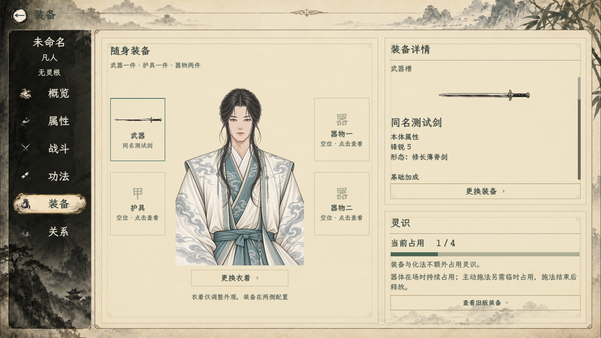

# 炼成剑通用适配验收

入口：正式行囊点剑器→装备，或人物装备页→武器→选择实例；人物战斗页手动将本器实际形成的御用/直施入口放入技能位置。试炼成器可通过“装备试用·进入对练”使用共用适配器，不写正式物品。

- [通用适配51项](运行.log)：四套真实投料＋专用御器测试，含其他占用、临时峰值、释放、保存读回。
- [装备页截图运行](界面.log)：52项断言通过，退出有纹理回收告警。
- [原运行态检查](ArtifactBattleRuntimeSmoke.log)：27项通过。
- [宗门兑换回归](SectEquipmentSmoke.log)：零价与独立实例、存档读回通过。
- [行囊回归](行囊回归.log)：47项通过，包含新剑器的装备按钮与装备/卸下，未跑本次跨进程读档分支。
- [实际对练入口](对练入口.log)：功能断言通过，退出资源回收告警保留。

截图中的“同名测试剑”为隔离人物持有的专用能力配置，非玩家存档、非正式平衡；灵识1为专用测试设定的其他占用，不是装备维系费。

