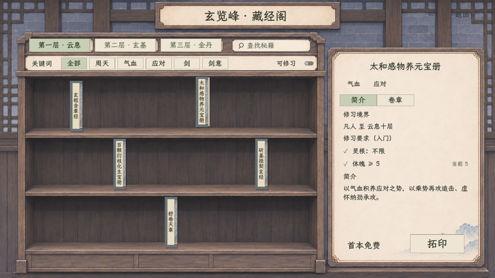
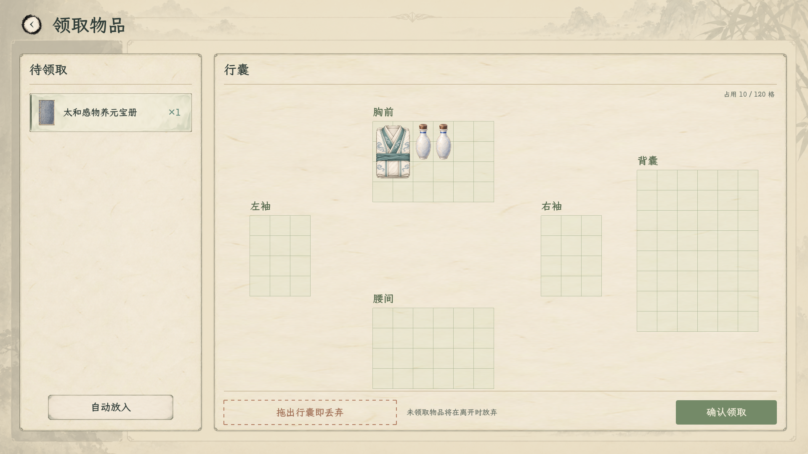
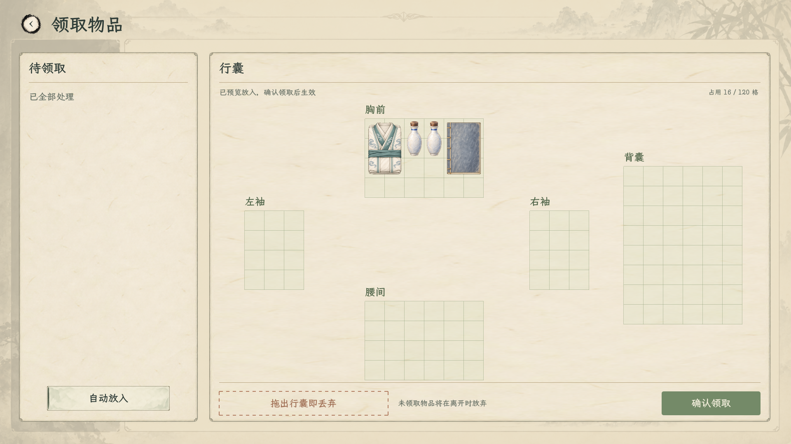

# 玄览峰拓印正式接入

2026-11-07，实际 Godot 主场景截图。入口为玉虚仙宗 → 玄览峰 → “选书拓印”。角色使用隔离测试新档的实际人物数据，体魄／灵慧为 5；不是浏览器假数据。正式玩法不修改玩家配点。

## 2026-11-07：右侧封面与顶部纸页（现行）

用户纠正：书脊朝外，抽出后右侧露出封面，顶部露出纸页。右侧直接复用现有秘籍图标的灰蓝布面纹理并按斜面透视绘制；顶部使用浅纸色、保留两侧薄封皮，页层细纹沿纵深排列，与两侧封皮在顶面上的边线平行。封面与顶部纸页的显露宽度、投影和书脊位移共用抽拉进度，归位时连续收回，中途反向也从当前进度衔接。书脊本体及命中槽位仍为 42×170，抽拉仍为横向 −5、纵向 −14、240 毫秒缓出。

[顶部纸页与平行纹理放大](顶部纸页_平行纹理_放大.png) · [完整书册放大](封面侧面_放大.png) · [1920 原生画面](封面侧面_1920.png) · [1280 原生画面](封面侧面_1280.png) · [归位途中](封面侧面_归位途中.png) · [中途反向](封面侧面_中途反向.png)。这些截图由 Godot 直接运行原生书架控件生成，使用隔离测试角色；本轮不重新生成素材或改变书目、费用与修习条件。上一轮[纸页误稿](侧页_修正后_放大.png)保留为历史，不作为当前表现。

验证：1920／1280、顶部纹理方向、抽出、归位及途中反向已逐图检查，最终归位截图与静止截图像素一致。原有[主场景拓印回归 63 项通过](验证_封面侧面.log)；无运行错误，[日志](验证_封面侧面_警告.log)仅有原《卸力》资源 UID 回退警告。常规整项目构建此前遇到既有 `csharp/debug/HumanCombatBoardSmoke.cs` 的 CS0121 构造函数歧义；本轮继续仅在验证构建中排除该无关调试场景，编译 0 警告、0 错误并运行上述回归，未修改该文件或正式工程配置。

## 书架与领取

左边待领取列真实秘籍名称、图标和数量；右边为已有胸前、两袖、腰间、背囊 120 格。可拖放、旋转或自动放入，整理期间不结算。最后确认领取后才产生实际物品与费用；未领取部分须确认放弃。

2026-11-07 底栏收简：仅保留靠右的“确认领取”，删除重复的“放弃剩余”；仍有剩余时沿用放弃确认，取消后继续整理。

- [关键词只变暗、不重排](02_关键词变暗.png)
- [逐卷境界、属性和前置条件](03_卷章条件.png)
- [成功领取后的后续报价](06_领取后价格.png)
- [1280×720 实际窗口](07_藏经阁_1280.png)
- [善功堂原四列及哑光素材](08_善功堂_1920.png)

## 本次行为

所有玉虚弟子首本免费；之后每册暂收 1 点宗门贡献，便于测试。同本可再次拓印独立物品。免费标记、贡献和物品仅在真实领取提交时结算；浏览、自动整理、满包和放弃本册均不消耗机会或贡献，已领取后再丢弃不恢复免费。保存首本真实路径、物品空间与贡献流水，旧档缺首本记录时不追扣已有物品。

书架只列现行五本秘籍，42×170 设计尺寸薄书脊沿用现有图标；题签按实际字体行高适配。关键词／搜索仅压暗非匹配项，暗项仍可点击；抽拉只移动视觉层。右侧条件读取实际角色，满足 ✓、不足 ✕，不显示简介里的首卷招式块。领取不授予修为、主修或已学章节，持书后进入原有研读目录。

白石新流程取消主持选书入口并修正指引；玄览峰不再要求先拜师才能领书。善功堂移除秘籍，只换已确认的框架素材、保留原四列与兑换机制。旧存档的既有物品和学习内容保持。

## 来源与边界

规则见[拓印主案](../../plans/剧情与宗门/玄览峰秘籍拓印与首本免费_20261106.md)，美术沿用[原布局 v4 与提示词](../藏经阁与善功堂布局保留交互_20261106/README.md)及[共用规范](../室内功能界面统一规范_20261106.md)。运行素材位于 `textures/ui/yuxu_library_20261107/`，来自已确认的 `藏经阁_空白框架_v4.png` 与 `善功堂_原布局哑光框架_v2.png`，本轮没有重新生成构图。

本轮不实施预备真传考核、择师时点或报到处重做；考核期限和细则仍待定。首本领取标记仅为将来考核提供依据，不代替研习判定。未验证发行导出包。

## 验证

| 检查 | 结果 | 范围 |
| --- | --- | --- |
| 完整构建 | 0 警告、0 错误 | 实际项目编译 |
| [原生拓印接入](验证_拓印实机.log) | 71 项通过 | 实际峰内挂牌点击，五本目录、真实属性、固定图标／题签边界、压暗与抽拉、首本／重复付费、放弃、满包、库存／报价／余额变动、重入、首本／实物／流水存读、正式快照与槽位保存、实际研读页及首卷条件，1920／1280 窗口截图 |
| [共享领取回归](验证_领取回归.log) | 53 项通过 | 原空间拖放、旋转、指定实例丢弃、保护物、部分领取、回调守恒、过期布局、原暂停状态、真实炼丹领取 |
| [善功堂回归](验证_善功堂.log) | 23 项通过 | 8 类 69 项目录、排除秘籍、原四列及横向／列内滚动、报价、确认与重复确认保护、搜索及窄窗 |

实机检查发现旧 `SecretBook` 对未学书籍首卷有直接放行分支，和用户已确认保留属性门槛不符；已统一调用原卷章判定。实际新档已验证体魄 5 可开始《太和感物养元宝册》，不足《舒卷天章》的体魄 6 时不能开读，不修改阈值。旧首卷借读限制仍用于无实物借读；持有正式秘籍则按现有卷章条件处理，不清除旧记录。

本轮实际窗口无运行错误。[警告日志](验证_拓印实机_警告.log)仅为既有《卸力》资源 UID 回退路径警告，本轮未修改该技能资源。首次截图检查中修正了图标默认最小尺寸及题签行高撑破书脊的问题，最终截图与验证均在修正后重跑。
