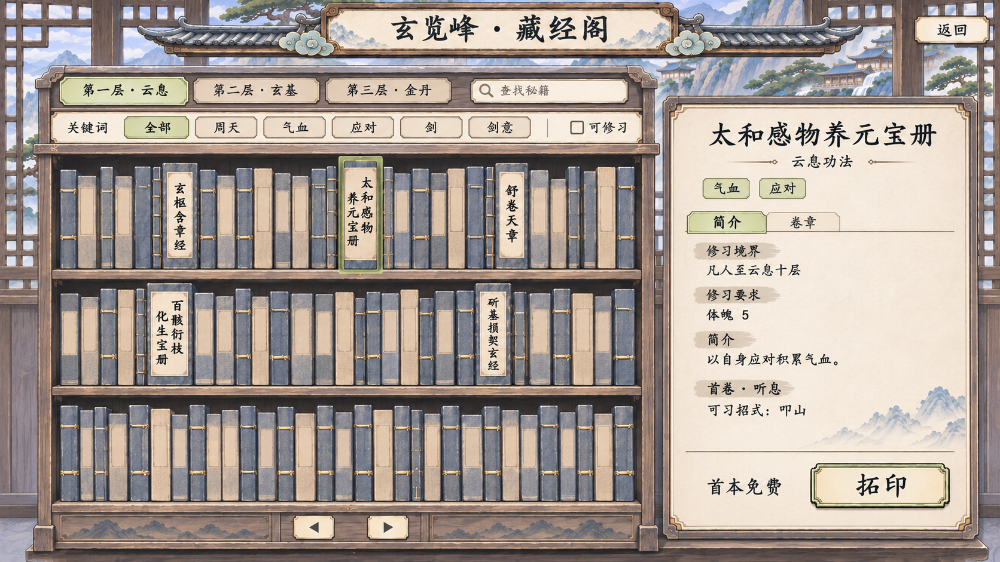

# 玄览峰藏经阁选书界面理想图

2026-11-06 最新裁定与[可点击 v4 预览](../藏经阁与善功堂布局保留交互_20261106/README.md)：保留原布局，只换材质；真书零散陈列、书脊等占位、字号按长度自适应，关键词变暗不重排，点击抽出。以下图片和集中摆放／同字号说明保留为历史，不再决定当前布局。

2026-11-06 最新预览为[藏经阁 v3 与善功堂室内统一稿](../藏经阁与善功堂室内统一_20261106/README.md)：按当前内景去泛光，柜体和牌匾有支撑，只陈列五本真实秘籍，书脊同规格；[共用美术要求与字级](../室内功能界面统一规范_20261106.md)、完整提示词均已保存。新稿尚未实装。

以下为 v1／v2 的历史图与当时记录；其中无字书脊、三排容量和屋檐形式不再作为当前方案。

2026-11-06，当前预览为 v2：按用户最新要求改为多排书脊、藏经阁楼层与关键词筛选，右侧改为单页详情。仅为视觉方向稿，未实装，不是游戏截图。

第一层对应云息藏本（含凡人起修的入门秘籍），第二层对应玄基，第三层对应金丹；本轮只示第一层的已开放书目，其他层级为导航提案，不代表已开放高境界秘籍或另定权限。每一楼层内部可以有多排书架，楼层与架上层板分别表达境界与陈列。

关键词使用既有主／辅心法展示标签：周天、气血、应对、剑、剑意。右侧显示修习境界、入门要求、关键词与内容预览，切换简介／卷章查看；取消 v1 的大幅摊开书本与桌案陈设。价格位置首次只写“首本免费”，按钮始终只写“拓印”，不保留“尚未领取”、底部解释句或全屏横幅。

图中五个有书名的条目为当前已开放秘籍；其余无字书脊是书库环境与未来容量示意，不是新增秘籍、可点击目录或真实库存。正式实施按真实目录紧凑排列，不用装饰藏书伪造可选项目。

- [功能方案与用户裁定](../../plans/剧情与宗门/玄览峰秘籍拓印与首本免费_20261106.md)
- [v2 完整提示词](理想图_v2_提示词.txt)
- [v2 生成来源记录](生成记录_v2.json)
- [v1 历史理想图](玄览峰藏经阁_理想图_v1.png) · [v1 提示词](理想图_v1_提示词.txt) · [v1 来源](生成记录.json)

使用内置 imagegen 工具，以 v1 为编辑目标，保持其灰青、米白、松绿、线装书材质与楷体风格，重排陈列密度与信息结构；未使用 CLI。生成原图保留，本目录为副本；没有覆盖运行时素材。

已查看生成画面，确认三排书脊、楼层／关键词入口、单页详情及“首本免费”“拓印”两处文案。图中文字与点击区域仍须由实际控件重建；未执行游戏输入、搜索、筛选或小窗口验收。

