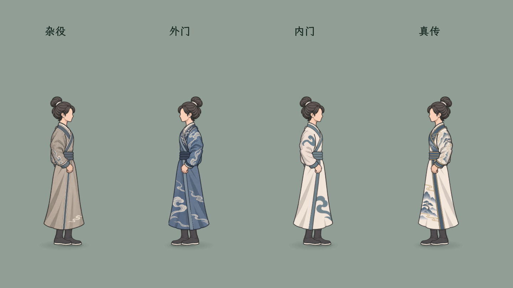
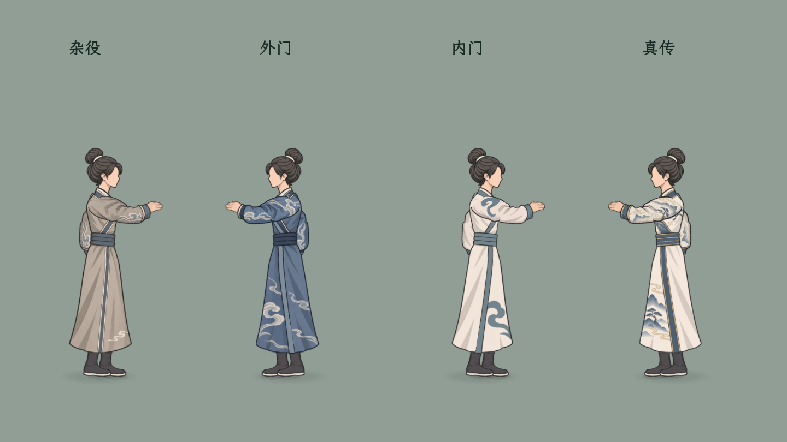

# 玉虚四套局内形象

当前：用户取消宽袖细节修订，保留本页此前四套服装和当前快速迈步表现；宽袖候选不接入。

## 本轮范围

用户指定在现有男修内门常服之外补齐杂役、外门、真传。保持原行动队列规则和当前快速滑步表现；局内服装按角色实际衣服编号匹配，前发5／后发6仍是首批支持的固定组合。独立换发与女款不属于本轮已完成范围。

| 服装 | 保存编号 | 现行立绘参考 | 局内资产目录 |
| --- | --- | --- | --- |
| 杂役 | 3 | `mods/appearance/ink_three_variants_20261004/male/clothing/04.png` | `tools/action_battle_test/art/queue_yuxu_servant_v1` |
| 外门 | 4 | `mods/appearance/ink_three_variants_20261004/male/clothing/05.png` | `tools/action_battle_test/art/queue_yuxu_outer_v1` |
| 内门（已有） | 5 | `mods/appearance/ink_three_variants_20261004/male/clothing/06.png` | `tools/action_battle_test/art/yuxu_fullbody_v15` |
| 真传 | 6 | `mods/appearance/ink_three_variants_20261004/male/clothing/07.png` | `tools/action_battle_test/art/queue_yuxu_true_v1` |

## 服装识别特征

杂役为灰褐袍、青灰领边与克制的浅色云纹；外门为蓝袍、浅色流云和深蓝领襟；真传为象牙白底、山松纹、深蓝领襟与细金边。沿用当前小人的清晰墨线和平涂明暗，用大纹样概括局外原图的细节。

新增身体和衣袖使用内置 imagegen 编辑生成，参照原身体／衣袖图保持UV位置、肩肘腕与腰袍衔接；头、腿和手型复用当前支持组合。原内门素材保持。

## 接入与验证

三套新服装已接入，原内门保留。首页「试演与预览 → 远景队列·玉虚换装试演」新增服装下拉选择；选择后重置试演首位人物，六人战场同时含四套衣服。保持原五类动作和0.35～0.70秒快速滑步。

构建通过，四套真实目录匹配、八种不支持发型组合回退、暂停／死亡重置、实际队列应敌完成均通过；见[真实场景日志](../../../output/queue_yuxu_four_outfits_smoke_20261103.log)。已目视同屏待机与攻击，肩袖、领口及袍腰连接连续，无可见白晕或矩形背景。素材仍有少量轮廓偏差，使用实际渲染检查；不宣称生成图逐像素一致。

独立换发尚未完成；这里只支持男修衣服3／4／5／6、前发5／后发6。其余角色保留原显示，不强行套用这些衣服。

## 生成记录

本轮使用内置 imagegen，最终PNG在上表资产目录；每套新增 `body.png` 和 `arm_relaxed_v19.png`。完整提示与参考来源：[杂役](servant_prompts.md)、[外门](outer_prompts.md)、[真传](true_prompts.md)。
