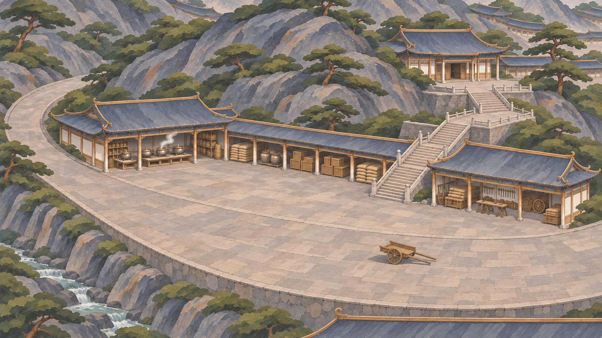

# 物品图标笔触场景试稿：和光峰

后续全套已完成：用户认可本张后，总览与其余七峰已按同一画法重绘，见[整套九张](物品图标笔触全套_20261104.md)。下文为单张试稿阶段记录。

2026-11-04。用户指出原局部场景存在大量白点，要求参考现用物品图标风格重画，明确先来一张。本轮只制作和光峰一张风格样板，未批量处理其余八张或替换游戏原图。

[打开试稿原图](../../../textures/sect_overview/repaint_20261103/local_20261104/heguang_item_style_v1.png) · [原局部版对照](../../../textures/sect_overview/repaint_20261103/local_20261104/heguang.png)

## 参照

已核对正式物品定义与活动图标，参照实际使用的：
- `textures/items/inventory_density_20261029/pill_container_empty_porcelain.png`（瓷瓶：柔和颜料块面与体积）
- `textures/items/inventory_density_20261029/manual_generic_2x3.png`（书册：哑光表面和顺形笔触）
- `textures/items/inventory_density_20261029/xuantie_3x3.png`（玄铁：大块明暗与材质分面）

[物品图标风格定稿](../行囊全物品图标与占地_20261029/风格定稿.md)和[全套图标](../行囊全物品图标与占地_20261029/README.md)仅作为画法依据；不将建筑和树木材质统一画成瓷或铁，也不复制图标的透明底或暗色预览底。

## 本次变化

- 山石用大块中间色及阴影交代形体，清除密集点状苔斑和浅色碎点。
- 树丛概括成松绿的叶团与少量阴影块面，撤下铺满画面的浅色叶尖、白花和粉花碎斑。
- 瓦面、地面与木件采用顺形的大笔触，降低密集勾线与碎纹；金边保持克制，不靠白色亮点表现材质。
- 保留原局部构图、工作坪、库房装卸面、货道与上殿台阶关系；灰青屋顶、浅石铺地、松绿树木的配色大类延续。
- 四角清晰，无虚化、渐隐、文字、UI或人物。

本图通过内置图像工具重新绘制，未使用模糊、锐化、滤镜或程序清点替代重画。已目视比较表面碎点和主要通路，风格仍待用户评价。未据单图观感宣称整套完成，未进行运行时接入或热点检查。

