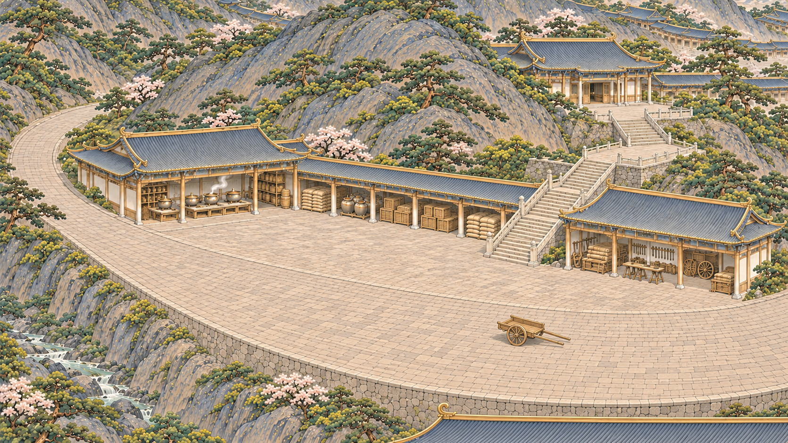

# 空间关系复核与和光峰修订样板

2026-11-04。后续局部版已完成，当前范围为一张总览与八张局部内景，见[局部版说明](局部版_说明_20261104.md)；下方保留阶段复核记录。

2026-11-04。用户指出九张重绘画面混乱、局部连接不合理；原九张不作为空间关系合格的交付。图片完整性、分辨率与色调参照不能替代建筑及通路检查。本轮先修一张和光峰样板，不将其等同全部九张已修完。

## 已确认的问题

- 总览的廊道、院落、山石与瀑布密度接近，主次和主路不清；“在山后延展”的要求被过多重复屋檐代替。
- 紫府峰桥、长台阶与院落之间的标高及落脚平台交代不清，不能凭远处有建筑就认为能沿可见路线到达。
- 和光峰的库房、膳房、工作坪没有共同清楚的货运地面；部分库房虽有门面，图内看不出货道如何抵达。
- 天工峰部分台阶末端与山石、水流的关系不清；建筑、平台、桥梁不能靠视觉遮住交点就判为合理。

以上以局部可辨关系为依据，不把图内无法辨认的节点武断判为真实穿模。其余原图同样需要按下述方法逐张复核，不能推定已通过。

## 修订顺序

先明确山坡与可建地，再确定主路、坡道、台阶、院落和门口，最后安排建筑与装饰。局部路线应可追踪，桥必须有真实两岸和桥头；台阶有上下平台及实体支撑，不能接屋顶或悬崖。货道可抵达库房装卸口，不能以只有台阶的路线承担图中车辆通行。

建筑保持主次与疏密，不把所有屋檐强行串成一条长廊。规模继续由画外延伸、山体遮挡和远处概括屋脊表现，四边保持清晰。色调和笔触仍使用原母参考，不因修连接重设冷暖或加金。

## 和光峰样板 v2

[打开原图](../../../textures/sect_overview/repaint_20261103/peaks/heguang_spatial_v2.png)

- 主货道从画面右侧进入工作坪，绕左侧山肩继续，库房与膳房在同一工作坪标高开口。
- 庶务殿位于上方自然山台，步行台阶从工作坪分支，经可见的平台转折抵达门前。
- 水流在左侧谷地，避免靠不必要的桥梁和瀑布拼接工作空间。
- 保留上方山后延伸的屋脊和下方画外建筑屋顶，不把整峰范围封闭在这张局部内。

首稿v1前景库房朝向下层窄台，与主货道分离，未保留为当前样板；v2移除这排前景库房，将可见装卸入口放回同一标高的中部仓廊。两次均使用图像工具编辑，没有事后单张调色。

v2目前仅为局部空间组织样板。已目视检查主货道、工作坪、门口与上殿台阶的主要关系；还没有逐构件确认屋面接缝、柱基和坡道坡度，也未完成其余八张修订或实机热点验收。

[返回旧九张对照](预览.html)

生成器本次样板实际原生尺寸：heguang_spatial_v1.png 1671×941；heguang_spatial_v2.png 1671×941。保留原生像素，未拉伸补齐。
