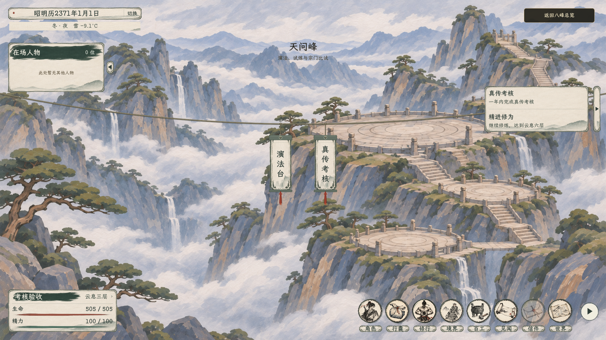
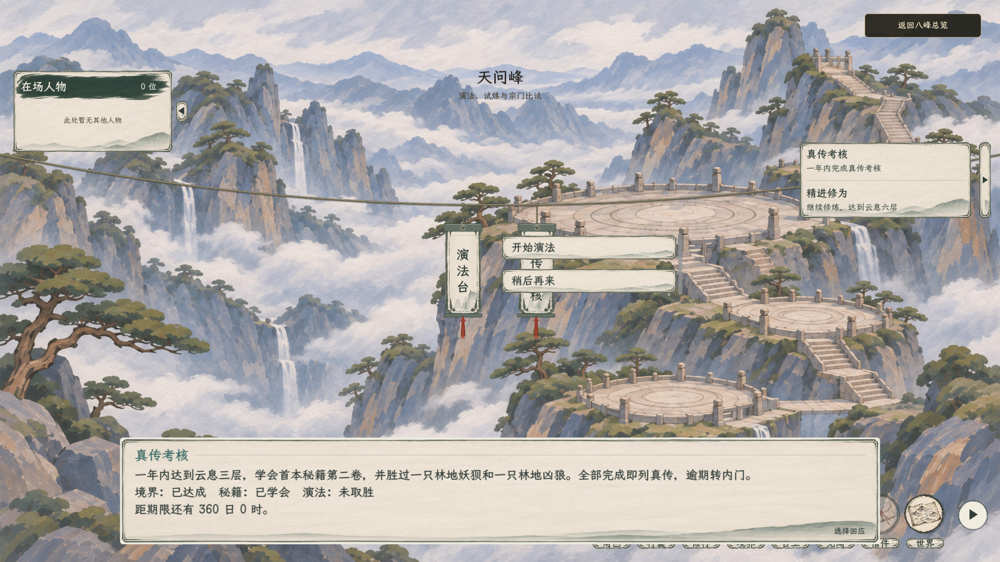

# 玉虚预备真传考核：场景入口与对白

2026-11-07，使用隔离测试存档拍摄实际 Godot 场景。天问峰复用现有绳索与吊牌；点击“真传考核”后，要求、三项进度和剩余时间显示在屏幕下方的现有对白栏。此处截图保留修改前的选项位置；[对话栏右上方的当前动态贴合位置](../对话选项贴合对话栏_20261107/README.md)已取代画面中部的旧布局。截图中的境界与秘籍为测试角色状态。

考核规则、存档兼容与验证范围见[一年考核方案](../../plans/剧情与宗门/玉虚预备真传考核与择师候选_20261107.md)。
