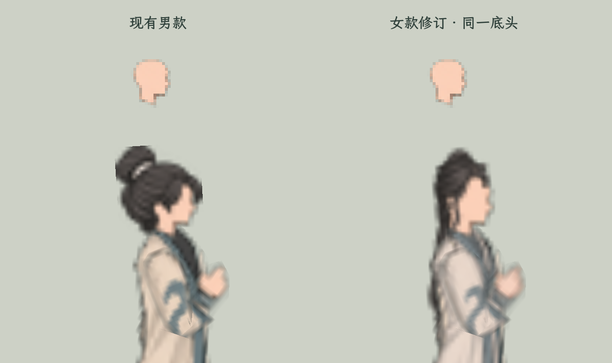
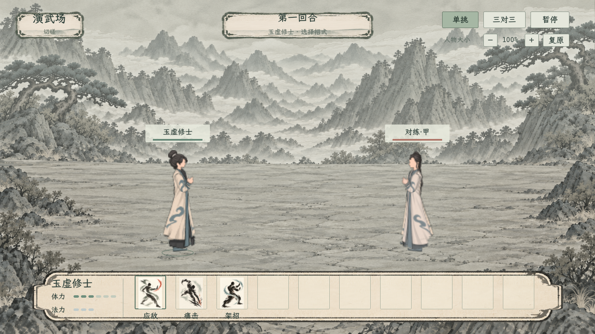
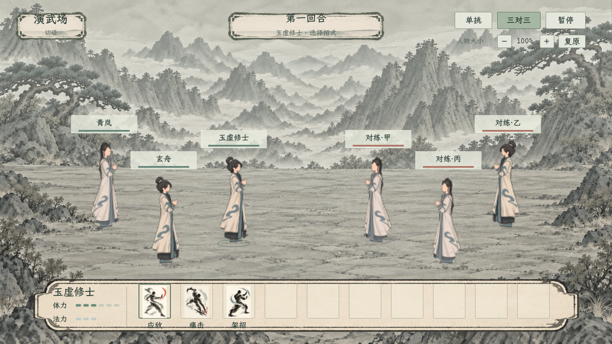

# 男女各一套：首套回合制局内人物

## 当前修订：按男款原始PNG尺寸制作

用户指出女款头部不对，要求直接核对男修素材尺寸。旧女款把偏正面的长脸、颈部与前发一起放在大图中，与男修独立底头的尺寸、侧向轮廓和像素精度不一致，已退出实际显示。

当前先将女款导出为[原尺寸独立部件](../../../textures/characters/turn_based_pair_20261106/female_native_v3)，再按原骨架和UV组装。以下为男修当前实际加载PNG的测量结果，有效区域按Alpha非零计算，均为像素：

| 部件 | 男修PNG画布 | 男修有效区域 | 当前女款PNG画布 |
| --- | --- | --- | --- |
| 头颈 | 24×24 | 14×17 | 24×24，底头RGBA与男款相同 |
| 头发 | 21×56 | 21×22 | 前发21×56，后发21×56 |
| 衣身／袍摆 | 60×100 | 37×92 | 60×100 |
| 近侧整臂 | 60×60 | 12×40 | 60×60 |
| 远侧整臂 | 60×60 | 17×39 | 60×60 |
| 裤腿与靴 | 50×80 | 20×64 | 50×80，双腿复用 |

女款保留清簪半束长发，底头、前发、后发三层独立；原24×24侧脸和短颈轮廓由共用底头保证。新发层由内置image_gen制作，原稿为[发层来源v2](../../../textures/characters/turn_based_pair_20261106/female_hair_layers_v2.png)，[对应提示词](头部修订提示词_v2.txt)。最终渲染读取21×56小图，不再直接取大图头部。

[同底头像素检查](头部素材对照检查_v2.json) · [原尺寸导出记录](../../../textures/characters/turn_based_pair_20261106/female_native_v3/native_export.json) · [可重做的导出脚本](../../../tools/action_battle_test/bake_turn_based_female_native_20261106.gd)。女款身体Alpha和男款原文件保持；头颈贴图、原头颈变换与UV一致，前后发使用原发层画布和挂点。女款8网格包括额外前发层，男款7网格。

[原尺寸与透明度逐像素核对](原尺寸核对_v3.json)已通过；修订后重新采集单挑／三对三和两档窗口截图，原队列的动作、冻结恢复及真实判伤检查再次通过。当前实际对练窗口已刷新为原尺寸部件版。

2026-11-06。按用户“男女各做一个先用着”的要求，男款沿用已审阅白青常服与束发髻；女款新增清簪半束长发、女款头颈前发和白青衣装。两款已接入原回合制人形渲染入口，按实际性别选用。现行边界见[主案](../../plans/界面与美术/男女首套回合制局内形象_20261106.md)。

## 查看

双击[打开男女回合制对练](../../../tools/打开男女回合制对练.cmd)，进入原队列机制的男女单挑，可实际规划、选择目标与执行；该对练使用独立角色快照。

双击[打开回合制战场预览](../../../tools/打开回合制战场预览.cmd)，可在单挑与三对三间切换，右上调节人物大小、暂停待机。预览单挑为男／女各一人，三对三为男／女各三人，包含女款的左右朝向。

[单挑1280×720](单挑_1280x720.png) · [三对三1280×720](三对三_1280x720.png)

正式战场仍使用原队列UI与背景；其技能栏更高，新人物脚点相应上移，完整衣摆和脚部留在栏上。截图：[正式单挑](正式队列_1v1.png) · [正式三对三](正式队列_3v3.png)。

## 女款发型与素材

- 前发：活动包 `ink_three_variants_20261004` 的“清簪垂鬓”，保存样式0、物理文件 `female/hair_front/01.png`。
- 后发：同包“清簪半束”，保存样式0、物理文件 `female/hair_back/01.png`。保留半束发髻、横向素簪与长披发，鬓发由前层提供。
- 衣装参考：同包 `female/clothing/06.png` 玉虚内门常服；概括为与男款相近的白青大块明暗和少量云纹。
- 制作方式：内置 **image_gen**，透明输出，生成后原样复制到项目。完整[制作提示词](制作提示词.txt)、[项目图集原稿](../../../textures/characters/turn_based_pair_20261106/female_atlas_master_v1.png)、[引用来源与哈希清单](../../../textures/characters/turn_based_pair_20261106/appearance_manifest.json)均保留。
- 身体四类部件在原尺寸导出时对齐原部件的可见范围，共用原蒙皮和身体Alpha，生成原稿与男款PNG不被重写；后发位于身体之后，前发独立位于头颈前层。
- 女款复用现有男性101的51节点运动骨架，共8个网格，其中1个是独立前发；并非额外恢复了一套女性原作骨架。当前局内款按性别固定，不代表局外三款女发和七套女装已经全部建立映射。

## 接入位置

- [女款皮肤](../../../tools/action_battle_test/turn_based_female_skin_20261106.gd)与[女款运行时](../../../tools/action_battle_test/turn_based_female_runtime_20261106.gd)。
- [原队列事件适配](../../../tools/action_battle_test/turn_based_pair_queue_20261106.gd)，统一待机、出招、受击、架招、闪避及暂停时钟。
- [人形入口](../../../csharp/battle/BattlePaperDoll.QueueAvatar.cs)与[C#桥接](../../../csharp/battle/QueueSmallAvatarBridge.cs)。实际人物外观数据只读，卡牌和资源数据未改。
- [正式战场布局](../../../csharp/battle/BattleManager.UiLayout.cs)：含新基础人物的战场采用与预览对应的显示高度，脚点上移避开技能栏；全部使用其他渲染器的场景沿原布局。

## 核对记录

本轮构建0警告、0错误。正式场景检查已通过，包括人数／性别、动作与暂停、真实判伤、原衣着发型数据保持和脚部避让技能栏。最终正式截图实际为2560×1440；独立构图提供1440×810及1280×720两档。

[本轮最终验收摘要](最终验收.json)记录上述结果；男女单挑的实际对练窗口已打开，使用最新程序集。

独立构图检查见[预览检查](预览检查.json)，正式队列检查使用[真实场景](../../../tools/TurnBasedPairAvatarReview.tscn)及[检查实现](../../../csharp/debug/TurnBasedPairAvatarReview.cs)。日志：[构图渲染](../../../output/turn_based_pair_capture_20261106.log) · [正式队列](../../../output/turn_based_pair_formal_20261106.log)。

正式检查使用实际渲染窗口，覆盖单挑／三对三、男女数量、7个完整网格、四类动作及应对冻结／恢复，确认展示事件不改生命／体力／法力，原衣着与发型快照不被回写，并由真实应敌调用检查伤害和动作收尾。命中本身有独立短停，因此恢复检查会等待其正常结束，不要求应对解除后立即越过短停。

本轮验证的是本机项目运行；资产导出打包沿原规格人物既有的后续检查范围处理。
