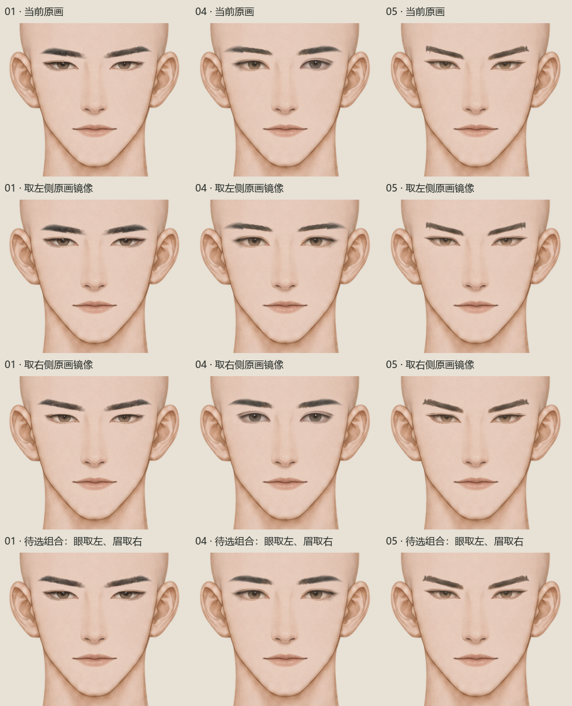
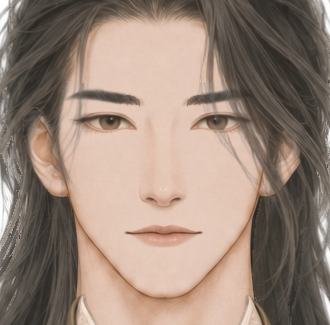

# 男性五官定位、原笔触与单侧镜像验收

日期：2026-11-09。本文是男性立绘五官定位与验收的现行入口。

## 当前状态：用户指定单侧镜像已接入并完成实机技术验证

用户最新明确提出“不对称，你生成一边镜像一下不就好了吗”。本轮按这一授权，直接保留当前自然原画中较好的一侧并作整侧镜像，以消除三眼、三眉各自的左右形差。这条新指令覆盖上阶段默认不镜像的限制；不能拿旧文档阻止已授权的镜像工作，也不为规避执行再请求一次确认。

本轮包为 `mods/appearance/male_face_single_side_mirror_20261109/`。三款眼睛01／04／05取**屏幕左侧**，三款眉毛01／04／05取**屏幕右侧**。六件已完成正常尺寸选源预审、接入与本包实际运行验证，335项技术检查通过、0失败；用户授权实施镜像，不等于用户已经通过这六件最终美术效果。

鼻01、嘴01和五款非空胡须02–06沿用当前原层定位，头颈、前后发、衣服、女性及选款配置不在本次改动内。本次仅替换六张眉眼，其余61PNG与选款配置保持，接口继续60选项／67PNG；本包已确认实际导入与组合，用户预设保持；这些运行事实不代替用户最终美术评价。

## 本轮取源与机械操作

来源是上一阶段已恢复的自然原绘图，在本包 `source/frozen_current/male/` 冻结；不是被用户否定的新生成眉眼，也不是先前用于引导生成的辅助图。风格母版仍为 `male_style_alignment_20261106/preview/male_whole_01.png`，扩款01／04／05的实际原部件分别按各自来源冻结，不混称全部来自母版01同一裁切。

| 部件 | 物理编号 | 保留的完整源侧 |
| --- | --- | --- |
| 眼睛 | 01／04／05 | 屏幕左侧 |
| 眉毛 | 01／04／05 | 屏幕右侧 |

画布仍为1024×1536，以[固定脸轴x513](feature_frame.json)反射，公式为 `x′=1026−x`。选中源侧的RGBA逐值保留，另一侧整侧整数反射；不重新生成、不重画RGB、不插值、不缩放、不旋转、不拉伸单眼，也不额外清Alpha或羽化中缝。中间列原本透明，不能无故加一道混色带。原细毛、睑线与虹膜清晰度是必须保住的绘画内容。

眼04左侧保留原暖棕虹膜与柔和睑线；眉04取右侧，避免把左眉原有硬台阶复制成两边。01和05同样先比较两侧原笔触，再决定取源，而不是盲目统一取左。具体源SHA、源侧、最终六件SHA与像素证明见[选定清单](../../../mods/appearance/male_face_single_side_mirror_20261109/source/selected_features.json)。

高光和眼白明暗随整眼一起镜像，不宣称额外独立绘光。正常尺寸整脸及完整搭配已作本轮预审，未见明显光照冲突；这个判断是执行已授权操作的预审，不是替用户作最终审美确认。

## 选源预审、安装与实际运行记录

- [本轮预审](../../../mods/appearance/male_face_single_side_mirror_20261109/qa/preinstall_review.json)状态为 `ready_for_user_requested_mirror_install`，绑定六件最终SHA，明确用户授权、母版／取源、无重绘和镜像高光的事实。`user_final_aesthetic_approval=false`。
- [原／左／右／混合正常尺寸对照](../../../mods/appearance/male_face_single_side_mirror_20261109/qa/original_left_right_mixed_faces_1x.png) · [三套完整候选](../../../mods/appearance/male_face_single_side_mirror_20261109/qa/three_whole_source_mixed_1x.png)。不能将候选拼合称为游戏实机。
- [本包实际运行结果](../../../mods/appearance/male_face_single_side_mirror_20261109/installation/runtime_check.json)。335项技术检查、0失败，实际输出九组无发、三组完整搭配、三组正式渲染器画面；六件镜像几何差为0，其余61PNG、配置与用户预设保持。335只记技术事实，不作美术分数。此前305／799／3355均不是本包结果；静态七发、胡须及衣领搭配也不冒充实机输出。

本轮运行报告SHA-256：`ac3a62f59cb9ea83013bdfec8ca460c47c907ded1d358eb804a0de7c2decbb74`；实际图与报告哈希另见本轮预审后的运行跟进字段。

目标是这六件各自左右对应并围绕共同脸轴，不把它扩张为整张脸、全部头发、皮肤光照或所有五官已完全镜像。遮发造成的可见差异仍需看实际组合；选定源侧自身的笔触细节会如实保留。

## 本轮执行顺序与门槛

1. 先读最新用户指令并冻结当前自然原图和配置。记录“用户指定单侧镜像”这一明确范围；按已获授权执行，不沿用旧禁令重复询问。
2. 同尺度对照原图、取左、取右的正常整脸与发衣搭配，选笔触、清晰度和神态更好的源侧。不能只看对称数值；有断口或失真的一侧不能被复制成两侧缺陷。
3. 只作已授权整侧RGBA镜像，围固定轴记录源像素与最终SHA。不得把镜像授权扩展为整件生图、缩瞳、局部拉伸或更换画风。若画风／清晰度／神态改变，立即退回原源，不用几何通过辩护。
4. 正常尺寸核对无发九种眉眼组合、全部七前发（含09遮挡）、浅深底及胡须／衣领组合；看整条睑线、虹膜同尺度、眉头峰尾、粗细与实际表情。放大图只用于定位细节。
5. 技术检查验证源侧原RGBA保持、整侧反射、中缝及固定头轴，再核候选接入、其余61PNG、配置与用户预设保持。真实导入与组合结果需另记本包运行报告；旧检查数量不能套用。修改选款／保存逻辑时另验保存恢复，不伪称本次重复了没有运行的保存流程。
6. PNG或来源变化必须重新绑定SHA与实物证据。待安装、已安装、技术通过与用户美术评价分开写；技术通过项数不是美术分数。用户否定后撤回旧 `accepted`，不能复用历史评审放行新图。

## 历史：原笔触恢复基线已经接入

上一阶段 `male_face_natural_restore_20261109/` 恢复六件冻结原绘图，仅作整数水平移动：眼01／04／05分别−3／−2／−2，眉01／04／05分别−1／−1／＋1。其余61PNG、配置及用户预设保持，[305项技术运行记录](../../../mods/appearance/male_face_natural_restore_20261109/installation/runtime_check.json)为真实恢复事实，原左右形差当时明确保留；它不是本次镜像安装结果，也不是美术通过。来源见[恢复清单](../../../mods/appearance/male_face_natural_restore_20261109/source/natural_restore_candidates.json)与[有限恢复评估](../../../mods/appearance/male_face_natural_restore_20261109/qa/visual_recovery_review.json)。

## 历史：被用户否定的新绘眉眼禁止复用

用户曾反馈“修正后的这么怪异你没发现吗”。当时新绘眉01变成均匀灰条，眉04被压平发虚，眉05加粗加黑；眼01清晰度下降、眼05变眯变硬，眼04又将失真的新绘左眼复制到另一侧，产生粗睫缘和僵硬眼线感。

失败原因是源绘图与神态已被改坏，不能推导出“用户以后也不准镜像”。本次用户明确要求镜像，采用的是已恢复清楚的原画源侧，二者必须区分。

该失败阶段曾实际接入13件并有[799项定位记录](../../../mods/appearance/male_face_alignment_fix_20261109/qa/alignment_gate_final.json)和[3355项实机记录](../../../mods/appearance/male_face_alignment_fix_20261109/installation/runtime_check.json)。这些历史技术事实不证明美术合格；[旧评审](../../../mods/appearance/male_face_alignment_fix_20261109/qa/final_visual_review.json)已经撤回 `accepted`，不能再复用这些糊图、旧选源或评审。

后续按本文和[项目工作约定](../../../AGENTS.md)执行；本次已按真实运行记录更新状态，用户最终美术评价仍单独记录，不从技术通过推定用户认可。
