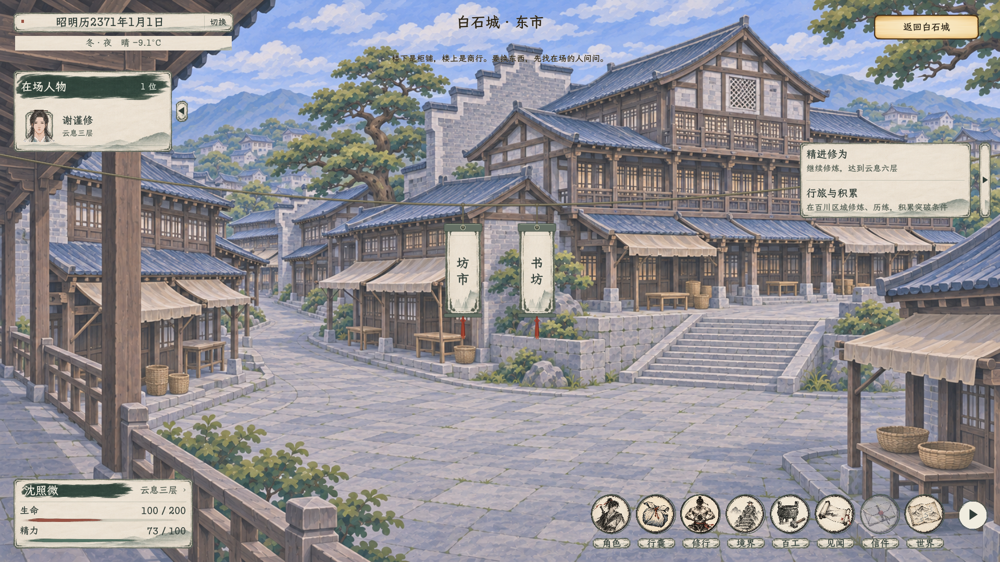
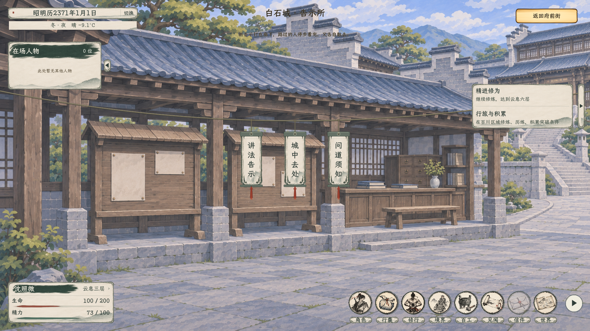
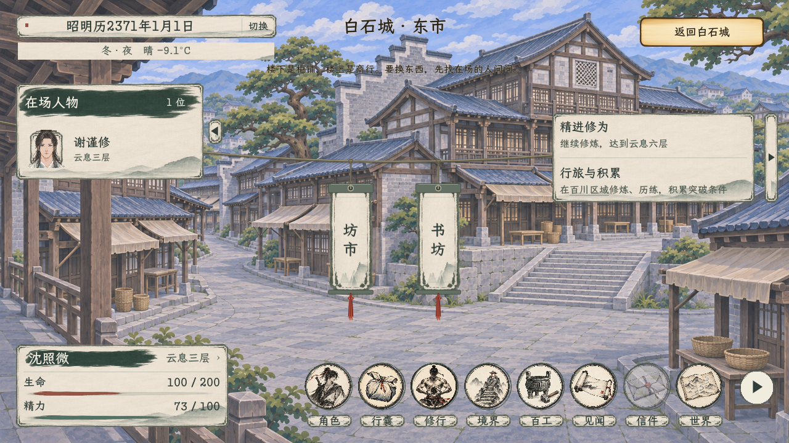

# 白石城分层与共用挂牌

2026-11-06，已接入。对应[当前主案](../../plans/剧情与宗门/白石城分层与共用挂牌修订_20261106.md)。[全部画面与动效](实机预览.html)。

一级白石总览保留原背景、四街区地标标签。进入街区后，设施入口和实际功能使用同一套悬绳竖牌，例如东市的坊市、书坊，以及告示所的三项告示。已有场所背景、空间ID、人物筛选和父子返回关系沿用，不为每项功能复制新的一级总览。

挂牌复用现有宣纸墨框素材，配灰绿木压条、穿绳孔及暗朱绳结，深墨字按牌面留白适配。主绳为两端固定的分段弹性绳，有局部受力、张力传播和阻尼，可轻拉后松手；挂点带动牌面，红绳穗独立滞后。不使用持续循环晃动，隐藏后停止，窗口及入口数量变化后重排。玉虚峰内和和光公事仍复用同一控件。

## 动效

[五秒实机视频](悬绳与挂牌实机.mp4)：1920×1080、24帧／秒、120帧、无音轨。由真实窗口连续取帧，展示拉绳松手和鼠标掠过牌面后的回弹；原始120帧约4.84秒，编码为5秒，未拼接概念动效。完整解码通过。

## 验证

- C#构建：0警告、0错误。四个相关场景脚本独立解析通过。
- 白石挂牌原生检查：52项通过，包含7张完整窗口截图；核验总览保留、二级共用控件、真实鼠标进入／选择、三项告示分别回调、书目、逐层返回、空场所和权限过滤、1280窗口。
- 动力检查覆盖鼠标触碰、主绳拖拉与松手、牌面及流苏响应、端点固定、坐标有限、阻尼回稳、低帧率步长保护，以及玉虚峰内和和光三绳兼容。
- 白石序章与同行回归：73项通过。游览、拖绳和查询未改变时间或精力；验灵、功法、道别和入宗等仍按原流程核验。

分组有重叠，不合计为互不重复用例。实际日志与截图规格见[验收记录](挂牌验收.json)。原生检查使用隔离存档和稳定人物数据，不写玩家正式存档；正式游戏人物仍来自原世界数据。

首轮检查发现输入回调读取鼠标缓存会漏接触碰，已改为直接使用该次鼠标事件坐标后完整复验通过。日志保留项目既有的资源UID回退等提示，不将本轮通过等同全项目零诊断。
