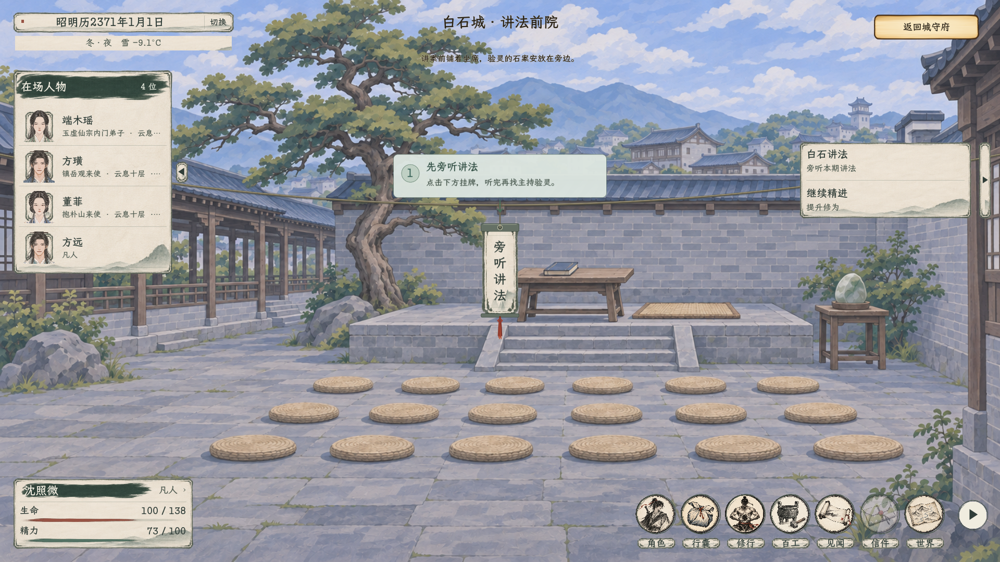
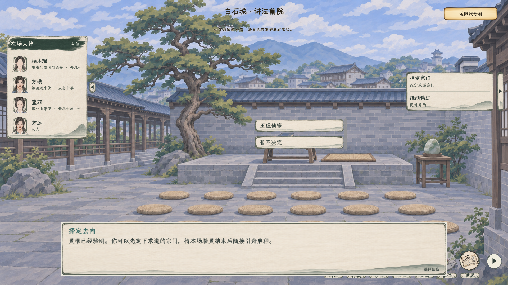
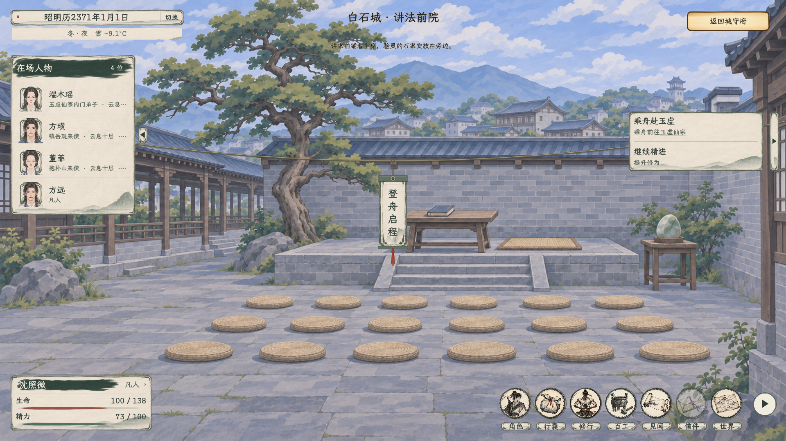

# 白石择宗与统一启程

2026-11-06，已接入。[现行主案](../../plans/剧情与宗门/白石讲法会与序章入道流程_20261103.md#择宗候验结束与统一启程2026-11-06当前) · [全部实机画面](实机预览.html)。

任务正文仅保留阶段要求：旁听本期讲法、查明自身灵根、选定求道宗门、等候本场验灵结束、乘舟前往玉虚仙宗、抵达玉虚仙宗。右侧“继续精进”摘要简化为“提升修为”；点击路径留在原独立引导。

主线顺序为听法坛、个人验灵、意向择宗、整场验灵结束、登舟。个人验灵后打开去向选择，目前仅提供真实可玩的玉虚及暂不决定；取消不写选择，已选玉虚不提前录籍或开船。等候以原对白过场推进，主持宣布结束后才开放登舟。方远在登舟前按原流程道别，真实玉虚弟子驾原接引舟出发。

选择、整场结束和原航程各自持久保存。选择未定或整场未结束时，入口及底层启航都受限；候验读档不自动放行。原首卷和研习保留为可选内容，不作为乘舟条件。舟速、容量、消耗和山门迎真沿用现行规则。

本轮等候是本场叙事收尾，不新增固定游戏时长、倒计时或费用；未将其描述为所有NPC均已有独立验灵、分流和排期演算。

## 验证

| 分组 | 结果 |
| --- | --- |
| C#构建 | 0警告、0错误 |
| 原生主线与引导 | 46项通过，9张完整截图 |
| 白石研习、正式快照与入宗回归 | 80项通过 |
| 接引航程、容量、在途读档和山门录籍 | 74项通过 |

原生窗口通过实际鼠标验证中央旁听、原验灵菜单、取消／重选宗门、候验存读档、等待过场中不提前放行、整场结束后登舟、方远道别、凡人实际启航，以及不会提前发功法或录籍。检查包含1920×1080和1280×720。原航程回归同时核验4800舟速、六人容量、超载拒绝、真实行旅时间及旧舟速迁移。

分组有重叠，不累计为互不重复用例数。日志及截图规格见[验收记录](启程验收.json)。截图和测试使用隔离存档及稳定玩家数据，本期主持仍由正式规则随机分配，不覆盖玩家正式存档。保留既有资源UID回退等诊断，不宣称全项目零提示。
