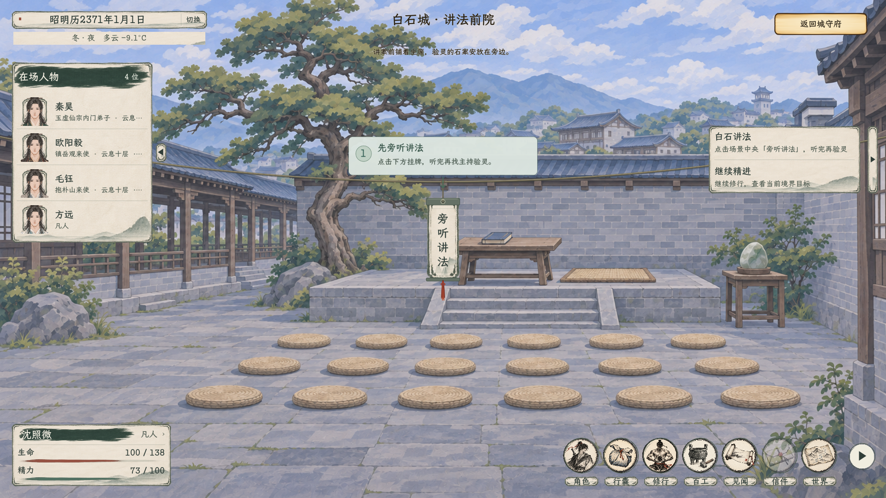
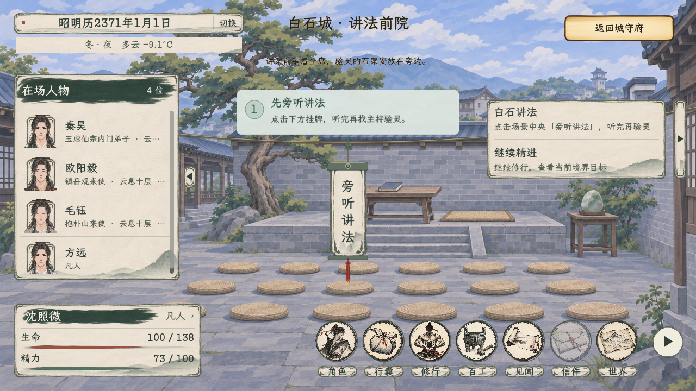

# 白石讲法入场引导

后续任务摘要与启程顺序已修订，见[择宗与统一启程](../白石择宗与统一启程_20261106/README.md)。本页图片保留引导接入时的界面；任务只写目标及验灵后择宗、候验、登舟以最新记录为准。

2026-11-06，已接入。[当前主案](../../plans/剧情与宗门/白石讲法会与序章入道流程_20261103.md#讲法入场引导与场景旁听2026-11-06当前) · [全部实机画面](实机预览.html)。

讲法前院中央提供“旁听讲法”悬绳挂牌。首次尚未听过时，独立灰绿引导浮层用步骤圆标、简短说明与细箭头指向入口；提示使用原生平整底，不使用纸纹或签牌边框。标题“先旁听讲法”，辅文“点击下方挂牌，听完再找主持验灵”。

点击中央挂牌接原讲法对白，同时收起提示和听讲入口。原主持菜单删除听讲；听完后仍从左侧名单找本期实际主持验灵、选卷和咨询。主持仍为本期真实随机人物。后续任务摘要已统一改为阶段要求，具体操作提示继续由本浮层承担。

引导以原 `heard_lecture` 状态决定显示，不增加独立存档字段。未完成重入仍可见，完成后不重复提示；入场本身不自动听讲或验灵，入口迁移不增加费用、时间或奖励。

## 验证

| 分组 | 结果 |
| --- | --- |
| C#构建 | 0警告、0错误 |
| 原生引导及入口 | 24项通过，含4张完整截图 |
| 序章、研习与入宗 | 75项通过 |
| 验灵后灵舟接引 | 52项通过 |

原生检查覆盖首次入场尺寸、独立步骤控件、中央挂牌、主持菜单移除听讲、离开重入、真实鼠标点选、1280窗口、听讲中收起、完整听讲后状态、旧存档字段保存与读取、后续从人物名单验灵，以及时间与精力保持。各分组有重叠，不累计为互不重复用例总数。

图像来自隔离存档的正式主场景，人物为稳定测试数据与实际随机主持，未覆盖玩家正式存档；不将固定夹具角色当作正式剧情人物。日志和截图规格见[验收记录](引导验收.json)。既有资源UID回退等提示仍保留在日志。
