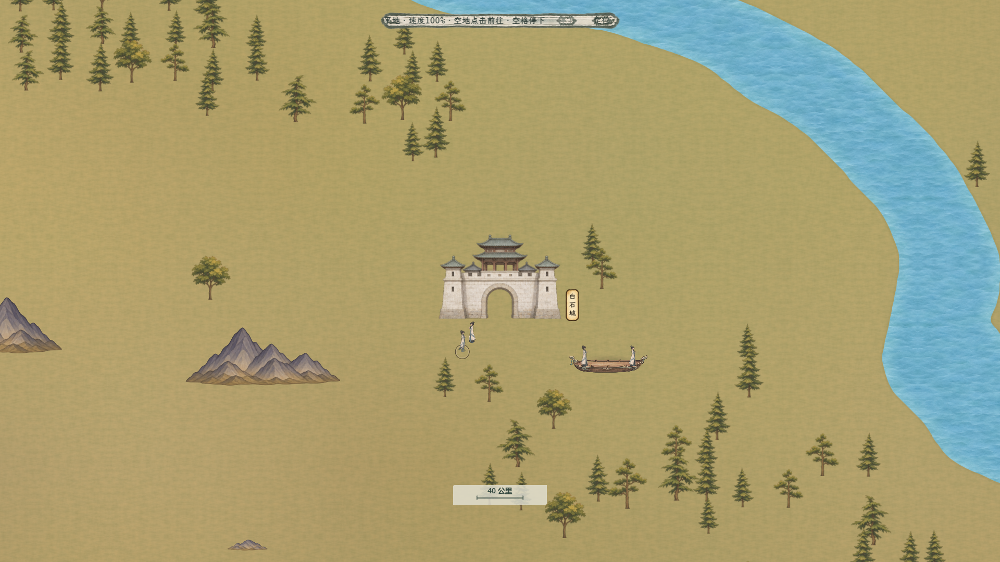

# 百川三倍地图、固定人物与独立景物

最新追加：[地表小景与草地色差](../百川地表小景_20261106/README.md)。在本页三倍地图基础上增加9款独立地面装饰及克制的草地/土色变化，地图、人物、山树和导航保持；下方图片记录追加前阶段。

2026-11-06。按用户确定的最近、人物清楚那档校准；世界仍为8000×8000公里，显示边长由7372.8扩为22118.4。最近档从0.96改为0.8，同样屏幕长度原100公里现为40公里。规则见[现行主案](../../plans/世界与探索/百川三倍地图与固定人物_20261106.md)。

## 实际画面与尺度

[玉虚近景](玉虚近景.png) · [完整主场景](完整主场景.png) · [NPC实际行走](NPC实际行走.png) · [桥渡与完整山体](桥渡与完整山体.png) · [全域](全域.png) · [24类地点素材](../../../textures/world/bai_chuan/expanded3x_20261106/nodes/contact_sheet_24.jpg)。以上地图图像来自实际Godot运行，白石的额外灵舟用于同屏比例对照。

- 主角、NPC、同行者、舟上乘客及驾驶者统一52世界单位，最近档约41.6屏幕像素；缩放时跟随地图同比缩放，人物、脚点和同行间距不再反向补偿。灵舟宽208世界单位。树高90—126世界单位，约为人物1.7—2.4倍。
- 地表只绘制土色纸面纹理和河湖海；原黄绿母图仅作为不可变地理来源，其山树建筑颜色不再进入底图。原水系与地域关系保留，岸线由平滑距离场绘制，岸边可通行区域及桥端另行核验。
- 独立放置429组完整山体、5509棵树、9座桥；53处建筑使用24种原生透明素材，13宗门各有独立轮廓。70处野外地点保留原身份和名称，不凭空添加建筑。
- 原生山体保持等比，使用完整Alpha连通区域切图，跨图集象限的山体也保留全轮廓；没有按四等分直裁山腰。山体全部禁止步行，树木整个投影框避开山体，建筑和桥端预留谷地及入口。

## X、Y、Z与通行

所有山、树、桥及建筑在布局文件明确X、Y、逻辑Z。落地景物的Z取脚点Y；桥面在地面层、人物从桥面上方通过；灵舟独立处理飞行高度。每张地图有自己的相机深度转换器，将可见脚点映射到引擎有效排序区间，避免三倍地图南部排序挤到上限。相机移动及缩放只更新临时绘制层，不改物件的世界坐标。

主要数据：[场景排布](../../../resources/world/bai_chuan/landscape_expanded3x_20261106.json)、[地点与路线](../../../resources/world/bai_chuan/free_layout_expanded3x_20261106.json)、[细导航](../../../resources/world/bai_chuan/free_navigation_expanded3x_20261106.json)、[独立地形耗时](../../../resources/world/bai_chuan/terrain_travel_expanded3x_20261106.json)。

细导航1413×1413，每格约15.6785世界单位；地形耗时独立471×471，每格约47.0354。山体按每个可见原生Alpha像素的实际世界足迹保守投影到细格，附一格边缘阻挡，避免下采样漏掉山尖。575条联系中101条重新绕山，123地点和444内部锚点全部连通，内部索引保留。未知存档来源拒绝迁移并保留原状态；已知旧来源读取自身几何与公里刻度后迁移，不把内部索引当连续坐标放大。

## 已保存原稿与最终提示词

本轮使用**内置imagegen模式**生成，无CLI/API回退；以下文件均已存入项目。保留生成原图及原生Alpha，原生尺寸按实际文件列出，未把提示词尺寸或插值后的大小当成画稿精度。

| 素材 | 实际原生尺寸 | 原稿与最终提示词 |
| --- | --- | --- |
| 宗门、城镇、坊市、村落与渡口 | 6张1254×1254图集，24种；绑定53处建筑 | [图集、脚点和区域目录](../../../textures/world/bai_chuan/expanded3x_20261106/nodes/node_catalog.json) · [最终提示词集](../../../textures/world/bai_chuan/expanded3x_20261106/nodes/prompts_final.json) · [来源记录](../../../textures/world/bai_chuan/expanded3x_20261106/nodes/generation_provenance.json) |
| 水面纹理 | 1254×1254 | [原稿](../../../textures/world/bai_chuan/expanded3x_20261106/surface/water_native.png) · [提示词](../../../textures/world/bai_chuan/expanded3x_20261106/surface/water_prompt.txt) |
| 桥梁图集 | 1774×887，4种原生桥面 | [原稿](../../../textures/world/bai_chuan/expanded3x_20261106/surface/bridges_native.png) · [提示词](../../../textures/world/bai_chuan/expanded3x_20261106/surface/bridges_prompt.txt) |
| 地表纹理（沿用） | 1254×1254 | [原稿](../../../textures/world/bai_chuan/layered_20261106/source/ground_native.png) · [提示词](../../../textures/world/bai_chuan/layered_20261106/prompts/ground.txt) |
| 独立树木（沿用） | 1312×1199，4种 | [原稿](../../../textures/world/bai_chuan/layered_20261106/source/trees_native.png) · [提示词](../../../textures/world/bai_chuan/layered_20261106/prompts/trees.txt) |
| 完整山体（沿用原稿、修正切图） | 2张1536×1024，8种 | [完整区域目录](../../../textures/world/bai_chuan/expanded3x_20261106/mountain_catalog_complete.json) · [A提示词](../../../textures/world/bai_chuan/layered_20261106/prompts/mountains_solid_a.txt) · [B提示词](../../../textures/world/bai_chuan/layered_20261106/prompts/mountains_solid_b.txt) |

最近档所有建筑均未超过原生有效尺寸，最紧的一项原生像素/显示像素为1.075；山体等比并预留采样余量。14张运行时纹理的基准像素已与原PNG逐字节核对。人物与NPC继续复用现有形象，不因换地图改人物衣着、身份或已结算时间。

## 验收记录

隔离存档目录运行，不写入玩家存档。几何及真实导航共16650项通过：35452174个山体可见原生像素无漏格、123844个真实运行时山体采样点不可步行、1150条双向路线及267720次细分通行检查通过，9桥与306个开水格均在实心桥面上。5509棵树完整框避山，地图边界补齐格不可通行。

[几何与实际导航报告](../../../output/bai_chuan_expanded3x_20261106/geometry_runtime_report.json) · [全量原生像素报告](../../../output/bai_chuan_expanded3x_20261106/geometry_runtime_report_python.json) · [布局烘焙报告](../../../output/bai_chuan_expanded3x_20261106/layout_bake_report.json)。

| 验收 | 通过项数 | 记录 |
| --- | --- | --- |
| 尺度、全图档、素材和XYZ | 23 | [真实地图预览](../../../output/bai_chuan_expanded3x_20261106/expanded_visual_report.txt) |
| 真实GPU像素前后遮挡 | 118 | [像素报告](../../../output/bai_chuan_expanded3x_20261106/pixel_occlusion_report.json) |
| 真实NPC相机变换与固定世界尺寸 | 13 | [相机补验](../../../output/bai_chuan_expanded3x_20261106/npc_camera_transform_report.json) |
| 真实旧来源迁移及幂等性 | 6422 | [迁移报告](../../../output/map_expansion3x_20261106/real_expanded_migration_report.json) |
| 完整Main行走、拖动、缩放与地点 | 73 | [行走报告](../../../output/bai_chuan_terrain_speed_20261105/qa/expanded3x_movement_final_20261106_report.txt) |
| 完整Main的NPC同尺寸、动作及读盘 | 66 | [NPC报告](../../../output/bai_chuan_terrain_speed_20261105/qa/expanded3x_npc_20261106_report.txt) |
| 完整Main地形速度、边界积分及存读盘 | 128 | [地形报告](../../../output/bai_chuan_terrain_speed_20261105/qa/expanded3x_terrain_final_20261106_report.txt) |
| 完整Main性能及按钮无多余悬停 | 23 | [性能及悬停报告](../../../output/bai_chuan_terrain_speed_20261105/qa/expanded3x_performance_20261106_report.txt) |
| 接引飞行及云尾 | 25、14 | [飞行](../../../output/bai_chuan_expanded3x_20261106/SpiritBoatFlightSmoke/stdout.log) · [云尾](../../../output/bai_chuan_expanded3x_20261106/SpiritBoatWakeSmoke/stdout.log) |

北、中、南各选山/树，最近0.8和中景0.4共12组实际像素验证。山后人物像素为0，树后按实际叶隙可见；脚点前方的正常排序与强制前景参照像素完全一致。主角与NPC近景42/42像素、中景21/21像素。相机变换不改变景物XYZ。测试用瞬移将角色置于山体后方只作渲染验证，另查该山导航不可步行；并不允许实际穿山。[南部山后](南部山后.png) · [同一山体前方](南部山前.png)。

迁移验证使用真实生产地图与三套不可变旧数据：7372.8完整山体、此前7372.8及12288连续版，以及v1节点档。独立积分旧地形和曲线后再投影到新绕山路线；最大NPC位置误差0.001381世界单位。覆盖驻足、遭遇、暂停押送、接引和个人飞行、未知来源原子拒绝及重复读取；个人舟合法ID/速度的物品回调作为边界，完整Main的物品取得/验权不在该迁移组内。11份数据哈希前后不变，测试不推进游戏时间。

本机1920×1080，各100帧：驻足平均16.387毫秒、无NPC模拟行走16.517、完整NPC模拟行走16.382；完整模拟行走P95为26.460、最大37.504，超过50或100毫秒均0帧，全程实际移动。[原始逐组性能记录](../../../output/bai_chuan_travel_performance_20261106/expanded3x_performance_20261106.json)。打包数组细导航避免约200万引擎格对象，当前核心约32.4MiB；景物按空间区块及视口刷新，原空兼容点不实例化。

C#构建0警告0错误。地形倍率保持平地1、林地0.8、山地0.6、桥渡1；公里换算与遁速公式不随显示边长另加时间。旧原图、旧布局和旧导航保持原文件，扩图另存新文件。
