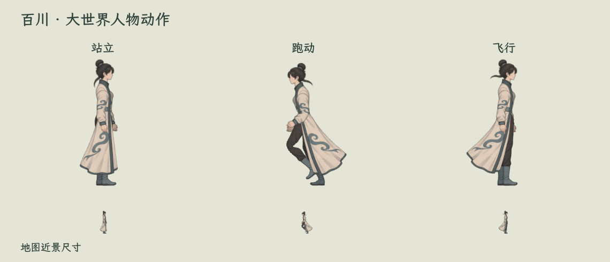
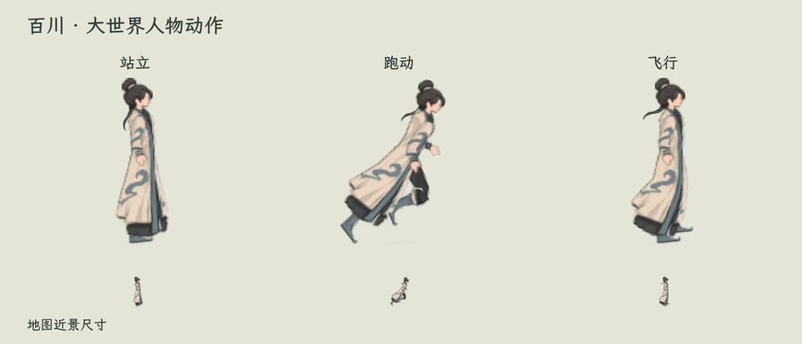

# 百川人物站跑飞与衣发风动

## 袖口与腰臀调整（当前）

2026-11-15。用户指出袖口接缝、手的位置和待机时臀后露出裤腿。逐层观察原帧，发现远侧裤腿的上缘越过袍身背侧，远侧手臂在待机从前襟探出，两只手在跑动经过腰侧时重叠。现将两侧腿根收向髋部，裤腿上缘固定于骨盆，增加长袍臀部的覆盖量，将下摆随风的权重过渡放到髋下。肩位上提，腕轴对到袖口中心，远侧袖手收回衣身遮挡内。迈步前摆时手自然从前侧摆出。

待机对照与动作视频均来自实际角色渲染器。下行以百川近景约 42 像素显示。[最新站立、跑动和飞行](袖口与腰臀_站跑飞.mp4)

- 分别渲染袍子和裤腿，核对两侧待机、跑动、停步、巡航及落风的 624 帧。以髋为中心上下各 7 个模型单位，按 50% 可见度阈值，后侧裤腿露出像素为 0，待机时袍前的露出像素也为 0。左右每处袖口沿腕轴取 15 点，最低覆盖 Alpha 约为 98.0%。[遮挡与袖口采样](袖口与腰臀_遮挡采样.json)
- 已重新采集地图 NPC 和舟上同行者的 128 帧，图集最小接合点 Alpha 约 98.4%。当前 SHA-256 为 `043805f7a9862a8990fa776a270076870c73ffa420c75973f8412fdb9a8d4a18`。[当前共享图集](../../../textures/world/bai_chuan/traveler_rig_20261115/avatar_atlas.png) · [当前来源清单](../../../resources/world/bai_chuan/npc_traveler_rig_20261115.json)
- 百川实机行旅 77 项、NPC 53 项、灵舟 40 项通过，运行名为 `world_traveler_fit_ground_20261115` 和 `world_traveler_fit_npc_20261115`。本轮跑动实机图 SHA-256 为 `e822c5d5b6b57d642e49a41d18b16bef5c8c5ca2e333f664f1ac4628509fe8df`。[百川跑动实机](袖口与腰臀_跑动实机.png)

待机对照图 SHA-256 为 `eab811e36427196f78f19027144b1b3028901842a7c7efeaa1aab132f7ed2c5b`，动作视频 SHA-256 为 `151d80501371111d1a16f9fbc02b154945a5db4046719745df722c6f92118e61`。检查结果记录实际覆盖和动作状态，观感待用户核对。

## 新画件与大世界骨架首版

2026-11-15。用户发现上一版跑动的接合露缝，要求参考《归墟行：人界篇》的大世界行走骨骼，并按百川自己的发型和服装生成素材。新画稿使用白青绣云衣、短束发髻、深裤与青靴，包含头颈、长袍、袖手、裤靴和松发梢五件。袖手和裤靴各是一张连续画件，腰带上下共用一幅袍面纹理。领内、肩窝和髋部保留画件搭接，发梢根部插入后发覆盖区。

在本机 Steam 构建 26674489 的 `Xgame.dll` 中定位到大世界 `MapFigure.Mount`，实际挂载 `idle_travel`、`run_travel` 与 `fly_idle`。装包的 `assets/stage/clips/run_travel.json` 为 0.64 秒，两侧大腿、小腿、脚掌的曲线严格错开半周期。百川按这 16 个相位和肩腿配合重绑，屈伸幅度适应自家袖裤和人物比例。运行时以 21 根 Godot 二维骨骼驱动七张网格，袖肘、裤膝、腕踝及袍腰的顶点连续分配权重，发梢和袍摆各走一条软摆骨链。[百川骨架](../../../gdscripts/world/WorldTravelerSkin.gd)

本机 `Xgame.dll` SHA-256 为 `70b0c9e147ace43f926a905e3c26efa17c37af7274900e902af27180d9910f21`。旅跑曲线 SHA-256 为 `f3ad6c8081a047e369dd4d1ba3341d8bae6d77434dd3bc82d16f498403d16607`。

[新版站跑飞视频](连续骨架_站跑飞.mp4)为 180 帧角色原生渲染，上行放大查看接合与衣发，下行按地图近景约 42 像素显示。

### 实装与验证

- 主角和舟上主角使用实时骨架。地面 NPC、同行者及舟上乘员使用从该骨架采集的六组共享动作帧。首版 128 帧逐帧测 15 个接合点，最低实际像素覆盖率约 96.9%，所有帧均在图集边界内。首版图集 SHA-256 为 `3ae62f12dff5b87d68bc8083ebfd70f1c7369588c14f86a31330a772e4a723b6`。
- 正式百川行旅 77 项、NPC 53 项、灵舟 40 项通过。运行覆盖真实跑动、停步、双向 NPC、暂停、读档、巡航风动、悬停和落地。[NPC 正向实机](连续骨架_NPC跑动实机.png) · [NPC 返程实机](连续骨架_NPC返程实机.png) · [飞行实机](连续骨架_飞行实机.png)
- 放大与地图尺度采样确认衣发随跑动与巡航分段后飘，暂停固定动作时钟，停风后回摆。风动结果、实际图与图集对应本轮版本。[风动采样](连续骨架_风动采样.json)

NPC 正向、返程和灵舟实机图的 SHA-256 依次为 `ef925f6104dcc7c01dd07602761673ca31ab139047e0bce7da36fa67c04726f0`、`6befba4298b0a2a3e84b96f7425d2962109ae71982cfcf56dd4e389e51a7d923`、`9a4db118ee632bc4ee74beb8726dfecdcd8e3d5052794ecc3e42f131ef31bdd1`。构建成功，编译报告有 1 项技能预览脚本的既有异步警告。实机报告运行名为 `world_traveler_rig_ground_verified_20261115` 与 `world_traveler_rig_npc_verified_20261115`。

首版安装后，用户指出袖口接缝、手的位置和待机漏裤腿，见本页当前调整。

### 画件原稿与生成提示词

以[百川上一版动作近看](摆臂重做_近看.png)作为发型、用色与衣装造型参考，通过图像生成得到 1774×887 透明原稿。SHA-256 为 `f98ce22a57e6fd8f51871059b6d6c11fb001eee93c77dd9db761468cdb4b9d39`。[五件原稿](../../../textures/world/bai_chuan/traveler_rig_20261115/traveler_parts.png)

实际提示词

Create one NEW production 2D game skeletal sprite PARTS SHEET on a truly transparent canvas. The reference is our original game's appearance and palette only. Repaint its young adult male cultivation traveler from scratch. Match our sober warm ink line, gently textured rice-paper wash inside the paint, warm ivory white-blue long robe, subdued slate teal flowing cloud embroideries and edge binding, plain warm-black fitted trousers, blue-gray fabric boots, and compact dark charcoal hair in a single round tied bun above the back of the head. Quiet clean side profile with small unaccented face, precisely facing RIGHT on the sheet. This is a tiny world-map traveler at 42px, with clear broad silhouette, controlled color blocks and subtly visible brushwork. Paint with sharp clean outer edges and solid color inside the shapes.

Lay out exactly FIVE independent intact transparent silhouettes in this single landscape sheet, leaving wide fully transparent gutters and margins on every side, none touching:

1. FAR LEFT column, top. A full side-view head and bare neck down to a short rounded column that can tuck under a collar. Black hair flowing up into a small compact round topknot and short side fringe. No accessory, no shoulders or torso.
2. CENTER LEFT column: the long RIGHT-facing sleeveless coat as one solid shape, from high slate collar and shoulder across slim torso and subtle blue waist accent to the single almost ankle-length warm-ivory coat skirt flowing a little to the LEFT. The body is the plain painted cloth armature with all shoulder fabric drawn behind where a sleeve would cover it. Distinct restrained slate-blue cloud curls toward the lower robe, with vertical dark-teal lining edge on its right/front. Coat and skirt are continuously painted through the waist. No exposed skin, sleeves, loose arms, legs, or internal holes. Paint the whole garment as though worn by our reference, with a narrow chest and flowing hem.
3. CENTER RIGHT column: one fully extended downward relaxed arm (turned RIGHT, side view), from broad softly rounded raised shoulder fabric, through a solid uninterrupted warm-ivory upper sleeve and forearm, directly into blue bound narrow cuff and small relaxed hand with compact fingers. The elbow is almost straight for skeletal binding. Sleeve must have opaque fill all the way through the elbow and cuff, and extra ivory fabric above the shoulder pivot. A little blue embroidery on the upper sleeve matches the robe. Hand touches cuff with continuous paint.
4. RIGHT column: one straight, full side-view leg in fitted charcoal trousers connected continuously to a tall slate blue fitted traditional cloth boot with a foot toe projecting to the RIGHT. Round concealed end on the upper thigh; trousers overlap boot fabric. Whole piece from hip to toe is painted as one opaque contiguous silhouette, no separation or bare leg. Foot fully visible. The heel and the bottom sole are at the same height when standing.
5. FAR LEFT column, below the head with a large clear vertical gap: a separate SHORT loose nape lock, matching the same warm black hair. A solid thick upper root that will tuck far under the bun; gradually curves subtly down and LEFT, tapers to one clean point. Small narrow strand, roughly as long as the visible head is tall.

Keep all five piece shapes large enough to rig. Arm and leg are vertically straight for mesh bending and have fully opaque, generously rounded sockets. Strong side profile, clean painterly cutouts, cohesive body proportions (coat roughly four times bare head height, full leg about two thirds the height of the coat, arm about half coat height). There is no drawn assembled character, no other panels, no character outline behind the pieces, no cast shadows, no floor, no checkerboard drawing, no text, no captions, no annotations, no logo. Fill the available landscape canvas with these large five well-isolated parts. Focus on solid separation and clean alpha on the outskirts.

## 上轮摆臂重做记录

此轮沿用旧身体，用户在跑动中看到了膝靴附近的接合缝。该次图集和采样留作历史，当前实物见上文。

双臂随对侧腿交替摆过身侧，前摆时手肘略收，后摆时手肘略伸，肩和头有小幅反向转动。站立与飞行时手落在胯旁，随呼吸或风轻动。跑动每步带起一次幅度较小的发梢和袍角波动，停步后各自回摆。飞行衣发随巡航风压后飘，悬停后逐渐落回。

[新版六秒动作预览](摆臂重做_站跑飞.mp4)由项目角色渲染器采集。上行放大查看手肘与发梢，下行按地图近景约 42 像素显示。视频包含起跑、左右换向、停步、巡航和减风。

### 当时的本机参考

- 《归墟行：人界篇》Steam App 5264930，构建 26656002。读取本机 Godot PCK 中的 `assets/stage/sprites/男主/云肩法袍/pack.json`，该包有 67 个节点和 17 个部件，头发、袖垂和衣摆各有独立跟随链。旅跑 `run_travel.json` 长 0.64 秒，包含交错的双腿相位。飞行 `fly_idle.json` 保留双脚支撑，`float.json` 分别给发与下摆单独的摆动系数。
- 《鬼谷八荒》Steam App 1468810，构建 21758240。本机 `guigubahuang_Data/resources.assets` SHA-256 为 `0d1e14ae4a2719b91055e201fadf294b600f730e5bfbba14f4806b7619ec3ced`，与项目原有男性101的局部解读来源一致。其现有解析记录体现跑动根部后展，衣摆中后段动态跟随，衣身使用连续网格。[原规格人物和落脚记录](../鬼谷原规格首套人物_20261105/README.md)

重做时逐相位核对本机曲线。《鬼谷八荒》男性101的 `Run_New1` 近侧前臂在采样周期内持续上抬，本轮采用其大腿领先相位和落脚骨链。《归墟行》`run_travel.json` 的近远肩错开半个周期，站立和飞行使用各自的姿势，本轮参考这种肩腿配合和低手位，按百川白青常服骨架另设肩位与手肘幅度。该旅跑文件 SHA-256 为 `f3ad6c8081a047e369dd4d1ba3341d8bae6d77434dd3bc82d16f498403d16607`。

### 当时的素材与挂点

- 当时的短发髻固定在头部。新绘短发梢从后发内部起笔，采样 1024×1536 透明原稿，通过三段弯曲跟随头部。腰下衣摆沿两侧骨链分别分配形变，起跑和巡航具备持续后拖姿态，停步和落地以独立阻尼回落。[上轮发梢原稿](../../../textures/world/bai_chuan/traveler_motion_20261115/nape_lock.png)
- 飞行风压读取灵舟相对地图的连续位移和实际高度。地面人和舟上人换显示时传递衣摆与发梢的当前形态。NPC 和舟上同行人使用共享图集，屏外或暂停时停止播放。[共享图集](../../../textures/world/bai_chuan/traveler_motion_20261115/avatar_atlas.png) · [图集清单及来源哈希](../../../resources/world/bai_chuan/npc_traveler_motion_20261115.json)

发梢原稿由内置图像生成获得。提示词要求严格朝右侧面的短束发松梢，顶端宽而圆以藏入旧发片，向左下收成两根靠拢的短尖，使用两级暖炭灰水墨、透明底和清楚的边缘。生成的透明原稿 SHA-256 为 `9b066ce06ebcf613274bd14daf4e52aa601ee0afc382e6013989dd4c4d7f61ff`。

### 当时的实机结果

- 跑动按单周期 80 个相位采样，双腿前后关系明显的 70 个采样均为对侧肩领先。手肘屈曲约 39° 到 63°。站立、停步和飞行的双腕均落在肩下。[摆臂相位](摆臂重做_相位.json)
- 原生预览采集 180 帧，检查了步态渐混、双向跑动、跑动腾空、飞行脚点和停风回落。巡航发梢的后飘角度大于跑动，悬停后袍摆和发梢继续回落。[衣发风动采样](摆臂重做_风动采样.json)
- 正式百川地图行旅 77 项、NPC 68 项与灵舟 40 项均通过，覆盖地图跑动、停步、暂停、NPC 双向动作、巡航风动、悬停和落地。[本轮飞行实机](摆臂重做_飞行实机.png)
- 重采 NPC 图集共 128 帧，六组的帧号完整，19 个来源文件哈希与清单一致。图集 SHA-256 为 `13e720d0573c1dde881d7a2c0d9ffd1fa711bcc425cc4988089ee24b56ea47e2`。实机图 SHA-256 为 `8529a061d6d03a8b09fb8b6c305f80b873215d77884fac738bd306d56641a049`。

## 首轮记录

[首轮六秒动作预览](站跑飞动作.mp4) · [首轮动作近看](站跑飞近看.png)

近看逐帧采集包含 180 帧。采样确认起跑逐步进入步态，跑动腾空不超过约 1.49 个模型单位，飞行人物脚点与甲板参考点一致，落风后衣摆仍有回摆。[采样报告](动作采样.json)

- 正式百川 NPC 检查 68 项通过，覆盖共享图集来源、双向跑动、缩放、暂停、屏外停止、点击与读档。
- 正式灵舟检查 40 项通过。实机处于飞行状态时，主角的衣摆、发梢达到巡航形变，同行者切入飞行动作，暂停时主角动作时钟冻结。悬停、重载、落地和续航检查同场通过。[百川近景实机](百川飞行实机.png)
- 正式地图行旅 77 项通过，覆盖驻足、跑动、途中停步、暂停保持动作、鼠标操作与窗口缩放。固定地点数检查按 123 处原地图标记统计，动态副本标记另走其原入口。.NET 构建 0 警告、0 错误。
- 图集采集 128 帧，所有帧通过透明边界检查。图集 SHA-256 为 `3bbba24e0210b902454f6b5662d4a60ad6c452786b303ee43ac5c9216597619d`。飞行实机图 SHA-256 为 `f786029eff8239f3cf8c0e47eedefe47faed6381fcc2b6d8fa582382e2257df9`。

