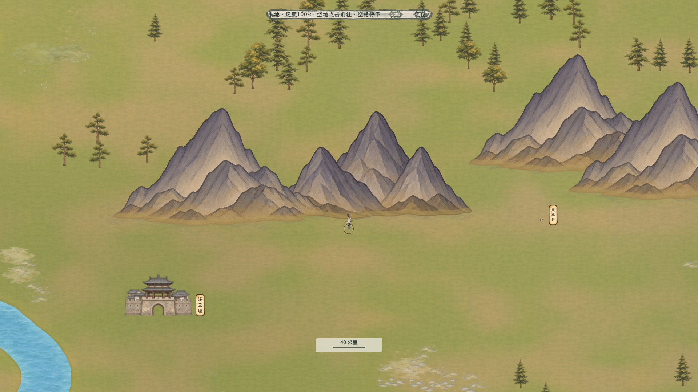
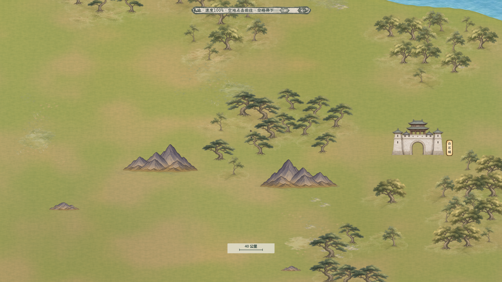

# 百川原山接地与俯视桥

2026-11-09，按用户最新要求恢复原来的灰紫整山，只调整山脚与地面的衔接，九座新俯视桥沿用。已接入当前大世界。[现行方案](../../plans/世界与探索/百川原山接地与俯视桥_20261109.md)。

## 实际效果

[相同原山、未处理衔接](xiyun_before.png) · [山脚细节改前](xiyun_foot_before.png) · [山脚细节改后](xiyun_foot_detail.png) · [完整Main实际行走](xiyun_main_walking_1920.png)。对照均使用1920×1080生产地图、同一镜头、原山轮廓与俯视桥，改前仅关闭接地材质及独立山脚贴花；细节图为原截图等比例像素裁取，未重绘或放大。

[河边原山及俯视桥](river_mountains_after.png) · [竖向俯视桥](vertical_bridge_after.png) · [白石自然树林](white_stone_forest_after.png)。已逐图检查溪云城大山组、白石小山及河边山脚，保留原山风格与大小，仅以较淡土色、接触暗部及少量碎石接到草地。

## 修改范围

429处山体、两张原生山图集、八款区域目录、每座山的X/Y、尺寸、翻转与脚点Z，全部与不可变原版 `landscape_expanded3x_20261106.json` 逐值一致。原山阻挡、地形耗时来源也恢复；原123地点、444内部锚点、575路线、5490棵活动树保持。地图仍为8000公里见方，最近档0.8/40公里标尺、人物52世界单位、建筑85%比例保持。

所有原山启用已有的下缘接地材质，保留原生柔和Alpha并将轮廓脚边与土色融合；本次未改着色器。2485处独立山脚贴花沿原图每列真实可见下缘布置，向山脚内侧靠拢，只露出较窄外沿；按前山遮挡和同组下包络过滤，避水、建筑与桥，独立地面Z24。425座山有合法可见贴花，另外4座的候选位置被前山或排除区完全覆盖。

白石136棵自然树和344处林下/根脚装饰保持；原32处样区山脚由本轮全域原山接地替代。原11199处通用地表小景沿用。九座严格俯视桥的素材、尺寸、坐标、朝向与上一轮逐值一致。

## 数据与原稿

[原山新视觉场景](../../../resources/world/bai_chuan/landscape_original_grounded_20261109.json) · [全域原山接地坐标](../../../resources/world/bai_chuan/mountain_ground_original_20261109.json) · [沿用自然树补丁](../../../resources/world/bai_chuan/forest_grounding_sample_original_20261109.json) · [原版细导航](../../../resources/world/bai_chuan/free_navigation_expanded3x_20261106.json) · [原版地形耗时](../../../resources/world/bai_chuan/terrain_travel_expanded3x_20261106.json) · [可复现工具](../../../tools/world_map/build_bai_chuan_original_grounding_20261109.py)。

本次未生成新山或重绘PNG，使用[原完整山体素材](../百川完整山树分层_20261106/README.md)、[已有接地素材及提示词](../百川山林接地样区_20261106/README.md#原生素材与提示词)和[上一轮俯视桥原稿与提示词](../百川短峰层叠与俯视桥_20261109/README.md#原生素材与提示词)。原素材、历史场景/导航和上一轮短峰来源均保留。

## 验收

- 原山、桥、导航、地形、树及贴花的独立检查15918项通过；2485个真实下缘锚点、前山遮脚及组下包络、水/建筑/桥避让均独立重算。[几何报告](../../../output/bai_chuan_original_grounding_20261109/geometry_independent_report.json)。
- 生产迁移1375项通过。合法的原山档/短峰中间档精确保留玩家位置、路径和风险点；短峰版站入恢复山体、起点/终点/段中/中间点受阻、仅风险点受阻、押送起点/路段受阻、自主飞行落点受阻均合法迁移，原来源自身非法仍原子拒绝。两种同尺寸来源的1150条定向NPC曲线保留加权小时数。[生产迁移报告](../../../output/bai_chuan_original_grounding_20261109/production_migration_report.json)。
- 三份新视觉数据重复生成字节一致，旧18来源哈希保持，生成器未写导航或地形。[生成清单](../../../output/bai_chuan_original_grounding_20261109/generation_manifest_20261109.json) · [重复生成](../../../output/bai_chuan_original_grounding_20261109/repeatability_20261109.json)。
- 生产GPU实际画面27项通过，完整Main行走、停止、拖动、缩放与地点交互73项通过；溪云城性能及无按钮悬停25项通过。[真实画面](../../../output/bai_chuan_original_grounding_20261109/actual_map_visual_report.json) · [实际行走](../../../output/bai_chuan_terrain_speed_20261105/qa/original_grounding_movement_20261109_report.txt) · [性能/悬停](../../../output/bai_chuan_terrain_speed_20261105/qa/original_grounding_xiyun_performance_20261109_report.txt)。

本机1920×1080、溪云城最近档、完整NPC模拟连续行走100帧：平均16.46086毫秒，中位16.055，P95为23.644，最大54.312；超过50毫秒1帧、超过100毫秒0帧，全程实际移动。关闭NPC行走平均16.5405毫秒，驻足16.70726毫秒。[原始性能](../../../output/bai_chuan_travel_performance_20261106/original_grounding_xiyun_performance_20261109.json)。本轮未改C#，复用当前构建；隔离存档、GPU场景串行，未操作用户运行中的游戏，未验证导出包。
