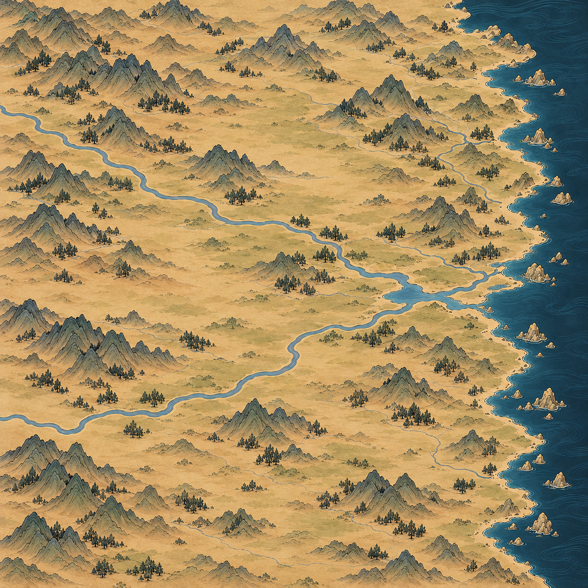

# 百川参考图画风底图

最新状态：用户否定v1的视觉方向，指出原参考感觉丢失，并明确200公里×200公里范围。已完成[相关对话回查与纠偏](对话回查与纠偏.md)；下图保留供对比，不作为后续生产母图。

2026-10-30，用户提供手绘地图参考，明确保留百川布局和东侧海岸、只模仿画风，并允许加入参考图中的小型树林。此确认覆盖此前无树要求；节点继续使用与底图清晰度和笔触一致的独立贴图。

使用内置 image_gen 工具生成，实际原图1254×1254，已检查文件尺寸；提示词请求更高尺寸，但工具本次未返回2048。未放大冒充6144生产母图。完整提示词见[生成提示词](生成提示词.txt)。参考图仅供画风，已有开阔底图用于河流与海岸大方向。本次生成一张完整方形底图，采用暖赭纸底、灰绿山体、细墨轮廓、深青海面及小型针叶林簇；不包含建筑、文字、路线与节点。

目视检查：东侧长海岸、两条西来河流、开阔平地及树林已出现，无建筑和文字。山群、河岸与123个具名地点及逻辑桥位尚未逐点校准，不能视为精确地理落位通过。仅为整幅画风底图稿，未替换游戏测试或正式地图，未修改节点、路网和旅行数据；九张2048生产分块与节点配套尚未制作。
