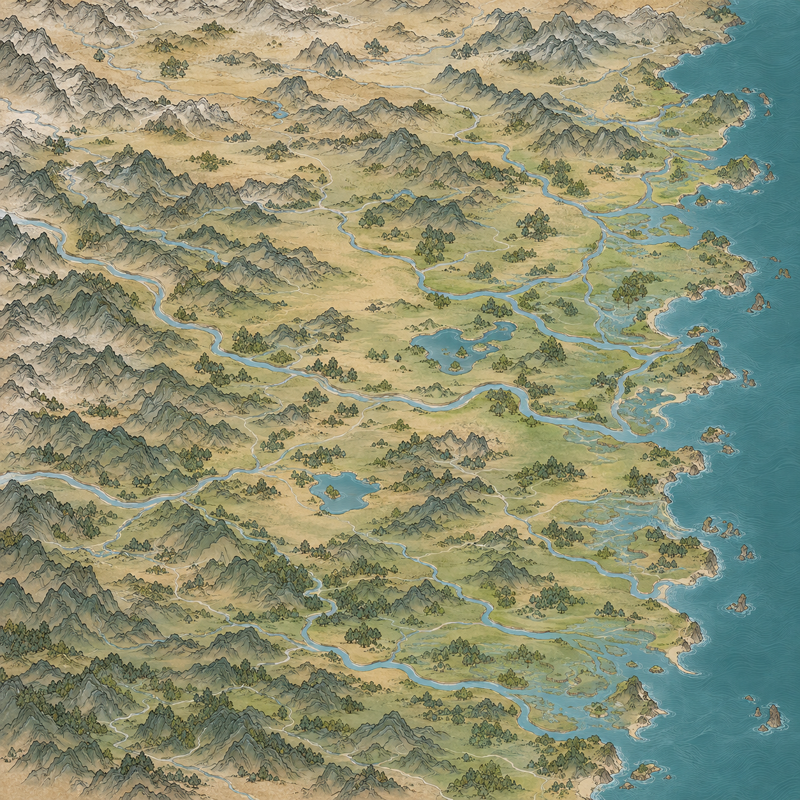

# 百川四图参考整幅效果

2026-10-30，用户要求先看完整地图，补充四张游戏地图寻找感觉。用内置image_gen工具生成一张完整百川底图，综合舆图的地域组织、低伏山脉、山体叠压、清楚的河谷和平地。沿用全域200公里×200公里，参考图尺度对应约1/9面积、向横纵各三块延展的要求。

实际原图1254×1254。提示词请求3072，但返回尺寸未达到；本图仅用于整幅构图及画风审阅，未放大为6144或裁切冒充九张2048生产底图。完整提示词见[生成提示词](生成提示词.txt)。

目视可见东侧长海岸、西侧山地、内陆河谷、小湖及树林。仍有较多地表纹理和偏密西岭，原生像素不足以检验1/9区域的正式显示清晰度。用户尚未评价，不能视为画风确认。未按123地点逐点校准，建筑、地点名称和道路尚未叠加，未接入游戏。
