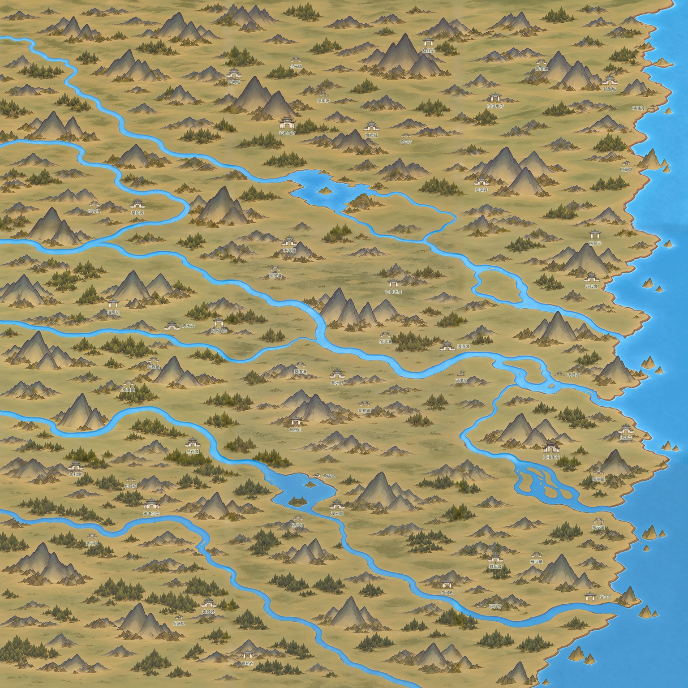

# 百川地图与节点验收

[打开可操作验收页](百川地图与节点验收.html) · [下载完整验收包](百川地图验收包.zip) · [查看完整预览](完整地图与节点预览.jpg)

2026-10-30，按用户最新指定恢复灰绿暖土色调，保留本批九块的地面景深和修复水系；三路并行用内置image_gen分别处理九张色调，再统一进行色调校准与接边。三个一级势力使用各自的透明门楼贴图，其余同类型复用。现已接入游戏内独立测试入口，正式行旅地图与存档未替换；等待用户确认后再替换实际地图。

## 游戏内验收（2026-10-31，当前）

从首页「试演与预览」→「百川九图 · 地图测试（固定倍率）」进入；也可双击 tools/run_bai_chuan_map_acceptance_20261030.cmd。标题为「百川舆图 · 新版验收测试」。正式行旅地图仍待用户确认后替换，本轮不改存档、旅行耗时或正式寻路。

当前游戏读取 display_layout_v3.json。按用户最新裁定，路径贴近节点时自然接入，途中不得无节点相接。575条显示边仅在444个真实节点处连接，321个普通过渡点保留；原498条相邻联系各记录为一串真实显示节点，形成132个独立环，不退化成一棵树。共用路段只绘一份，路口由显示图实际度数决定。显示图已改变，正式规划图未替换；不能把这批预览连接当成已接入正式旅行。

节点以底图地形为先：123处逐项分类，其中53处相对上一展示位置调整；朱明谷离开山体正面、葬日谷移入内陆山间开口、疏影潭撤出外海小岛至主陆水岸、天门峡靠两峰间入口。具名地点最小显示间距约175像素，仍比最初52像素疏开。部分泉、潭、泽名称只能靠近画面既有水岸或低地，底图没有为每个名称单独画出专属地貌。[地形前后对照](../../../textures/world/bai_chuan/acceptance_20261030/terrain_key_before_after.jpg)。

虚线加深为近黑墨色，沿低地、山前和岸边绕行；灰山颜色取样占比由v2的12.21%降至5.75%，水域2.98%降至1.69%，外海取样为0，连续大于80像素的灰山或水域长段均为0。这些是画面颜色蒙版复核，不是高程、桥渡权限或实际通行证明；短过河仍须正式接入前统一校准。[地形路线审阅](../../../textures/world/bai_chuan/acceptance_20261030/route_terrain_review_v3/terrain_metrics.json)。

独立几何检查基于完整折线，不靠虚线空隙、贴图或名牌遮住问题：非节点交叉/搭接/重叠为0，误穿无关联节点为0，非节点处4像素墨线净距检查通过；距路段中部14像素以内、却没有接入的节点为0（路段中部要求距两端沿路均超过18像素）。独立报告绑定实际加载文件SHA256，防止沿用旧数据检查。[几何检查](../../../textures/world/bai_chuan/acceptance_20261030/display_layout_v3_independent_audit.json)、[显示图与原联系映射检查](../../../textures/world/bai_chuan/acceptance_20261030/display_layout_v3_checks.json)。

项目自带 Spine 3.8 / .NET Godot 4.7.2 引擎完成无窗口与1920×1080 Windows窗口各2639项检查，失败0：从真实首页进入与返回、123名称选择、53建筑鼠标悬停/点击与透明孔洞、原像素大小、图层与相机、575显示边首尾及444节点连通、498原联系逐条沿新图可达、几何报告与加载文件哈希一致。自动交互检查不代替用户美术验收。

- [窗口检查](游戏内验收_Windows.json) · [无窗口检查](游戏内验收_headless.json)
- [玉虚游戏截图](游戏内_玉虚仙宗.png) · [玄都](游戏内_玄都天府.png) · [无相](游戏内_无相圣宗.png)
- [朱明谷](游戏内_朱明谷.png) · [葬日谷](游戏内_葬日谷.png) · [疏影潭](游戏内_疏影潭.png) · [天门峡](游戏内_天门峡.png)

名称沿用用户所给纸牌素材去字提取的透明纸纹底板，由内置image_gen制作、以九宫拉伸复用；三宗18号字、其余建筑16号字、自然地点14号字，名称与贴图独立，保留点击/悬停。名牌之间及名牌遮建筑检查均为0。[底板、用户参考与完整提示词记录](../../../textures/world/bai_chuan/acceptance_20261030/nameplates/generation_record.json)。

本节为最新游戏测试版。下方浏览器页面与离线ZIP是此前画风/素材交付快照，仍保留旧横排名称和初始落位，不代表当前路网。九张1254底图、3762整图、53建筑九种实际尺寸贴图保持。

引擎退出时仍有一张12280字节纹理及1个RID未释放日志；单独运行旧首页、不进入地图也出现同样退出日志。本轮未改该既有问题。最新窗口日志在 output/bai_chuan_ingame_20261031.log。

## 此前浏览器快照怎样验收

- 点击“全图”查看色调、地貌疏密和完整海岸；打开九宫格检查分块。
- 点击“实际尺寸”或三大宗门按钮，以1:1查看建筑大小与笔触；拖动地图平移，滚轮不改变倍率。
- 左侧搜索或筛选地点，点击查看；门楼悬停提亮，点击保留选择。名称、建筑节点及自然地点可分别切换。
- “素材与大小”按真实像素显示九种采用贴图。底图由九张构成，53处建筑和70处自然地点共123处均可从列表查看。
- 下载完整验收包并完整解压，用浏览器打开index.html；背景、节点、数据均在包内，正常使用不依赖网络。

## 本次交付

九张底图各1254×1254，整图3762×3762。用户颜色参考与最终整图RGB统计接近，但统计只辅助校准，不代表美术已获认可。内置工具本次仍未输出原生2048单块；不将1254放大冒充九张2048／6144生产图。

九种透明贴图对应53处建筑：3个一级势力各自独立，10个二级宗门同模板，16城同模板，14镇同模板，5坊市／3村／2渡分别同类复用。一级宽100像素，二级72、城87、镇61、坊58、村44、渡47；名称独立于贴图。

地点逻辑ID与坐标仍来自原规划。显示贴图单独登记artOffset，以避水、避大树和贴近山脚低坡；该偏移不修改地点逻辑坐标或路网。最大显示偏移约255像素，详见presentation数据。抱朴山和沧溟水府经目视复核后又向原有低坡靠近；原尺寸宗门局部见[落位检查图](宗门原尺寸落位检查.jpg)。小门楼与山前／山肩的具体意境仍由用户审阅，不能把蒙版分数当作“山上落位”已获认可。

## 验证与边界

[浏览器实测记录](浏览器验收.json)、[落位检查](落位检查.json)、[九图尺寸与水域检查](底图尺寸与水域检查.json)、[交付核验](交付核验.json)。

已检查九图裁切与整图像素对应、透明PNG尺寸和素材复用；建筑外接范围无压水、无互相重叠，树林检测只作辅助。两组主要水域颜色连通组件均有左侧画外来水；这是无方向的图面连通检查，不证明流向高程，最南西来河仍跨下边框。

Microsoft Edge在1920×1080完成35项浏览器实测，全部通过：63张页面图像加载、123地点逐项选择、53建筑／9素材计数、同类复用、三宗定位到1:1、分类搜索、四类图层开关、自然地点选择自动显示、跨分类宗门跳转、拖拽平移、滚轮倍率锁定、悬停与点击、素材真实宽度，以及可携带离线包的资源加载、实际尺寸和素材页。见[玉虚实际尺寸截图](浏览器实测.png)、[全图截图](浏览器全图实测.png)。这些是功能和资源检查，不代替用户美术验收。

接边使用6像素共同几何参考带并向内42像素过渡，几何参考来自旧1254母图并按最新参考做颜色校准。该窄带清晰度低于新生内区，仍须用户目视审阅；接边像素差小不代表完全无缝。见[十二处接边审阅](十二处接边审阅.jpg)及本目录12份原尺寸条带。

生成原图与完整提示词：底图在textures/world/bai_chuan/acceptance_20261030/recolored下九份record.json，节点在[节点素材目录](../百川节点透明贴图_20261030/README.md)。验收包包含采用的九块PNG、九张实际尺寸节点、节点高分辨率源图、完整浏览数据与生成记录。
