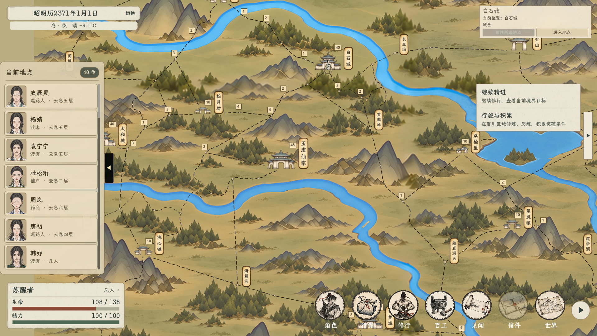

# 百川地图人数标记避让

2026-11-03，按用户反馈修复人数与地点名称重叠。正式地图人数不再只使用固定右上角偏移，而是在名称完成缩放与落位后，按实际字宽、字号、边框和图标范围选择附近空位。

- 地点名牌、建筑图标、途经点圆标和已放置人数框都参与避让；相邻地点的名称也会被纳入检查。
- 保留人数显示、字号和三档节点显隐规则；不删减或隐藏人数来消除重叠，不改节点、路网或旅行数值。
- 人数变化、缩放和窗口尺寸变化后重排。优先紧贴所属节点，按稳定节点顺序安排位置，相同人数刷新或名单顺序变化不会使人数框漂移。
- 小窗口最远档改为悬停显示城市名称时，浮动名称同样参与避让；退出悬停后恢复常态布局。

## 实际画面

[1920×1080近景](近景人数避让.png) · [1280×720全图](全图人数避让.png)

## 验证

- 自动布局专项覆盖1920×1080、1280×720、1024×720的三档缩放、平移、人数变更、统一五位数人数压力、重复刷新及名单逆序，以及小窗口16座城市逐个悬停。
- 43组布局、4948个人数框检查，名称／图标／人数框重叠和远景越出HUD安全区均为0；重复刷新及名单逆序的位置稳定检查通过。
- 正式1920×1080与1280×720窗口三档缩放、节点命中、行旅、棋子移动及地点进入检查通过，已查看实际截图。运行时脚本加载与旅行计时检查通过。退出时仍有此前存在的Godot资源释放告警，本轮未处理退出清理。
- 专项脚本：`tools/world_map/verify_bai_chuan_badge_layout_20261103.gd`；日志：`output/bai_chuan_badge_layout_20261103/`。所有游戏检查使用隔离用户数据。
