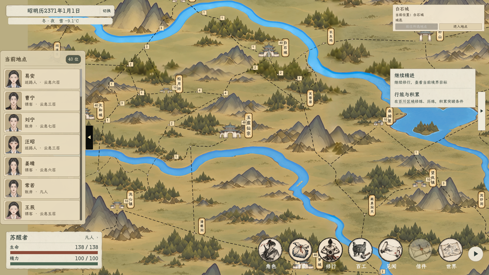

# 百川地图道路疏密修订

2026-11-03，按用户要求改善节点过近和道路连续急折，已更新正式地图共用的 `display_layout_v3.json`。遵守[节点路线主案](../../plans/世界与探索/百川节点分层与过渡路线规划_20261027.md)：地形优先、近黑虚线、真实节点会合，完整路网仍只在最近档显示。

## 调整结果

| 项目 | 调整前 | 调整后 |
| --- | ---: | ---: |
| 小于60世界像素的节点对 | 66 | 1 |
| 小于80世界像素的节点对 | 140 | 27 |
| 双连接途经点中大于45度的折转 | 55 | 1 |
| 双连接途经点平均折转角 | 43.48度 | 2.82度 |
| 全路网曲线总长 | 84064.30像素 | 83501.16像素 |

- 调整213个途经点，单点最大位移97.33像素；清理152段细碎折线，123段道路内部折弯与287处贯通节点采用柔和转折。
- 123个具名地点及其建筑落位全部保持。444个节点、575条连接、498条原联系的路径映射与原数据逐项相同；没有删点、合点或重接分支。
- 85像素是本轮美术疏密优化目标，不是强制等距网格或新增玩法数值。仍保留一处较紧连接：`bc_place_023`—`bc_transit_144_01`，约43.54像素；本轮候选移动未通过地形与道路净距联合检查，保留原位。
- 行旅、人物移动和显示道路继续共用同一份曲线；仍按3762像素对应200公里、遁速100每40公里24小时计时。路线长度随曲线调整而变化，完整路网总长约减少0.67%，各条路线变化不同。

## 游戏画面

[调整前近景](调整前近景.png) · [调整后近景](调整后近景.png) · [调整后全图](调整后全图.png)

## 验证与边界

- 独立几何检查通过：端点不一致、非节点交叉／搭接、误穿其他节点、近节点中段擦过、墨线净距不足及越界均为0。
- 地形颜色采样中，连续穿山或跨水超过80像素的道路均为0，没有海面道路。颜色识别仅作画面辅助检查，不代表高度、桥渡权限或完整地理语义验证。
- 节点图加载、最短路径、反向路径、旅行状态恢复检查通过；实际行旅推进时间与新路线预览一致。
- 项目编译通过，0警告、0错误；正式窗口1920×1080与1280×720的三档缩放、节点点选、棋子移动、行旅和地点进入检查通过。
- 单击、双击、滚轮、拖拽、遭遇锁定和图标／名牌交叉双击的正式窗口专项通过。
- 缩放检查曾在同一城市的连续点选中误触双击行旅；改动前布局也复现。缩放检查增加0.5秒单击间隔，双击专项将依赖帧数的过期等待改为0.51秒实际等待，未改变游戏双击窗口或行动规则。通过后退出仍有Godot资源释放告警，不能声称退出过程无告警。
- 验证日志与数据差异：`output/bai_chuan_route_refine_20261103/`；独立几何报告：`textures/world/bai_chuan/acceptance_20261030/display_layout_v3_independent_audit.json`。检查使用隔离用户数据，没有读取或覆盖玩家存档。
- 复现工具：`tools/world_map/refine_bai_chuan_routes_20261103.py --input output/bai_chuan_route_refine_20261103/before_layout.json`，只生成候选，不直接覆盖正式布局。
