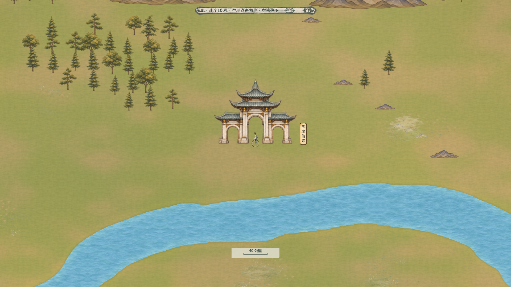

# 百川地表小景与草地色差

最新追加见[白石山林接地样区](../百川山林接地样区_20261106/README.md)：局部自然林团及山脚过渡已实装，另将53处建筑素材缩小15%；本页保留通用11199处小景的原阶段来源和验收。

2026-11-06。用户要求学习《龙胤立志传》，让当前底图更丰富。本轮参考其本机资源中可见的地域色差、成组与零散结合的小景，以及建筑周边留白；继续使用百川自己的黄绿纸墨风格和新生成素材。规则主入口为[三倍地图](../../plans/世界与探索/百川三倍地图与固定人物_20261106.md)。

## 实际效果

[白石](白石新增小景.png) · [南部开阔地](南部新增小景.png) · [完整主场景](完整主场景.png) · [同视角改前](玉虚改前.png) · [原生小景一览](小景原稿纸底预览.jpg)。地图图片来自生产地图的1920×1080实际GPU画面。

增加三层地面变化：大范围的浅草绿与暖土色过渡、低对比草地/苔地/沙地小斑块、草丛/小花/碎石/平石/低芦苇等细节。保留成片开阔地，避免等距铺满小景。宗门和城镇全建筑框外另留45世界单位，桥框外留30；完整小景投影框避开山、水和世界边界。

九款小景以748个不规则自然簇组成11199处独立摆放。平地、旱地、林缘、山脚和水岸分别选材，芦苇与水岸保持约40—160世界单位距离。最近档白石可见77处、玉虚66处、南部96处；草、石和芦苇均低于现有人物52世界单位，地表斑块可以更宽。

全部小景有固定X/Y/Z，Z=24，仅为不阻挡人物的地面贴花；山树建筑继续使用原脚点遮挡。地表色差只影响已有地面纹理，不改变河网和水面。8000公里总幅、最近档40公里标尺、人物尺寸、123地点、575联系、导航和耗时均沿用。

## 原稿、提示词与布局

使用**内置imagegen**生成九款原生透明素材，实际图集1254×1254；完整原PNG和Alpha保持，运行时仅添加缩小采样层，未把放大插值算作原生清晰度。

- [已保存原生透明图集](../../../textures/world/bai_chuan/ground_details_20261106/ground_details_native.png)
- [完整最终提示词](../../../textures/world/bai_chuan/ground_details_20261106/prompt.txt)
- [九款区域、尺寸、脚点与原图哈希](../../../textures/world/bai_chuan/ground_details_20261106/catalog.json)
- [固定XYZ布局](../../../resources/world/bai_chuan/ground_decorations_20261106.json)
- [可复现布局工具](../../../tools/world_map/build_bai_chuan_ground_details_20261106.py)

全图只共用一张小景图集。按空间区块与种类合批绘制，视口附近才创建批次，全域档隐藏微小细节；不为11199处小景各创建一个节点。相机变化只调度批次，不改布局坐标或游戏状态。

## 验收

布局工具全量检查与独立逐条检查均通过：完整投影框避开山、水、建筑与桥，材质尺寸等比且最近档不超过原生分辨率，全部XYZ正确；重新生成的布局字节完全一致。现有地图源文件哈希保持。

隔离GPU批绘24项通过，与原生Sprite对照采样像素差为0，包含图集区域、翻转、透明度、跨区块和先画地表斑块的次序。原生纹理与PNG fallback的全部RGBA基准字节一致，并有缩小采样层。

[布局报告](../../../output/bai_chuan_ground_details_20261106/placement_qa.json) · [独立检查](../../../output/bai_chuan_ground_details_20261106/placement_independent_qa.json) · [可复现性](../../../output/bai_chuan_ground_details_20261106/determinism_qa.json) · [真实地图图像与缩放检查](../../../output/bai_chuan_ground_details_20261106/actual_map_visual_report.json)。

真实地图近景、三处改前/改后、单独地表色差和小景、三档缩放共27项通过。地表颜料色差采用原生纸面纹理的低频采样，跨片统一世界坐标，玉虚、白石与南部实际画面人工检查过渡完整。近景白石16个活跃区块/59批、玉虚12区块/37批、南部16区块/51批，实际强制刷新约1.3—2.6毫秒；普通行走只在区块进入/离开时新建/移除批次。

完整Main实际行走、地图拖动缩放及地点检查73项通过；性能和多余悬停检查23项通过。当前版本本机1920×1080，完整NPC模拟连续行走100帧，平均18.528毫秒/帧（约54帧），P95为40.238、最大57.265；2帧超过50毫秒、0帧超过100毫秒，采样全程实际移动。驻足平均16.637毫秒、关闭NPC模拟行走16.562毫秒。[实际行走报告](../../../output/bai_chuan_terrain_speed_20261105/qa/ground_details_movement_20261106_report.txt) · [性能及悬停报告](../../../output/bai_chuan_terrain_speed_20261105/qa/ground_details_final_performance_20261106_report.txt) · [原始性能数据](../../../output/bai_chuan_travel_performance_20261106/ground_details_final_performance_20261106.json)。
