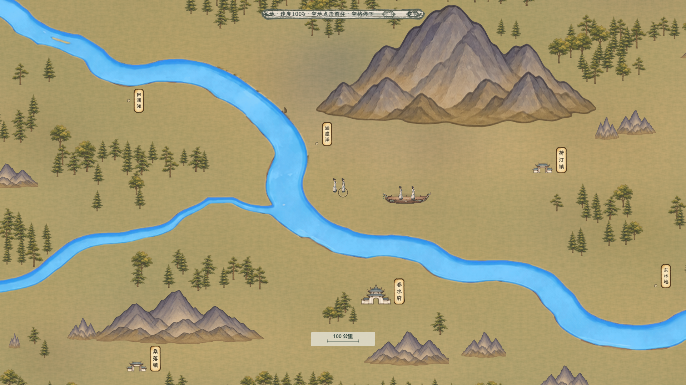

# 百川完整山树分层与统一人物

本页为7372.8画布的上一阶段记录。现行版本见[三倍地图与原生素材](../百川三倍地图_20261106/README.md)，人物已改为52世界单位、最近档约41.6屏幕像素；下方旧数据及原图保留为迁移来源和历史验收。

2026-11-06。按用户最新要求：底层仅地表纹理与原水系，山树独立；山体必须完整且不可步行，树不得长在山面；主角、NPC、同行者及舟上人物共用40屏幕像素。灵舟保持150像素，树缩至52—76世界像素。规则主入口见[当前方案](../../plans/世界与探索/百川高清分层与显示尺度_20261106.md)。

## 实际画面

[真实主场景NPC同尺寸](主场景NPC同尺寸.png) · [近景主场景](主场景地图.png) · [纯地表水系](地表与水系.png) · [全域缩放](全域.png) · [山后遮挡](山体后方.png) · [同位置前景像素验证](山体前方.png) · [树后遮挡](树后.png)。全部为真实Godot运行画面。遮挡像素验证会暂时隐藏周围其他景物，以隔离被测山树；主场景和近景图保留正常场景。

初版按岩面颜色抠图切掉山腰，错误地产生空心山，且把树放进山腰缺口。该版已撤下。现用8种完整无植被山体，按原山地区域及显示框放置339组；树2644棵，完整投影框避开山体。9组临岸山体略移以避开原水系，未切开山体。

山体投影按最终透明轮廓离线烘焙为步行阻挡，575个原联系中200段绕山，保留444兼容锚点与123地点身份。14个地点入口及49个内部锚点移到同区域附近合法地面，地点最大移动约130.3显示单位；原内景、身份和交接条件保持。逐项调整见[导航报告](../../../output/bai_chuan_layered_20261106/mountain_navigation_report.json)。

## 原生素材与提示词

使用**内置imagegen**生成，无CLI/API回退；以下均已复制到项目目录，原图及生成Alpha保留。边缘透明度由渲染器柔和收束，不在源图上重新绘制。原生尺寸如实列出，不把游戏画布或插值后的尺寸当成原生画稿。

| 素材 | 实际原生尺寸 | 完整最终提示词 |
| --- | --- | --- |
| [独立树图集](../../../textures/world/bai_chuan/layered_20261106/source/trees_native.png) | 1312×1199，4棵独立树 | [树提示词](../../../textures/world/bai_chuan/layered_20261106/prompts/trees.txt) |
| [纯地表纹理](../../../textures/world/bai_chuan/layered_20261106/source/ground_native.png) | 1254×1254 | [地表提示词](../../../textures/world/bai_chuan/layered_20261106/prompts/ground.txt) |
| [完整山体A](../../../textures/world/bai_chuan/layered_20261106/source/mountains_solid_a.png) | 1536×1024，4组 | [山体A提示词](../../../textures/world/bai_chuan/layered_20261106/prompts/mountains_solid_a.txt) |
| [完整山体B](../../../textures/world/bai_chuan/layered_20261106/source/mountains_solid_b.png) | 1536×1024，4组 | [山体B提示词](../../../textures/world/bai_chuan/layered_20261106/prompts/mountains_solid_b.txt) |

山体参考为项目原黄绿地图；地表、树与灵舟使用项目自身素材风格，不复制商业游戏资产。原3762母图、9片1254、水系以及上一版导航和布局文件未覆盖。地面纹理重复采样，山树不再画进地面；人物骨架和NPC共享图集沿用，只统一尺寸及地图实例内部层级。后续精细化人物应继续使用同一标尺和脚点，并重新采集共享NPC图集。

## 验收

隔离APPDATA运行，未写入玩家存档。引擎纹理转换后逐字节重读校验通过，C#编译0警告0错误。

| 项目 | 结果与证据 |
| --- | --- |
| 完整山面全部禁止步行、山树零相交、山体不压河面、所有锚点及575联系、细分角点、NPC旧路段迁移 | [1603项通过](../../../output/bai_chuan_layered_20261106/navigation_runtime_report.txt) |
| 实际遮挡像素、舟栏、40像素共用标尺、三档裁剪、旧在途/驻足/遭遇、未知与损坏存档拒绝 | [61项通过](../../../output/bai_chuan_layered_20261106/visual_report.txt) |
| 真实主场景NPC共享形象、行走/暂停/屏外、三档同尺寸、点击交互及完整读盘 | [118项通过](../../../output/bai_chuan_terrain_speed_20261105/qa/complete_mountains_npc_20261106_report.txt) |
| 真实行走、停走、鼠标、拖图、进入地点及1280窗口 | [73项通过](../../../output/bai_chuan_terrain_speed_20261105/qa/complete_mountains_movement_20261106_report.txt) |
| 完整世界、旧尺度及NPC导航迁移/重复读盘、押送战后接续 | [105项通过](../../../output/bai_chuan_terrain_speed_20261105/qa/complete_mountains_compat_final_20261106_report.txt) |
| 写盘重建、连续位置、旧档、可见遭遇 | [51项通过](../../../output/bai_chuan_terrain_speed_20261105/qa/complete_mountains_event_20261106_report.txt) |
| 实际地形速度、耗时、跨地形、暂停及存读 | [126项通过](../../../output/bai_chuan_terrain_speed_20261105/qa/complete_mountains_terrain_20261106_report.txt) |
| 灵舟仍可跨山河、独立高度、在途存读和跨月 | [22项通过](../../../output/bai_chuan_layered_20261106/flight_regression.log) |
| 全人口行走及导航悬停回归 | [23项通过](../../../output/bai_chuan_terrain_speed_20261105/qa/complete_mountains_performance_20261106_report.txt) |

完整NPC演算下100帧实际行走：平均16.417毫秒，P95为26.164毫秒，最大39.535毫秒，超过50/100毫秒均0，100帧全程在移动。关闭NPC演算的实际行走平均16.503毫秒。该组为本机采样，不代表跨设备帧率保证；[原始统计](../../../output/bai_chuan_travel_performance_20261106/complete_mountains_performance_20261106.json)。视口场景在1920近景约268个独立景物，移镜查询这次记录约0.8毫秒。

日志仍有既有UID文字路径回退、NPC图集直接图像读取提示，以及多次重建主场景时既有Mono GCHandle清理报错；功能检查全部通过，不将其称为全局无警告。未对导出包另行验收。

## 重建入口

依次运行`build_bai_chuan_layered_landscape_20261106.py`、`build_bai_chuan_mountain_navigation_20261106.py`，再使用Godot运行`bake_bai_chuan_landscape_textures_20261106.gd`。前两者只生成数据和遮罩、读取原生图，不负责绘制新素材。导航与景物数据分别放在`resources/world/bai_chuan/`；原生图和无损引擎资源在`textures/world/bai_chuan/layered_20261106/`。
