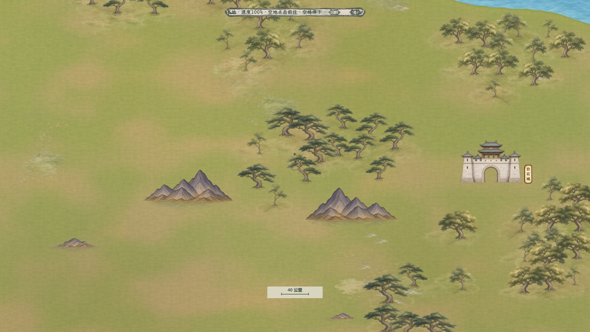

# 白石山林接地样区

2026-11-06。用户要求试做有环境感的树林，并补充山体也缺少过渡。本轮在白石周边接入独立样区，规则见[当前样区方案](../../plans/世界与探索/百川山林接地样区_20261106.md)。

## 实际画面

[同视角改前](山林样区改前.png) · [白石周边](白石样区.png) · [林缘](林缘样区.png) · [完整主场景实际行走](完整主场景行走.png)。均为1920×1080生产地图的实际GPU画面，人物采用现行52世界单位。改前参照只恢复样区原树和原山体材质，其余地图、地面与相机保持。

树使用不规则阔叶、宽冠松及较矮树苗，按树种组成有冠间搭接与留白的林团。地面以落叶、苔地和根脚暗部连起来，林缘逐渐稀疏。山脚沿原生山体每列最下可见轮廓，补少量暖土、接触暗部及碎石，并保留原山体完整轮廓和阻挡。

样区为X3800、Y12900、宽3200、高2400；仅替换完整落在范围内的旧树，跨边界树保留。新树、地面与现有山体继续独立摆放，明确X/Y/Z；人物和景物按脚点遮挡，地面贴花Z24位于下层。原8000公里总幅、近景40公里标尺、全部人物同尺寸及通行/耗时规则保持。

最终136棵树组成10团，主树形、伴生和较矮苗木错落；同类树占80—100%，每团10—17棵，最近干距最小68.98、中位92.53，团间冠框至少78.01世界单位。现有完整落入样区的155棵旧树替换，22棵跨边界旧树保留。376处地面由208处林下/林缘、136处根脚、32处山脚组成。山脚使用低对比土色与零散石点，原稿下部Alpha和实际下缘的土色融合共同衔接地面，Alpha实心核心及几何完整保持。

用户追加要求后，当前地图53处建筑素材统一缩小15%，围绕原脚点缩放；姓名文字保持，点击框及轮廓随图同步。白石图与主场景图均已使用缩小后的建筑，人物仍52世界单位。

## 原生素材与提示词

使用**内置imagegen**，新原稿已复制进项目。原PNG和生成Alpha保留，运行时纹理逐字节重读基准RGBA一致，仅添加缩小采样层。跨图集象限的宽树冠按完整连通组件测量，未按等分网格裁掉树冠；有效轮廓无邻树混入。

| 素材 | 实际原生尺寸 | 原稿与完整提示词 |
| --- | --- | --- |
| 六种自然树形 | 1086×1448，六棵独立树 | [原稿](../../../textures/world/bai_chuan/forest_grounding_20261106/trees_natural_native.png) · [区域/脚点目录](../../../textures/world/bai_chuan/forest_grounding_20261106/trees_catalog.json) · [提示词](../../../textures/world/bai_chuan/forest_grounding_20261106/trees_prompt.txt) |
| 六种林下及山脚过渡 | 1536×1024，六种独立浅地面 | [原稿](../../../textures/world/bai_chuan/forest_grounding_20261106/transitions_native.png) · [区域目录](../../../textures/world/bai_chuan/forest_grounding_20261106/ground_catalog.json) · [提示词](../../../textures/world/bai_chuan/forest_grounding_20261106/ground_prompt.txt) |

[独立视觉补丁](../../../resources/world/bai_chuan/forest_grounding_sample_20261106.json) · [地面摆放](../../../resources/world/bai_chuan/forest_grounding_details_20261106.json) · [可复现布局工具](../../../tools/world_map/build_bai_chuan_forest_grounding_20261106.py)。不覆盖现有场景、导航、地点路线、耗时和11199处通用地面小景文件，渲染前验证完整补丁后合并。

## 验收

六款新树/四款旧树的多图集加载、脚点、翻转、近景/全域内部采样、地面批绘次序、透明度与RGB调制，隔离GPU46项通过；默认山材质与旧版一致，样区山保留实心Alpha核心。原生两张纹理无损重读通过。

完整树框避开山、水、地点建筑和桥；贴花避水与建筑/桥，山脚贴花允许伸入山体下方。512条保存记录独立复核、32个真实原生下缘锚点复算、18份来源哈希及重复生成字节一致全部通过。[布局检查](../../../output/bai_chuan_forest_grounding_20261106/placement_qa.json) · [独立复核](../../../output/bai_chuan_forest_grounding_20261106/placement_independent_qa.json) · [可复现性](../../../output/bai_chuan_forest_grounding_20261106/determinism_qa.json) · [真实山脚下缘](../../../output/bai_chuan_forest_grounding_20261106/mountain_native_lower_contours.json)。

生产地图GPU共188项通过：三处同视角改前/改后、实际样区启用、六种新树/四种旧树、三档物理尺寸和地面细节切换，以及53建筑分别核对15%缩小、点击框和脚点保持。[真实画面验收](../../../output/bai_chuan_forest_grounding_20261106/actual_map_visual_report.json) · [最终46项渲染复验](../../../output/bai_chuan_forest_grounding_20261106/render_probe/isolated_project/report.json)。

C#构建0警告0错误。完整Main在真实白石地点、最近档、当前样区及15%较小建筑下，性能及悬停25项通过。本机1920×1080，完整NPC模拟连续行走100帧：平均16.468毫秒、P95为26.232、最大38.326，超过50和100毫秒均0帧，全程保持移动；驻足16.513、关闭NPC模拟行走16.400毫秒。[实机性能/悬停](../../../output/bai_chuan_terrain_speed_20261105/qa/forest_grounding_final_white_stone_20261107_report.txt) · [逐组原始性能](../../../output/bai_chuan_travel_performance_20261106/forest_grounding_final_white_stone_20261107.json)。

当前最终版本的完整Main行走、停下、拖动、三档缩放与地点交互73项通过。[最终行走报告](../../../output/bai_chuan_terrain_speed_20261105/qa/forest_grounding_final_movement_20261107_report.txt)。
