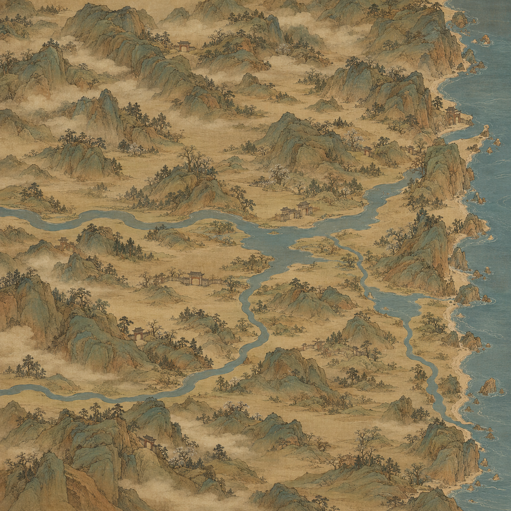

# 百川山水舆图风格试稿

2026-10-29，用户要求参照《影之刃零》的整体地图风格与质感，后续制作3×3地图，本轮先生成一张供观察。

[打开原图](百川_山水舆图整体风格试稿_v1.png) · [完整提示词](生成提示词.txt) · [生成记录](生成记录.json)

本轮使用内置图像生成工具，实际成图1254×1254。它是一张面向后续3×3范围的连续整幅构图与画风试稿；九张生产分块尚未制作，也未将此图放大冒充6144原生底图。未接入游戏，未覆盖现用地图或修改节点、路网数据。

以细墨轮廓、皴染、灰绿淡设色和古纸质感组织连续山势、谷地与水系；入口随地形一起绘制。东侧长海岸与两条西侧画外来河沿用现有大方向，宗门门楼有山体承托，城镇入口落在谷地平地。当前仅为代表性入口，不代表全部53入口和123地点已经精确落位。

画风参照来自[公开地图画面](https://cdn.mos.cms.futurecdn.net/urxdKj5oNNKf3MjSqMTLkQ.jpg)，图源S-GAME／PC Gamer，仅作研究参照。旧地图总览只提供大方向地理构图。用户尚未评价本轮样稿，不能作为最终风格已确认的记录。
