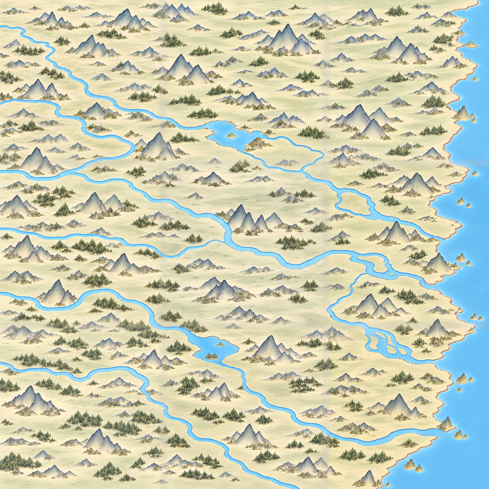

# 百川提浅九块底图

2026-10-30，用户确认v8提浅与地面景深方向，要求开始3×3底图。使用内置image_gen工具分别生成九个区域，随后拼接检查。

[3762原尺寸整图](../../../textures/world/bai_chuan/pale_nine_20261030/bai_chuan_nine_master_3762.png) · [九张底图下载](百川九块底图_1254.zip) · [编号总览](九块编号总览.jpg) · [十二处接边检查](十二处接边检查.jpg)

## 交付与清晰度

九张均为新生成的1254×1254原图，整图为3762×3762。提示词请求2048，工具实际未返回该尺寸；没有把1254放大宣称2048。这批是九块初稿，仍未达到规划的九张2048／6144原生细节要求，未接入游戏。

同一v8整幅参考被裁为九区引导；2048引导仅用于构图，不作为新生高清素材。九张新图保存在generated目录，交付图保存在tiles目录。拼接时内部边缘6像素采用同一原始构图，向内42像素平滑过渡，以保持跨块河岸、山林与底色位置；该窄边带使用了原整图参考，清晰度低于新生内区，不能当作全图原生高清或无缝生产验收。

| | 西 | 中 | 东 |
|---|---|---|---|
| 北 | [bc_11](../../../textures/world/bai_chuan/pale_nine_20261030/tiles/bc_11.png) | [bc_12](../../../textures/world/bai_chuan/pale_nine_20261030/tiles/bc_12.png) | [bc_13](../../../textures/world/bai_chuan/pale_nine_20261030/tiles/bc_13.png) |
| 中 | [bc_21](../../../textures/world/bai_chuan/pale_nine_20261030/tiles/bc_21.png) | [bc_22](../../../textures/world/bai_chuan/pale_nine_20261030/tiles/bc_22.png) | [bc_23](../../../textures/world/bai_chuan/pale_nine_20261030/tiles/bc_23.png) |
| 南 | [bc_31](../../../textures/world/bai_chuan/pale_nine_20261030/tiles/bc_31.png) | [bc_32](../../../textures/world/bai_chuan/pale_nine_20261030/tiles/bc_32.png) | [bc_33](../../../textures/world/bai_chuan/pale_nine_20261030/tiles/bc_33.png) |

## 检查与限制

已检查九张尺寸、拼图与输出裁块像素一致、整图及十二段接边。跨块主要河道、东岸和地貌大方向延续v8；内部新生纹理较v8更细，局部墨线略深、底纹略碎，用户尚未审阅本批，不能视为完全保持原画风的确认。

[水域检查](水域检查.json)检出两个主要水域组件均接左边，另有一处240像素疑点；[放大复查](水域疑点局部.png)可见该点是湖面亮纹造成颜色阈值分段，并非新增孤立河流。颜色连通只辅助检查图面，不代表验证上下游方向或地理高程。最南河延伸出下边框的既有状态保持。

未生成节点、建筑、额外空节点、道路或文字；未改123地点、路网、旅行数值和游戏绑定。完整提示词为本目录九份bc_提示词.txt；原生尺寸、参考边带比例与接边度量详见[尺寸与接边记录](尺寸与接边记录.json)。
