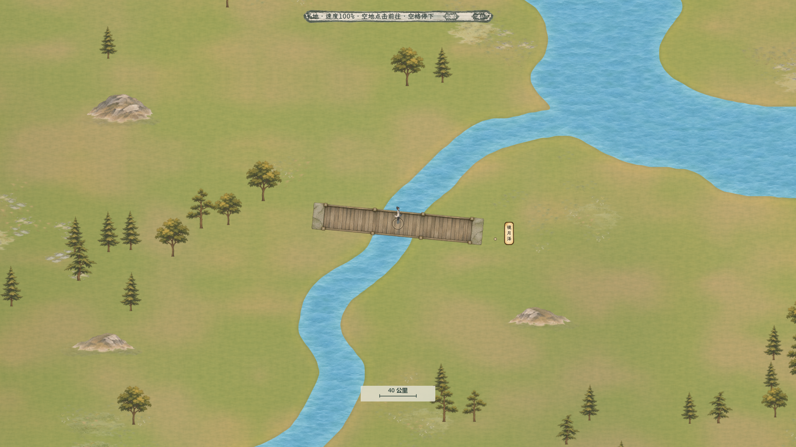
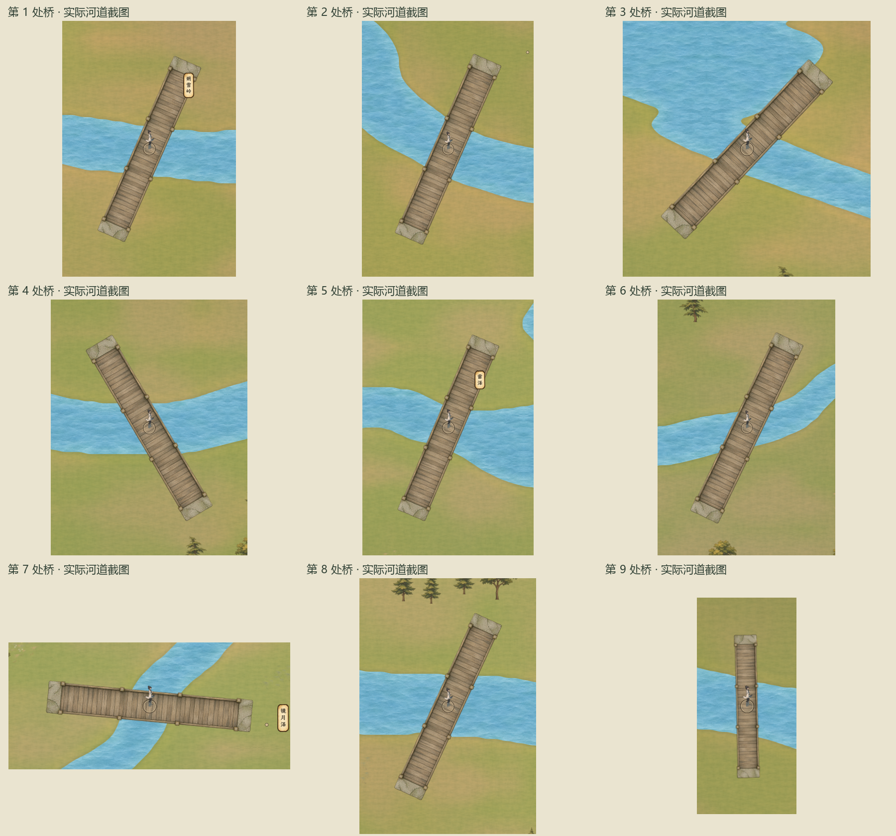
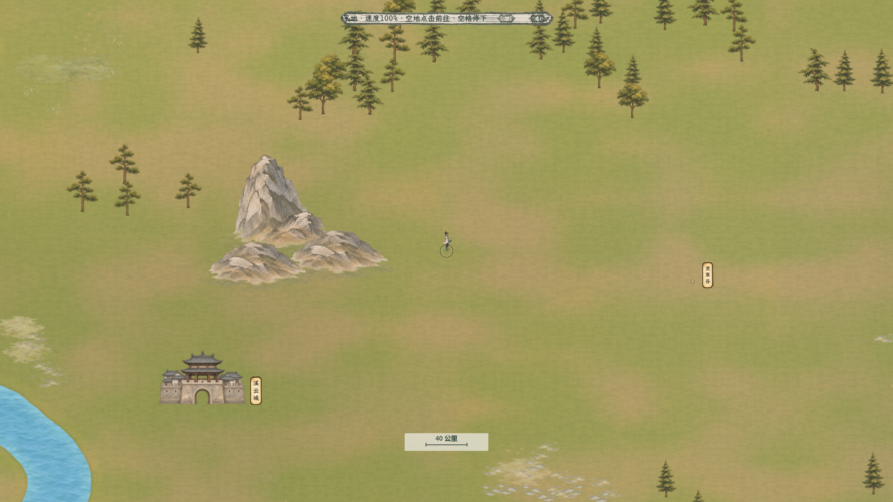

# 百川短峰层叠与俯视桥

**历史记录。**用户随后否定本轮短峰，要求恢复原山仅处理地面衔接，现以[原山接地与俯视桥](../../plans/世界与探索/百川原山接地与俯视桥_20261109.md)为当前来源。下列九座新俯视桥继续沿用；短峰、释放山格和性能记录仅对应当时版本。

2026-11-09，已接入正式大世界运行时。按用户最新修订保留九座桥，重做严格俯视桥面；长横排山体换成独立短峰、前后低丘与山脚过渡。[当前方案](../../plans/世界与探索/百川短峰层叠与俯视桥_20261109.md)。

## 俯视桥实景

[同视角旧桥](bc_bridge_007_before.png) · [竖向新桥](bc_bridge_009_after.png) · [竖向旧桥](bc_bridge_009_before.png)。均为1920×1080生产地图GPU画面，最近档0.8；旧桥对照只在隔离画面中恢复原素材和原尺寸，相机、河岸、人物及地点一致。

桥面采用严格正俯视：平行长边、木板顶面、细栏顶边及石桥头顶面。整体随河道旋转，九处原中心、方向、岸边联系与通行格保持；新素材等比缩小，桥头实际落在岸上。已逐一查看下列九处实际截图，检查横向、斜向和竖向的透视、尺寸与岸边衔接。

九桥桥面用原生不透明区域拟合，306个原开放水格的1224个角点全部落在真实桥面像素内，最小原生Alpha251；18次双向生产寻路通过。显示宽363.45—602.58世界单位，等比源缩放0.182—0.302，保持原生清晰度。

## 山体和接地实景

[同相机旧长山排](xiyun_before.png) · [山脚实际像素细节](xiyun_peak_detail.png) · [完整Main实际行走](xiyun_main_walking_1920.png) · [白石自然树林回归](white_stone_after.png)。山体对照只在内存中换山体/桥精灵及山脚层，原底纹、河网、地点与相机一致。

六款完整独立峰/低丘共161处，组成128个地域短组：106个单体、11个双体、11个三体。单体宽193.4—298.9世界单位，组合最长499.10；溪云城前原2321.85世界单位的横排收为499.10宽的三体组，高峰在后，低丘脚点向前错开。物件分别记录X/Y与脚点Z，前后关系由实际深度排序形成。

山体使用原稿柔和下缘和低对比暖土衔接，并沿真实原生像素下缘布置1029处接触暗部、土色及少量碎石；贴花在独立地面Z24层。白石136棵自然树与344处林地/根脚贴花沿用，旧32处山脚由新的全域山脚数据替换。通用11199处地表小景继续使用原文件。

## 原生素材与提示词

两张新稿均使用**内置imagegen**，真实透明RGBA，已复制进项目。原PNG与生成Alpha保持，区域目录只测量完整轮廓/脚点；运行时纹理添加缩小采样层，无损重读的基础RGBA与源图逐字节一致。

| 素材 | 实际原生尺寸 | 项目原稿与完整提示词 |
| --- | --- | --- |
| 六种独立短峰与低丘 | 1086×1448 | [原PNG](../../../textures/world/bai_chuan/compact_peaks_20261109/peaks_compact_native.png) · [运行时纹理](../../../textures/world/bai_chuan/compact_peaks_20261109/peaks_compact_native.res) · [完整区域/脚点](../../../textures/world/bai_chuan/compact_peaks_20261109/peaks_catalog.json) · [完整提示词](../../../textures/world/bai_chuan/compact_peaks_20261109/peaks_prompt.txt) |
| 严格俯视木桥 | 2172×724，完整桥区域1996×343 | [原PNG](../../../textures/world/bai_chuan/compact_peaks_20261109/bridge_topdown_native.png) · [运行时纹理](../../../textures/world/bai_chuan/compact_peaks_20261109/bridge_topdown_native.res) · [区域/脚点/实心桥面](../../../textures/world/bai_chuan/compact_peaks_20261109/bridge_catalog.json) · [完整提示词](../../../textures/world/bai_chuan/compact_peaks_20261109/bridge_prompt.txt) |

提示词指定的画布尺寸为生成意图，表中为实际产物尺寸。山脚贴花沿用[已有原生接地素材](../百川山林接地样区_20261106/README.md#原生素材与提示词)，不额外生成低分辨率放大图。

## 数据与兼容

[新场景与XYZ](../../../resources/world/bai_chuan/landscape_compact_peaks_20261109.json) · [细导航](../../../resources/world/bai_chuan/free_navigation_compact_peaks_20261109.json) · [地形耗时](../../../resources/world/bai_chuan/terrain_travel_compact_peaks_20261109.json) · [全域山脚坐标](../../../resources/world/bai_chuan/mountain_ground_details_20261109.json) · [白石树补丁](../../../resources/world/bai_chuan/forest_grounding_sample_20261109.json) · [林地地面](../../../resources/world/bai_chuan/forest_grounding_details_20261109.json) · [可复现布局工具](../../../tools/world_map/build_bai_chuan_compact_peaks_20261109.py)。

新阻挡按完整新峰的可见原生像素生成，并加一格十字边缘保护；新山格20595，严格包含在旧103383山格中，释放82788格。原1604925个可走格、288261个水格与306个开放过桥格保持，峰间腾出的空地真实可走，山体不可步行。全部5490棵树的根脚在陆地、完整树框避新山；旧54处临水树冠的既有覆盖格保持，白石136新树整框避水。

世界22118.4单位/8000公里、最近0.8/40公里标尺、所有人物52世界单位、建筑85%显示比例保持。原123地点、444内部锚点、575路线及6693段几何未修改。同尺寸旧三倍档先验证原位置/路径，再升级来源标记；玩家原坐标、路径、风险点与已结算行程保持，NPC同地形成本下的行程小时数精确保留。更早三种尺寸及节点旧档继续使用已知历史来源迁移，未知来源拒绝且保留原状态。

## 本轮验收

- 独立几何11630项、真实生产旧档/NPC迁移1420项通过；复核12247623个原生可见山像素、全部树、双向路线、九桥真实桥面与两岸。新山没有旧轮廓遗留的无形阻挡。[验收汇总](../../../output/bai_chuan_compact_peaks_20261109/qa_summary_20261109.json) · [几何明细](../../../output/bai_chuan_compact_peaks_20261109/geometry_independent_report.json) · [生产迁移明细](../../../output/bai_chuan_compact_peaks_20261109/production_migration_report.json)。
- 隔离渲染83项逻辑、94项GPU通过，覆盖多图集原生纹理、相对区域、地面绘制次序及桥绘制。[GPU报告](../../../output/bai_chuan_compact_peaks_20261109/runtime_probe/isolated_project/report.json)。生产地图实景另71项通过，包含溪云城前后对照、九桥各自实拍、白石回归和三档人物尺度。[实景报告](../../../output/bai_chuan_compact_peaks_20261109/actual_map_visual_report.json)。
- 六份新数据重复生成字节一致，旧场景/导航/路线/耗时和原稿来源哈希保持。[可复现记录](../../../output/bai_chuan_compact_peaks_20261109/repeatability_20261109.json) · [生成清单](../../../output/bai_chuan_compact_peaks_20261109/generation_manifest_20261109.json)。
- 完整Main实际行走、停止、拖动、缩放与地点交互73项通过；溪云城近景性能与无按钮悬停25项通过。[实际行走](../../../output/bai_chuan_terrain_speed_20261105/qa/compact_peaks_movement_20261109_report.txt) · [性能及悬停](../../../output/bai_chuan_terrain_speed_20261105/qa/compact_peaks_xiyun_performance_20261109_report.txt)。

本机1920×1080、溪云城最近档、完整NPC模拟连续行走100帧：平均16.5512毫秒，中位15.712，P95为26.288，最大30.118，超过50/100毫秒均0帧，全程保持实际移动；驻足平均17.2052，关闭NPC模拟行走16.45749毫秒。[逐组原始性能](../../../output/bai_chuan_travel_performance_20261106/compact_peaks_xiyun_performance_20261109.json)。这是本机短程采样，不代表所有设备和地域。测试使用隔离存档且GPU场景串行，未操作用户运行中的游戏；本轮未改C#，复用当前构建，未测试导出包。
