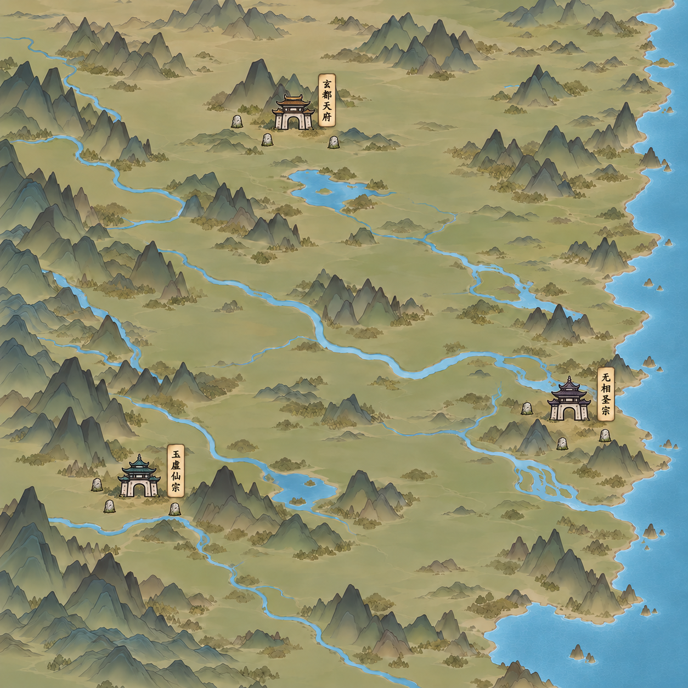
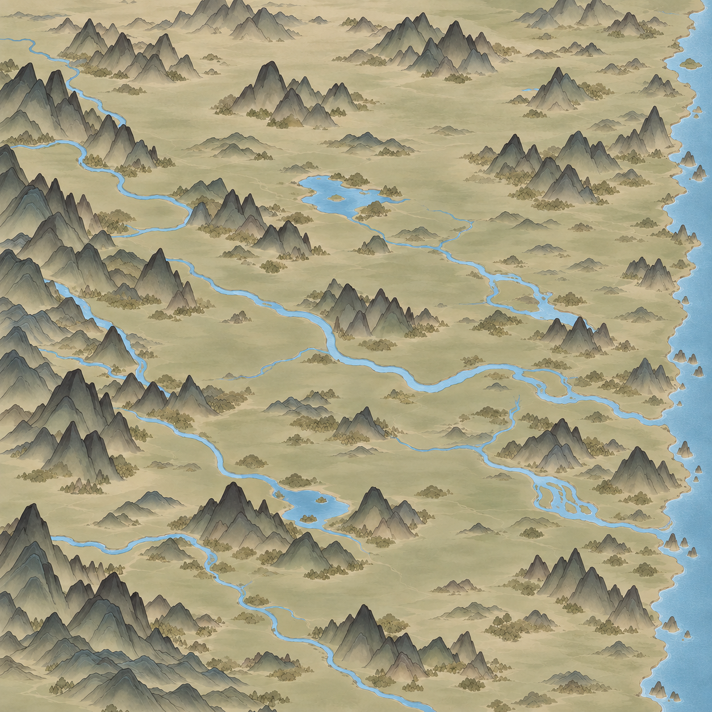

# 百川简笔景深整图

最新v8：[提浅与地面景深整图](../../../textures/world/bai_chuan/ink_depth_20261030/bai_chuan_pale_ground_depth_v8.png)。用户指出v7仍太深，要求地面增加景深；内置image_gen按原布局提浅为淡米灰／灰绿，并以轻淡坡面、谷地晕染和远近渐淡表现地面层次。实际1254方图，待审阅；保留小山尺度和水系大方向，辅助亮度／水域检查见[记录](提浅与水域检查_v8.json)，[完整提示词](地面提浅景深提示词.txt)。尚非九张高清生产素材，未接入游戏。

最新v7：[淡色水系整图](../../../textures/world/bai_chuan/ink_depth_20261030/bai_chuan_muted_water_v7.png)。用户要求全图水系有左侧画外来水可追溯，并提出山色按纬度略作变化；随后否定过重颜色，指定恢复所附淡灰绿暖土色调。已压低山色差异，修复两处山脚遮断和湖泊出水，并清理孤立短支流。内置image_gen生成，实际1254方图。详见[提示词](淡色水系修订提示词.txt)、[水域连通检查](水域连通检查_v7.json)。颜色连通只能辅助核验画面连接，不能证明上下游流向或高程；最南一条西来河仍出下边框。九张生产图尚未生成，未改逻辑水系或游戏。

最新v6：用户否定平顶台地，要求“老老实实放山”。已用内置image_gen将v5的平顶台地改为同尺度普通小山群，目视未见原台地；[查看v6整图](../../../textures/world/bai_chuan/ink_depth_20261030/bai_chuan_mountains_only_v6.png)、[完整提示词](去台地提示词.txt)。保持小山尺度、树林与河海大方向，当前为整图效果稿，九块生产图尚未生成，未接游戏。

## 小山尺度与疏密修订（最新）

用户要求九块生成先等一下，指出山太大。缩小山体高度和占地后的[小山v4](../../../textures/world/bai_chuan/ink_depth_20261030/bai_chuan_small_mountains_v4.png)获用户确认“山的大小挺适合”，但全图太空。当前[v5疏密修订](../../../textures/world/bai_chuan/ink_depth_20261030/bai_chuan_small_mountains_density_v5.png)在同尺度下增加小山群、低岭、林簇及少量台地，主河湖和海岸保持大方向；待用户评价。内置image_gen生成，实际1254方图，非九张高清生产素材，未接入游戏。详见[提示词](小山疏密修订提示词.txt)。空节点额外素材已由用户取消，三宗节点模拟被指出过大，不推广。

## 最新修订与三宗模拟

用户要求恢复v1灰绿暖土色调，保留v2的较小海面，海岸线须适度参差而非等距整齐。已用内置image_gen生成[海岸v3](../../../textures/world/bai_chuan/ink_depth_20261030/bai_chuan_coast_v3.png)，并制作[三宗贴图模拟](../../../textures/world/bai_chuan/ink_depth_20261030/three_sects_mock_v1.png)。三宗取既定锚点：玉虚22／74、玄都43／19、无相83／61；名称为玉虚仙宗、玄都天府、无相圣宗，正面门楼贴图方向来自用户指定参考。

[统一空节点素材](../../../textures/world/bai_chuan/ink_depth_20261030/empty_waystone_v1.png)为透明PNG小路石，模拟图少量试放；不是既有空节点全部落位。三宗图是整体生成的贴图效果模拟，并非实际独立建筑资源叠放或像素不变的合成，山肩承托与精确命中范围尚未验收。底图及模拟图均1254方图；未改变规划坐标、路网、游戏素材绑定。提示词见本目录海岸色调修订、空节点、三宗模拟三个文本。用户尚未评价。

2026-10-30，用户要求放弃旧稿，单独参照最新两张游戏地图重新生成，以概括山形、前后遮挡与近深远浅呈现景深。用户评价第一版“很好”，继而要求增加简笔水墨感、缩小右侧海面并保留海岸线。

[用户认可方向的v1](../../../textures/world/bai_chuan/ink_depth_20261030/bai_chuan_depth_v1.png) · [完整修订提示词](修订提示词.txt)

使用内置image_gen工具编辑v1，目视检查v2保留主要山河构图和山体景深，右侧陆地扩展、海面收窄，山体转淡墨晕染。实际v2为1254×1254；仅为全域效果稿，不是九张2048生产素材。v2尚待评价，未按123地点校准、叠加节点或接入游戏。
