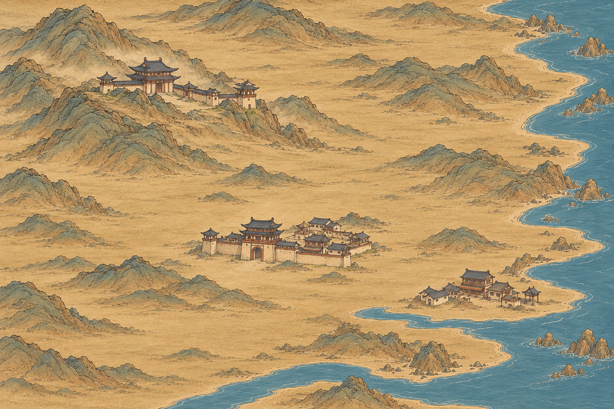

# 百川三类节点小景试稿

2026-10-29，用户看过《太吾绘卷》的节点组合处理后，要求先做少量效果。本轮用内置图像生成工具完成一张连续局部地图，展示山地宗门、平原城镇和临水小镇；以主建筑、陪衬屋顶和局部地形形成可识别的小景。

[打开原图](百川_三类节点局部效果_v1.png) · [完整生成提示词](三类节点局部效果_提示词.txt) · [生成记录](生成记录.json)

实际原图1536×1024。左上宗门借低山肩承托，中部城镇在连通平地，右下临水小镇在干岸；三类节点的主次、建筑密度与轮廓有所区别。继续无树，统一暖纸、细墨和灰绿淡设色。宗门使用多处建筑及围墙，城镇使用门楼、屋顶和短墙，小镇偏低矮、松散。

本轮为放近观察节点处理的局部效果稿，尚待用户评价。未拆透明图层、未绘制悬停蒙版、未按123个逻辑地点落位，也未替换现用地图；不是3×3生产图已经完成的记录。

纸墨来源为[本项目低山试稿](../百川山水舆图风格试稿_20261029/百川_低山平地与节点意境试稿_v3.png)；[太吾世界地图研究参照](../百川节点小景参考研究_20261029/太吾_世界地图参照.jpg)仅提供节点的建筑群组合与轮廓思路。原作参考图不作为游戏生产素材。
