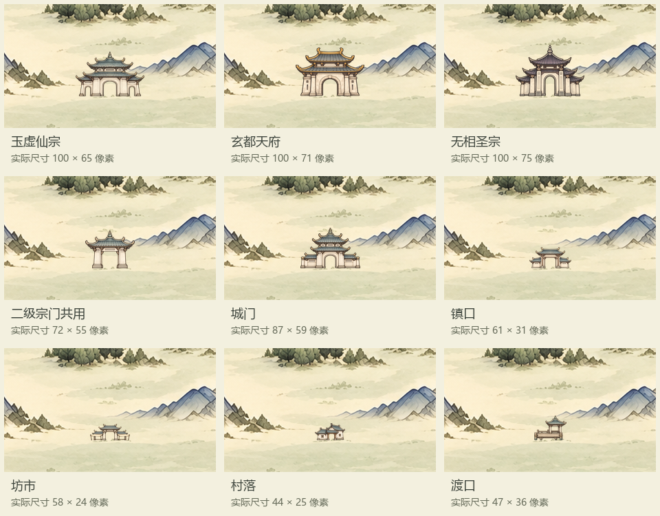

# 百川节点透明贴图

2026-10-30，用户要求生成节点并注意大小，随后明确只有三个一级势力使用独立素材，其他同类型共用。采用内置image_gen生成透明源图，裁除近透明空边并缩至实际显示尺寸，保留原始alpha和高分辨率源图。

当前采用九张：玉虚仙宗、玄都天府、无相圣宗各一张；二级宗门、城市、镇、坊市、村落、渡口各一张模板。未采用已生成的书院／古寺额外变体，不为70自然地点和普通空节点新增贴图。

| 类型 | 当前3762地图的实际尺寸 |
|---|---|
| 玉虚仙宗 | 100×65 |
| 玄都天府 | 100×71 |
| 无相圣宗 | 100×75 |
| 二级宗门共用 | 72×55 |
| 城门共用 | 87×59 |
| 镇口共用 | 61×31 |
| 坊市共用 | 58×24 |
| 村落共用 | 44×25 |
| 渡口共用 | 47×36 |

主要尺寸按旧6144世界宽度分级164／118／142／100／94乘3762/6144换算；村落、渡口为本批小型视觉样板44／47像素，不新增玩法等级。仅放大源图展示不能作为实际尺寸验收。

完整源图在 textures/world/bai_chuan/node_sprites_20261030/source，实际PNG在icons；本目录保存每份完整提示词及[尺寸对应清单](尺寸与对应.json)。[下载九张透明贴图](节点透明贴图_九类.zip)。当前可操作地图和53处实际落位以[综合验收页](../百川地图与节点验收_20261030/百川地图与节点验收.html)为准，本目录早期三宗对照只是最初尺度样板。
