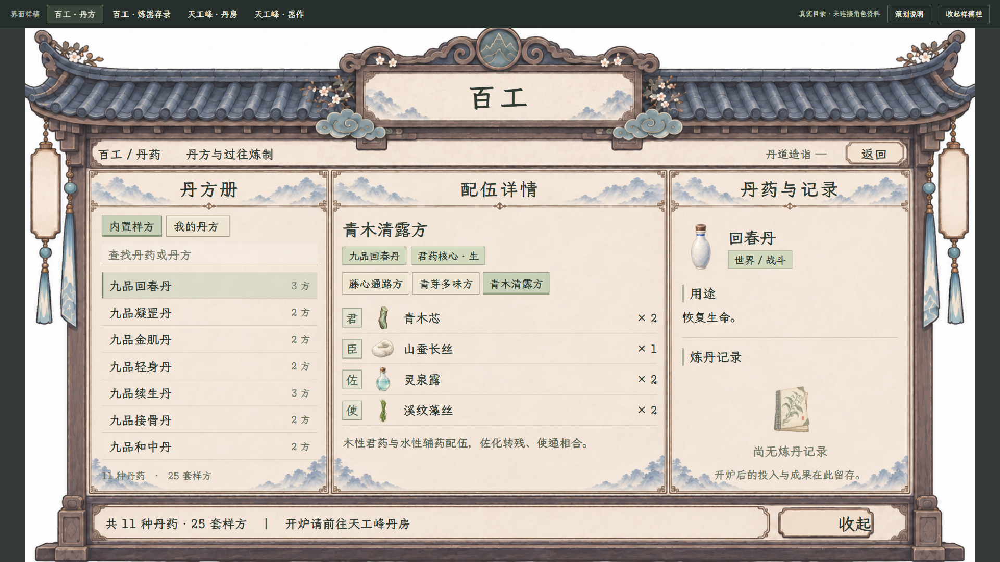
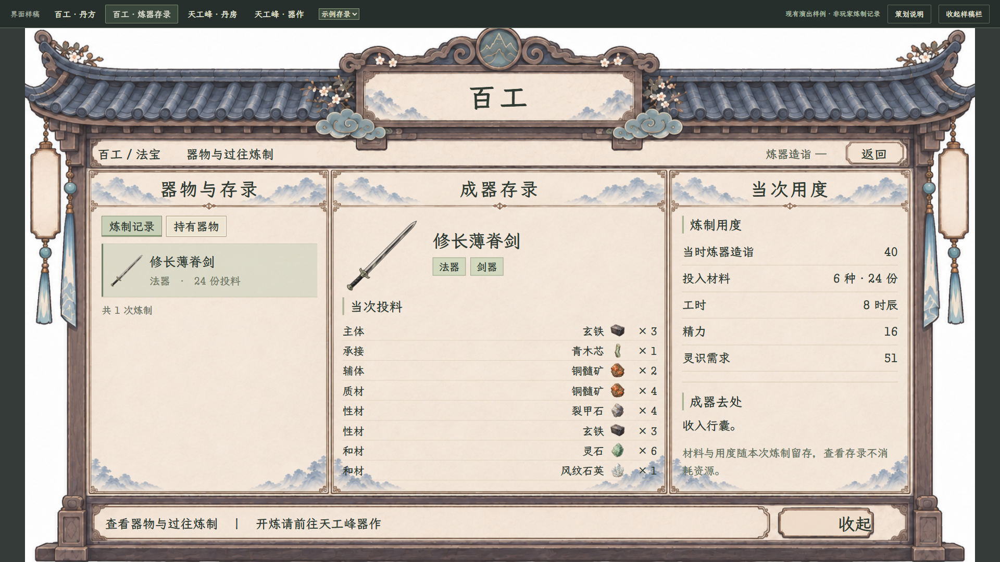
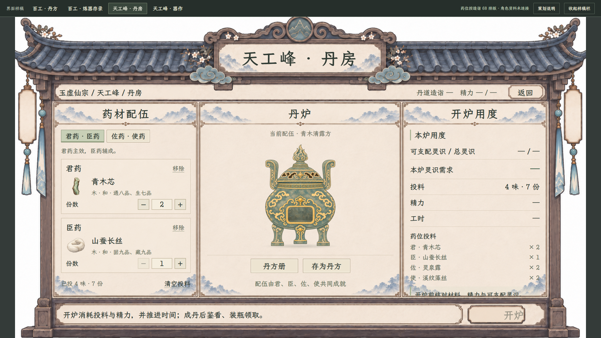
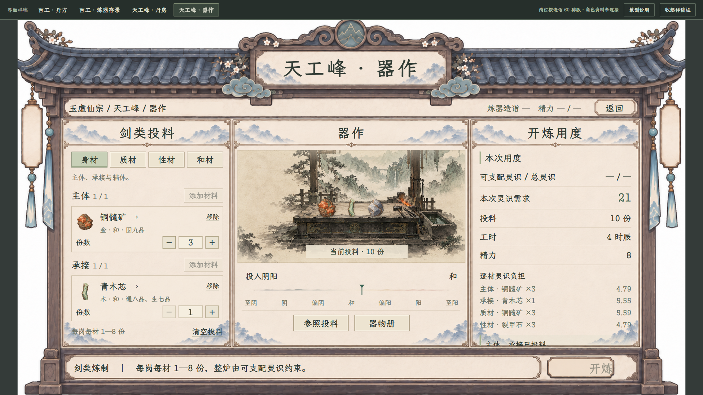

# 百工与天工峰界面样稿

> **历史理解稿，停止作为本次工作入口。**用户随后澄清：现有炼丹、炼器界面够用，需要的是宗门设施的租用／进入页面，并确认按时长收贡献。请转到[当前丹房与器作租用入口](../天工峰丹房器作租用入口_20261107/README.md)。下列四页及49项检查只记录此前样稿，不代表本次租用需求完成，也不继续改入正式游戏。

2026-11-07，四页独立交互样稿，供本轮审阅，尚未接入游戏。用户本轮选择先查看、切换界面样稿，再决定正式接入。

[打开四页可切换样稿](index.html) · [百工丹方](index.html#recipes) · [百工炼器存录](index.html#records) · [丹房](index.html#alchemy) · [器作](index.html#forging)

打开 `index.html` 后，用顶栏切换四页；顶栏是审阅工具。右侧“收起样稿栏”可单看界面，Esc 恢复。策划说明单独收在右侧说明页，不混入玩家正文。该样稿使用项目相对路径，可直接在本地浏览器打开。

## 四页分工

| 页面 | 左栏 | 中栏 | 右栏 |
| --- | --- | --- | --- |
| 百工·丹方 | 现行丹药、自拟丹方与检索 | 样方切换、药位、材料及份数 | 丹药用途与炼丹记录 |
| 百工·炼器存录 | 炼制记录／持有器物 | 成器图、当次各岗位投料 | 当时造诣、工时、精力与灵识需求 |
| 天工峰·丹房 | 君臣／佐使分组、选药、剂量 | 现有丹炉、丹方册、记下配伍 | 本炉用度与投料清单 |
| 天工峰·器作 | 身／质／性／和页签、选材及份数 | 现有工坊、当前投料、连续阴阳轴 | 灵识需求、逐材负担、工时与精力 |

百工只供查阅；实际炼制仍归天工峰设施。百工没有开炼或传送按钮。设施返回只到天工峰，个人页返回百工资料分类。样稿中的“开炉”“开炼”只展示位置并禁用，不执行游戏事务。

## 界面

### 百工·丹方

11 种现行丹、25 套样方，支持丹药／丹方名称检索、切方与我的丹方空状态。目录不恢复通脉、静心。配伍来自当前资源，不以样方名锁定成丹。

### 百工·炼器存录

示例为现有独立炼器演出的修长薄脊剑、法器，投料取 `ExampleDraft(1)`，即现行配置第二套样方；24 份、8 时辰、16 精力与灵识需求由既有公式展示。此为排版样例，不是玩家经历或库存。审阅栏可切换“空记录”，角色造诣仍显示未连接状态，不把样例造诣当作玩家值。

### 天工峰·丹房

支持分组切换、选药、五行／功用检索、整份剂量增减、移除、清空确认、载入样方及临时记方。炼丹不套用炼器 8 份上限，不增加手动颗数或控火小游戏。炼前不预告成丹数量、品质或评分。实际精力、工时及灵识未绑定，保持“—”。

### 天工峰·器作

支持四类投料、合法材料岗位筛选、增减、更换、移除与参照填料。每岗每材 1—8 份；连续阴阳按当前数量衰减、保留率、材料偏性计算，不以普通剂量均值代替。右侧仅展示当前投料用度，不预测器形、器阶、伤害或成器属性；中心保留工坊和阴阳，不恢复已撤下的配伍关系面板。没有燃料、租炉费或新增资源。

## 风格与素材

依据[室内功能页现行规范](../室内功能界面统一规范_20261106.md)与[善功堂当前样板](../藏经阁与善功堂布局保留交互_20261106/README.md)，保留近全屏占屏比例、原善功堂平面檐形木框、浅纸面、灰蓝及哑光灰褐材质、现有楷体。内容工作区调整为三栏，是本次供审阅的布局候选，不改变善功堂自身四列。

- [三栏无字框架](共用三栏框架_v1.png)：使用内置图片生成工具，以现有善功堂无字框架为编辑目标，仅改内容分栏与底部摘要条。[完整提示词](共用框架_完整提示词.txt) · [生成记录](框架生成记录.json)。
- 文字、检索、药位、按钮和份数均是可操作控件，没有烘焙进生成图。
- 字体复用 `resources/font/LXGWZhenKaiSlabGB-Regular.ttf`；物品、瓷瓶、丹炉前后层、工坊与阴阳轴复用项目现有素材。

## 数据与接入边界

[目录及材料来源](数据来源.json)。丹种、25 套样方、材料图标、五行、阴阳、功用品级与炼器岗位直接从当前资源提取。器物存录的形制与器阶来自[现有演出样片](../炼器演出样片_20261106/README.md)。

本页没有读取人物、真实库存、本地丹方或玩家存档。未连接的当前资源、库存显示“—”；药位按丹道造诣 68、炼器岗位与投入阴阳按炼器造诣 60 作排版场景，上方审阅栏和独立说明明确标记。临时丹方与草稿仅存于当前页面内存，刷新恢复。

正式接入继续遵守[地点接入主案](../../plans/百工技艺/炼器/炼器炼丹游戏内接入_20261025.md)、[炼丹完整主案](../../plans/百工技艺/炼丹/炼丹完整结算与正式接入_20261023.md)、[首批八丹](../../plans/百工技艺/炼丹/首批八种丹药扩充与接入_20261104.md)、[突破丹来源](../../plans/百工技艺/炼丹/突破丹炼制接入与样方_20261104.md)、[炼器界面现行修订](../../plans/界面与美术/炼器投料配伍与灵识界面修订_20261024.md)与[器物现行主案](../../plans/物品与装备/器物系统现行主案_20261023.md)。旧地点接入文中的三丹范围由后续两篇丹药接入主案覆盖。

正式人物校验、费用扣除、时间推进、演出、鉴看装瓶、领取、成器入包、持久记录与存读档均留在游戏现有流程，本轮仅提供界面审阅，不宣称完成这些接入。

## 验证

使用实际 Edge 浏览器，49 项检查通过，覆盖两档窗口、真实目录检索与切方、选材组合筛选、重复药材排除、炼丹／炼器不同份数边界、临时存方与副本隔离、清空确认、空记录、Esc、逐层返回、禁用提交以及无网络写入／无持久存储。结果见[交互与布局验收](交互与布局验收.json)。截图全部来自本页浏览器样稿，不是 Godot 实机。

[1280 丹方](百工_丹方_1280.png) · [1280 存录](百工_炼器存录_1280.png) · [1280 丹房](天工峰_丹房_1280.png) · [1280 器作](天工峰_器作_1280.png) · [1280 选材弹窗](选材弹窗_1280.png)

未更改游戏脚本、配方、物品定义、战斗卡、角色或玩家存档。本轮未运行游戏编译或场景测试；当前交付为独立界面样稿。
