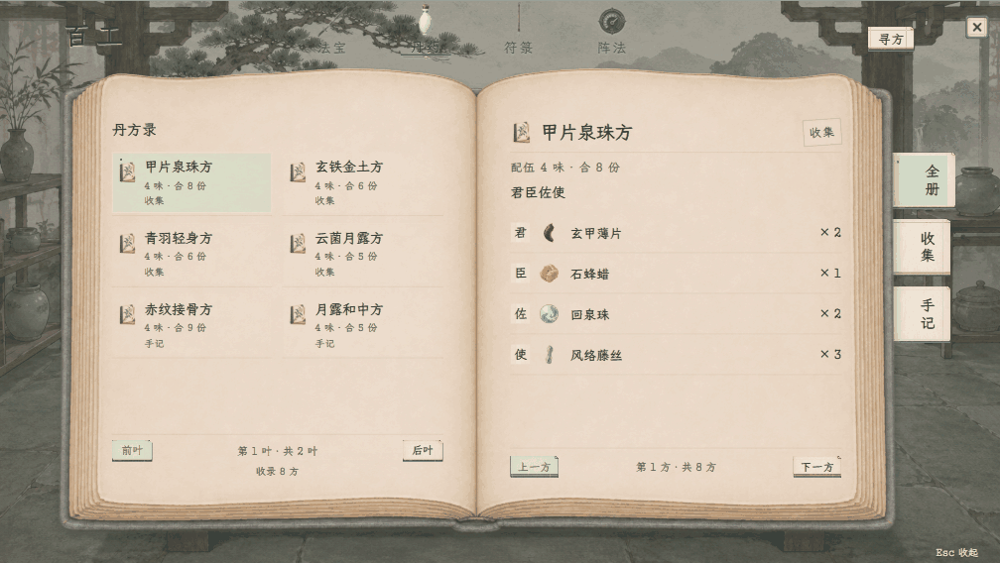
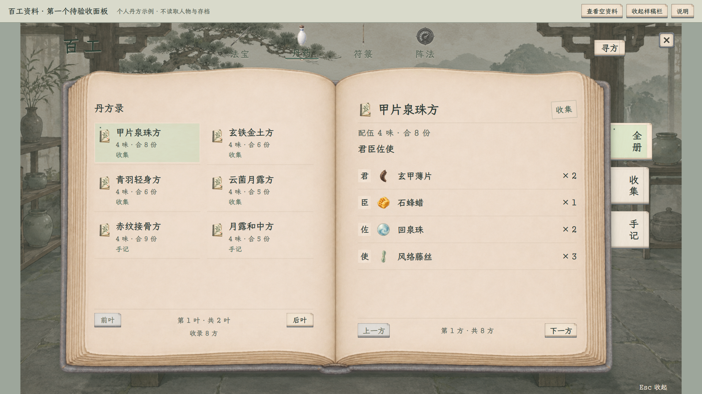

# 百工资料 · 摊开书册样稿

2026-11-08 · **修订3暂存，未接入游戏，尚未通过最终验收。** 用户要求先完成其他面板，再回看百工；当前保留本版画面与交互，不继续细化。

[打开完整样稿](index.html) · [丹药](index.html#alchemy) · [法宝](index.html#artifacts) · [符箓](index.html#talismans) · [阵法](index.html#formations) · [主案与边界](../../plans/界面与美术/百工资料页纸墨木石逐页验收_20261108.md)

本地查看：http://127.0.0.1:8876/docs/美术规范/百工资料纸墨木石样稿_20261108/index.html

## 本轮形态

整个百工采用一本摊开的书，中央书沟、等宽双页、弧形书叶及纸叠保持。法宝／丹药／符箓／阵法四个大类移到书外上方，以器物与墨线题签表现；书侧仅放当前系统内标签，丹药为全册／收集／手记，法宝为炼录／持有，阵法为阵图／阵录。寻方入口和百工标题也移到书外，书页主要排目录及正文。

丹药页只展示个人收集／记下的丹方示例，按方名排双列目录，正文展示君臣佐使、材料和整数份数。8条隔离样例均摘取已有配伍，收集／手记各4条；不是人物真实收藏，也不再默认列出11种丹药／25套开发样方。空册、未匹配和撤签都不会回退到全量目录。

“寻方”打开一张书内夹笺，以手写墨栏题下方名、丹名或药材，查阅后在个人目录中筛选。没有常驻搜索框和放大镜。原有个人丹方文件目前只保存方名、材料、药位和份数；来源类别与参考丹种只在样稿中演示，不代表正式人物已具有收集来源、固定成丹或产量记录。

已加入500毫秒书页绕书沟翻动的动画：大类和目录叶切换用整叶翻动，选方与上一方／下一方用右页翻动。前后方向相反，连点以最终请求为准；关闭、缩放及减少动态效果模式可正确收束，文字和页码同步变化。

## 完整图

[法宝1920](百工_法宝_1920.png) · [符箓1920](百工_符箓_1920.png) · [阵法1920](百工_阵法_1920.png)

[丹药1280](百工_丹药_1280.png) · [法宝1280](百工_法宝_1280.png) · [符箓1280](百工_符箓_1280.png) · [阵法1280](百工_阵法_1280.png) · [空资料1280](百工_空资料_1280.png)

## 素材与内容边界

书册底图由内置图像生成工具制作，参考既有浅纸、灰蓝布面和哑光水彩做工，随后定向清理透明外缘。原始RGBA按字节保留，显示时沿既有Alpha过滤清除低透明度残点；未用脚本改图。[书本素材](assets/展开书册_v2.png) · [完整生成提示词](assets/展开书册_v2_提示词.md) · [生成记录与原图哈希](assets/展开书册_v2_生成记录.json)

搜索、短页签、小图标及必要滚动继续使用同族已有素材；字体、瓷瓶、药材、剑器图标及手绘案面沿项目现有资源。善功堂、藏经阁、凝核及角色／静室保持。[数据与素材来源](数据来源.json)

现行11种丹药、25套样方支持丹名／方名／药材检索和切换；我的丹方与个人记录为空，器物采用已有演出样例并在样稿栏说明，支持空资料查看；符箓继续尚未开放，阵法只读查阅现有资源。未读取玩家资料或存档，不扣料、扣费、开炉、学习、装配、领取或推进时间。交互只改本页内存，无浏览器持久存储与网络写入。

## 验证

个人目录／寻方边界、全部材料份数、翻页与焦点、连续操作、减少动态效果、关闭和缩放收束、两档文字安全区均有浏览器检查；实际结果见[修订3验收记录](验收记录_修订3.json)。动图为浏览器真实渲染帧的慢放，实际交互默认500毫秒。

[修订2的149项](验收记录_修订2_149项.json)及[修订1的133项](验收记录_修订1_133项.json)对应历史样稿，不作为本轮通过项。所有图均为浏览器独立样稿，未接正式游戏。
