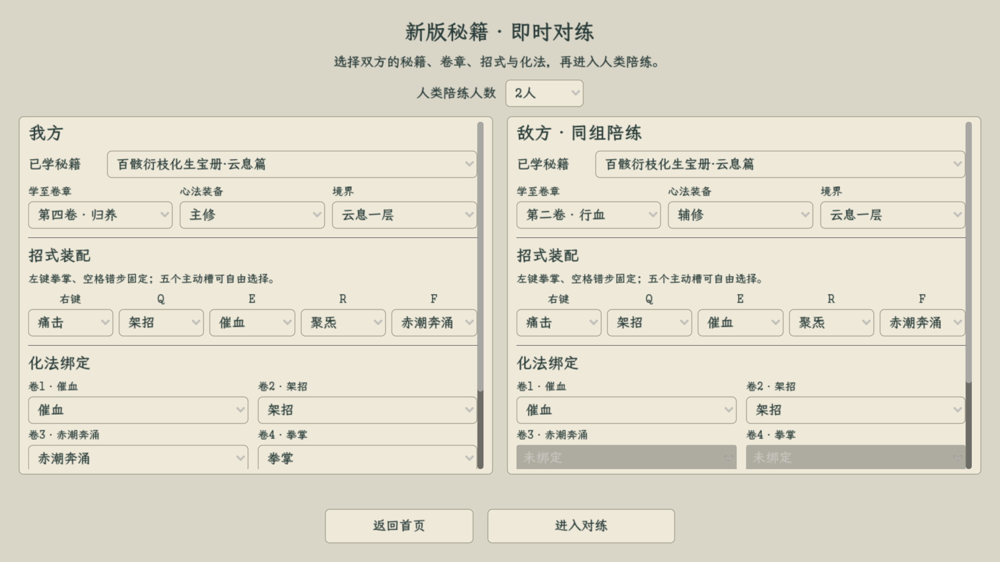
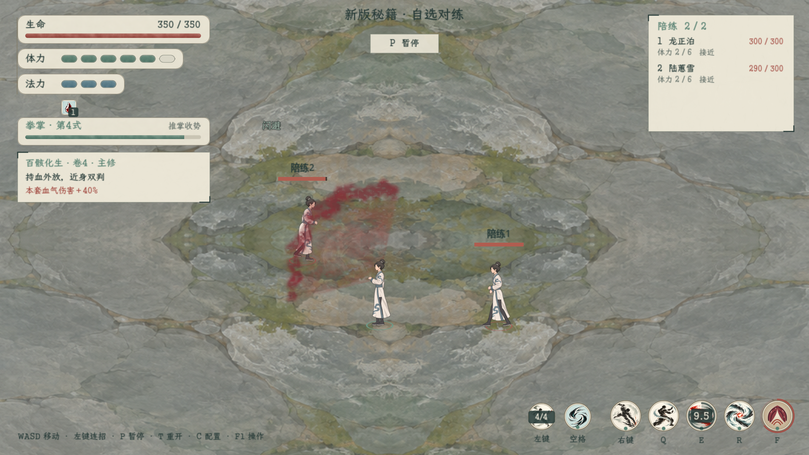

# 百骸云息篇即时对练

2026-11-05修订，实际游戏场景与自选入口验收。规则见[实装与击退控制](../../plans/战斗与构筑/百骸云息篇即时实装与自选对练_20261104.md)，秘籍主稿见[双页图谱](../../秘籍词典/drawio/新版秘籍/百骸衍枝化生宝册·云息篇.drawio)。

首页“试演与预览 → 战斗与特效 → 即时战斗 · 新版秘籍对练（自选）”。也可运行[即时对练启动器](../../../tools/run_manual_battle_test.cmd)。

2026-11-05当前：招式更名“赤潮奔涌”，持续6秒、结束后冷却24秒；第四卷化法绑定名为“拳掌”。持续期间只保留技能图标外沿倒计时圈，图标不显示“强化”、持续秒数或文字遮罩，心法状态区不重复计时。到期外圈消失，转为原有冷却显示。

[开启时满圈](duration_started.png) · [战斗中外圈缩短](wave_combat.png) · [结束后冷却](cooldown.png) · [施放失败提示](activation_blocked.png)。缺血、运功、连段等条件不满足时，界面会短暂说明原因，不扣费、不自动补放。默认配置可先按E完成催血，再在连段外按F，随后按住左键完成拳掌末段。

双方分别选择已学卷章、主修／辅修、五个主动槽和四项化法绑定；可选1—3名人类NPC。选择招式后仍保留清晰的双栏宽度，测试属性在主动展开后编辑。未习得、越阶、重复装配及未绑定来源均按实际资格处理。

[7秒实机流程](battle.gif) · [被动血气](blood_contact.png) · [技能说明](skill_detail.png) · [局内装配](skills.png) · [操作说明](help.png) · [首页入口](menu.png)

录制使用自选测试配置：我方第四卷主修、四项化法、生命350；两名敌人第二卷辅修、催血／架招化法、生命300。所有人物从0气血开始，经正常催血、付费赤潮奔涌和左键连招推进；未在战斗过程中修改生命、伤害或冷却。35帧预览由70张实际渲染帧隔帧缩放编码，合计7秒；原始配置与捕获结果见[capture_manifest.json](capture_manifest.json)。此片记录功能和表现，不作为平衡胜率结论。

被动血气沿用实际拳／掌的图集、动画和水墨材质，暗朱前伸；范围与结算沿现行规则。血浪采用现有水墨材质和同一条0.78秒波前曲线；战斗版按实际地面坐标绘制，不额外二次压缩纵深，判伤、扇面和浪头保持一致。旧血浪纯美术入口继续用于独立表现比较。

## 验证

源码与日志索引见[专题验收](../../plans/战斗与构筑/百骸云息篇即时实装与自选对练_20261104.md#验收)。截图来自OpenGL实际窗口，规则与自选交互另有无窗口检查。失败过的配置宽度与场景切换输入时序已修正，最终验收以对应最终日志为准。

本轮104项机制、35项实际入口、84项实际战斗捕获、2项详情及60项原人类对练回归通过。技能词典和双页draw.io已同步；伤害、范围、费用及控制保持原方案。
