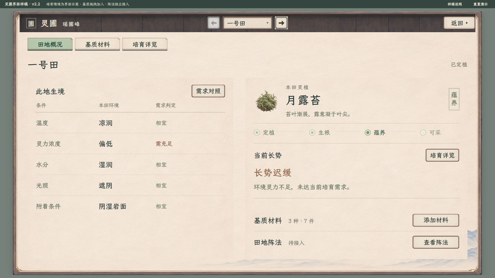
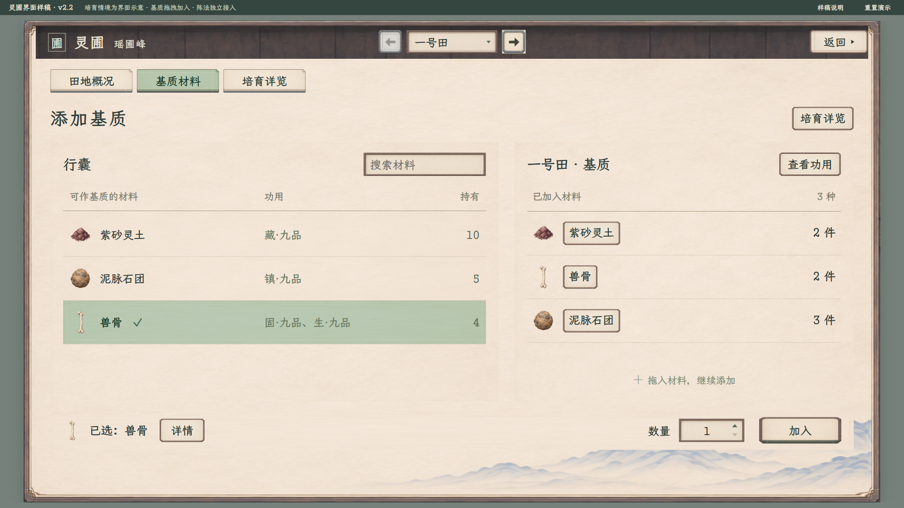
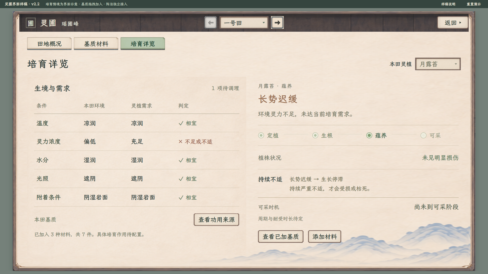

# 灵圃界面 v2.2：控件规范校准

2026-11-09，按用户要求先核对其他页面与策划中的按钮规范，完成普通／主要按钮、图标、输入、页签和六态校准，待用户查看。v2.1 的无田图、阵法正文入口和两栏布局保持，基质继续列表拖拽或选中直接加入。

[打开可操作样稿](index.html#overview) · [基质材料](index.html#substrates) · [培育详览](index.html#growth)

[种植主案](../../plans/百工技艺/种植/种植系统设定流程与界面规划_20261107.md) · [修仙培育方向](../../plans/百工技艺/种植/灵植生境与培育规则候选_20261107.md#2026-11-09-修仙培育体验方向) · [功用与阵法边界](../../plans/百工技艺/阵法/种植功用接入与多类环境阵法_20261108.md)

## 田地概况

[1280 窗口](田地概况_v22_1280.png)。一田一页，顶部切田与返回同行，字号22、行高46；左侧五项当前生境及缺项，右侧灵植、阶段、长势与原因。基质和阵法在正文下方并列，均用普通纸面按钮；完整说明继续进入子页。

一号田展示“月露苔正在蕴养、环境灵力不足导致长势迟缓”。这是独立的改造后情境夹具，便于看清信息层次，不是新田自带岩面或凉润优势。所有田地仍共用原有基础环境。阶段与植株状况只作展示，不等于物种阶段规则已定案。

## 基质材料

[1280 窗口](基质列表_v22_1280.png)。可用材料仍为列表，拖到右侧即加入，或选中、调整数量再点“加入”。数量改用同族输入槽和上下三角，实际加入保留主操作纸面。默认一件，拖拽已选材料沿用当前数量；同材合并、耗尽过滤、跨田剩余量与拖出取消保持。

功用及单项品级直接随列表显示，材性、说明和本田来源清单按需打开。没有常驻大详情、材料卡、另存方案或二次提交。所有田地共用演示行囊，各田加入记录独立。

## 培育详览

[1280 窗口](培育详览_v22_1280.png)。五项环境与需求完整对照，阶段、长势与损伤分开显示；来源和操作改用同族纸面按钮。仍不计算未知周期、品质或增益。

雾铃花完整需求仍显示“资料未齐”；空田允许在灵草标题旁选择目标，已定植田地不能通过预览更换植株。[未知需求状态](雾铃花待明_v22_1280.png) · [空田状态](空田概况_v22_1280.png)。

## 阵法与范围

阵法在田地概况正文中，通过“查看阵法”打开，未接入时提示“阵法系统待接入”。`PlantingPrototype.connectFormationSystem(handler)` 仍只向外部系统传递冻结的 `{fieldId}`，不增加阵式、阵位、供能或效果结构。基质功用来源不列阵法。

材料名称、图标、材性及单项功用品级来自项目资源；数据1为九品、9为一品，不用物品总品阶代替。可入田资格、持有数、情境环境和阶段为独立演示数据。兽骨只是现有材料，不等同完整遗骸；未来特殊需求另定。

本版为独立浏览器样稿，可本地打开，无网络依赖。加入只更新页面内存记录及演示剩余数，刷新恢复；不读写真实人物、行囊或存档。未定义的材料作用不会自动改变生境、阶段或损伤；真实投料、费用、时间、连续生长与采收尚未接入。

## 控件规范

[逐项对照与16张状态实拍](控件规范修订/README.md)。参考现行全局策划及角色、静室、炼丹、炼器的实际控件，采用普通22字／46高、主要22字／52高；返回右上18／24、最小114×46，并与切田同高同行。页签和材料行整纸灰绿，材料行有勾选；无中央块或选中细线。按下整纸与内容下沉1单位、命中区不动，键盘焦点为2px实线。不可用保留可读文字并说明边界，减少动态效果时关闭过渡。

## 素材

控件直接引用[项目共用木纸素材](../角色与静室纸墨木石样稿_20261108/skin-data.js)，选中状态沿用[整纸规范](../全局界面风格母板_20261108/paper-button-selection.css)。本轮不生成新素材，文字、控件与互动均由网页绘制。v2.0 田面插图保留作历史资料，本版不加载、不显示，也不预留空图框。

[历史田面原图](assets/灵苔培育小景_v1.png) · [旧图提示词与生成方式](assets/灵苔培育小景_v1.prompt.txt) · [当前数据与素材来源](数据来源.json)

## 验证

[62项操作与排版回归](交互与排版验收.json)和[44项控件专项](控件规范修订/控件规范验收.json)在1920×1080、1280×720两档通过，计数分开；另核对本地打开、4份材料、8份共用图片和4份脚本语法。专项包括普通与主操作分工、返回位置和行高、六态、上下限、实际三角输入、键盘焦点及减少动态效果。截图由实际操作取得，无状态注入。

[v2.1 概况旧图](田地概况_v21_1280.png)及[62项历史验收](交互与排版验收_v21_20261109.json)、[v2.0 旧图](田地概况_v20_1280.png)及[55项历史验收](交互与排版验收_v20_20261109.json)、[v1.3 历史稿](../种植系统分页面原型_20261107/README.md)均保留。本轮未改共用原图、其他面板或正式Godot界面。
